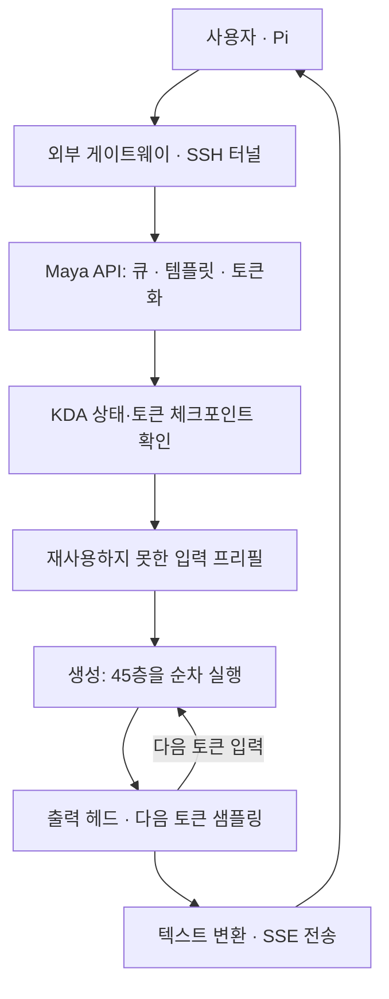
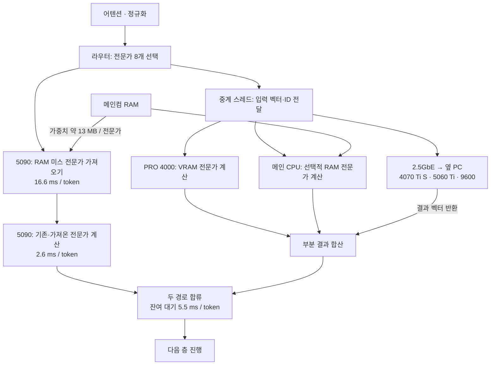

# GLM home inference: critical-path audit, 2026-10-27

The dominant measured path is expert movement out of main-PC RAM, followed by
the exposed wait for side computations at each layer. CPU utilization and GPU
utilization alone do not identify those costs. The source and fresh measurements
below distinguish work that overlaps from time that extends token completion.

## Scope and method

- Source: `a926aeb`, based on the preserved home tree and demand-copy experiment.
- Same IQ4_XS pack, 256K context, INT8 KV, MTP off, two local GPUs, two network
  GPU helpers, remote RAM 54 GiB, Ryzen 9600 helper at six threads.
- Baseline and demand-copy/copy-aware candidate: unchanged Claude `qshort.py`
  chat/code harness, one pass per arm; the original long-context task twice.
- Existing `PROF=4`, `NET_TRACE=1`, and route logging; profiling extended to
  token setup, output head/readback, host enqueue/wait/collection and sampling.
- Per-request stream stage sums match their reported total within 0.025 ms.
  Host boundary + enqueue + wait + collection match forward wall time.
- Instrumentation reduces throughput approximately 6%; these diagnostic timings
  are not replacement performance claims. Prior uninstrumented tests measured
  about 34-35 tok/s chat and 29-30 tok/s code.
- Single-client text inference. Browser/Cloudflare, concurrent request queues,
  vision encoding and agent tool execution are not fully benchmarked here.

## Request path

The model has 34 KDA recurrent layers and 11 DSA layers. The first three layers
have dense FFNs; the other 42 route eight experts each. GPU/CPU helpers distribute
expert computation inside a layer, not independent full layer stacks. The next
layer needs the completed current-layer result.

KDA snapshots are not arbitrary KV-prefix rollback. The production keep-answer
path preserves the state at an answer end; sufficiently long prompt checkpoints
also permit fallback. Reusing a valid state and rereading a prompt have different
first-response costs, independent of steady decode throughput.

## One MoE layer: the two branches and their join

Times on this diagram are **sums over 42 MoE layers for one coding token**,
from the baseline instrumented run; they are not one layer's duration.

The main service sends network requests first, then handles the local helper and
optional local CPU, then finishes network replies and publishes their combined
answer. The main GPU fetches and computes while the side work proceeds.

The source orders RAM fetch and local expert math on the same CUDA stream.
Even already-resident selected experts wait behind that layer's fetch kernel.
The fetch is GPU SM code reading host-mapped memory and writing VRAM. The join
wait is also a GPU kernel. Both contribute to reported GPU busy time without
being dense arithmetic throughput.

Approximate layer critical path:

`attention/routing + max(main fetch + main expert math, side-result latency) + combine`

Side-result latency already overlaps main-GPU work; do not add its full network
or CPU execution time to main-GPU time. Likewise, host `wait_host` includes the
GPU forward and must not be added to the CUDA stage totals.

## Fresh coding-stage measurements

Mean of the four 200-token coding questions, ms/token:

| Exposed stream interval | Baseline | Demand copies + copy-aware |
|---|---:|---:|
| Main RAM → 5090 expert fetch | 16.640 | 16.043 |
| Remaining helper/CPU-result wait | 5.534 | 5.493 |
| 5090 expert gate/up/down math | 2.551 | 2.533 |
| Attention, HC, routing, head, setup and other | 11.770 | 11.770 |
| Total profiled stream | 36.495 | 35.840 |

Fetch plus exposed join wait is about 61% of baseline token time. Eliminating
all measured join wait, with every other cost fixed, would still leave about
31 ms/token in this instrumented path. The current MoE fetch/math/wait subtotal
alone is about 24.7 ms, already above the 20 ms budget for 50 tok/s.
These are diagnostic counterfactuals, not achievable throughput predictions.

Other measured components, baseline coding mean:

- Attention family (KDA, DSA, MLA and KV resolve): 6.48 ms/token.
- Output head + head prep + argmax/readback: 0.443 ms/token.
- Sampled-token selection/readback: 0.085 ms/call.
- Host boundary: 0.421 ms/forward; CUDA enqueue: 5.857 ms/forward.
- Host waiting for GPU completion: 30.223 ms/forward; collecting profiling events:
  0.048 ms/forward. Enqueue overlaps GPU execution; the wait is not extra time.
- Measured disk reads on the four coding requests: 0.00, 0.01, 0.00, 0.01 per
  token. SSD is not the steady-state coding bottleneck in these requests.

## Bytes and placement

Fresh routing logs plus exact expert blob sizes show:

| Coding quantity | Baseline | Candidate |
|---|---:|---:|
| Main RAM expert bytes fetched/token | 0.788 GB | 0.820 GB |
| Effective bytes / fetch interval | 47.4 GB/s | 51.1 GB/s |
| Fraction of fetch bytes in layers 19-44 | 99.83% | 99.88% |

This locates the expensive data path, but does not isolate the hardware limit
among DRAM bandwidth, PCIe transactions and SM-copy implementation. Do not call
it a proven PCIe line-rate ceiling from this measurement alone. The candidate
actually moves more bytes while spending slightly less time fetching, so miss
count alone is not a sufficient optimization objective.

The source's cold-start helper ranking sorts zero-initialized usage counts when
no usage file is provided. The resultant early-layer concentration agrees with
the trace. Primary slots remain nearly uniform at 36-39 per MoE layer. This is a
candidate placement problem, not proof that simply spreading experts uniformly
will be faster: additional remote-active layers incur additional round trips.

Actual links inspected: main GPU slot x16; PRO 4000 x4; both PCs' Ethernet links
2500 Mb/s full duplex. Reported PCIe generation drops at idle, so idle generation
values are not treated as transfer-time link measurements.

## Remote latency and exposed waiting

The candidate trace sampled 43,138 helper routes. Mean net0 and net1 answer
latencies after send were 346 and 604 microseconds respectively. The traced
GPU's remaining waits depended on the class: net0-only about 277 microseconds,
net1-only about 82, both about 389. Slower remote completion is therefore not
automatically a larger exposed wait: net1 commonly overlaps more local GPU work.

These are sampled route classes across all probe requests. The existing trace
collects a lagged record only when a later helper route triggers collection; it
does not sample every route uniformly. Do not multiply these class means by all
routes and claim an exact decomposition of the 5.5 ms stream wait. That stream
interval includes all helpers, publication/dispatch and wait-kernel overhead.

The `glm helper: CUDA1 ... ms` shutdown field uses the whole service-branch
accumulator, including network waits. It is not a standalone PRO 4000 kernel
timer. Per-route local GPU host timing and GPU-stream timing have different
boundaries too. Adding them as independent costs would double-count work.

## Prefill, cache and request transport

The same existing long-context task produced 16,524 prompt tokens (the helper's
input parameter is an approximate character-based target, not an exact token
count).

| Baseline request | Prompt processing | Decode | Outside native engine |
|---|---:|---:|---:|
| First 16,524-token prompt | 12.153 s | 8.366 s / 225 tokens | 15.8 ms |
| Identical prompt repeated | 40.1 ms; 16,523 tokens reused | 7.917 s / 224 tokens | 49.5 ms |

The candidate was similar: 12.128 s first prefill, 37.7 ms repeat prompt,
17.1/50.1 ms outside-native overhead. Context changes attention/indexer cost,
but did not turn attention into the dominant steady-state cost here.

A separate streamed request through B200 localhost:8010 and the SSH tunnel,
after production restoration, had total wall times 5.433/5.311 s. Native prompt
plus generation accounted for all but 24.7/58.8 ms. First text arrived after
1.231/1.211 s; native prompt processing alone took 1.202/1.148 s. These short
requests did not reuse prompt state. Browser/Cloudflare latency was not measured.

## What the next experiment should target

1. Optimize **placement by critical-path cost**: residual PCIe bytes, side-call
   frequency, per-helper latency and VRAM budget, using actual route co-occurrence.
   A frequency-only replay can reduce misses while increasing RPC-active layers.
   The existing copy-profile experiment changes RAM copies, not GPU-helper layout.
2. Test overlap of already-resident expert math with missing-expert fetch. The
   present path serializes both. Preserve selected IDs/weights and arithmetic
   checks; additional streams may contend for SMs, so overlap is not guaranteed.
   Even perfectly hiding the current expert-math interval alone saves only about
   2.6 ms/token, not enough to reach 50 tok/s.
3. Revisit speculative verification only with a budget for **bytes per emitted
   token**. Adjacent-token fetched-expert overlap was only 5-7% in prior traces;
   more accepted tokens per round do not imply proportionally less transfer.

Do not prioritize more CPU threads, sampling or small MLA/indexer kernels as the
main route to 50 tok/s on the current execution path. Memory movement and the
layer join must change substantially; the exact attainable ceiling is unproven.

## Restoration and artifacts

The CPU helper was restored to six threads and 54 GiB before this audit. Original
production was restored at 19:33:31 KST; helper binaries/settings were not changed
during the audit. New instrumentation is opt-in under `MAYA_GLM_PROF`.

Run: `codex-bottleneck-a926aeb-20261027`. Local raw logs, routing traces, context
timings and the machine-readable `audit-summary.json` are retained in the task's
analysis directory. No production promotion was made.
