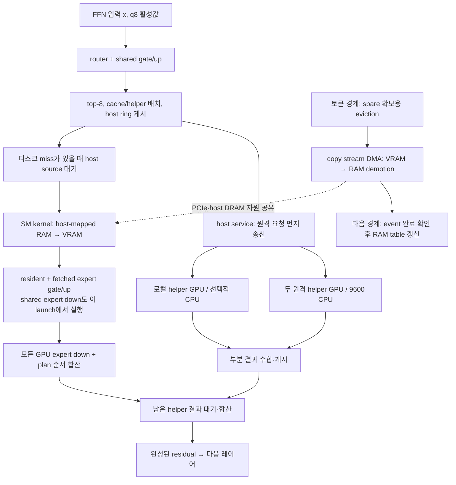

# GLM 홈 구성의 프리필·디코드 실행 경로 감사

2026-10-27, `codex/decode-cycle-audit`의 `cc7d315` 소스와 주 작업이 수집한
동일 날짜 phase 1 실측을 반영했습니다. 코드에서 확인한 실행 순서, 새 실측,
아직 실행하지 않은 구현·검증 후보를 구분합니다. 전체 결과와 최종 운영 상태는
[50 tok/s 종합 보고서](home-50tps-feasibility-20261027.md)를 참조해 주세요.

## 확인된 결론과 확인하지 못한 것

현재 단일 trunk 디코드에서는 **해당 레이어의 RAM expert fetch가 끝난 뒤
이미 VRAM에 있던 expert까지 함께 계산**합니다. 따라서 이 구간을 겹칠 수 있는
여지는 실제로 있습니다. 하지만 전송과 연산을 나눌 때 발생하는 추가 커널,
중간 결과 저장, 자원 경쟁까지 감안하면 기존 expert 연산 시간 전체가 절감되는
것은 아닙니다. 이 방법 하나로 50 tok/s를 기대할 근거도 없습니다.

현재 0.16 ms copy-cost / 코하네 DDR5-5200 구성의 비계측 plain은 대화
36.3/36.5 tok/s, 코드 31.7/31.7 tok/s였습니다. 50 tok/s는 20 ms/token이므로
코드에서는 약 31.55→20 ms, 즉 11.55 ms(36.6%)를 더 줄여야 합니다.
대화에서도 약 7.4–7.5 ms의 단축이 필요합니다. 다음은 같은 구성의 새 profile을
각 요청의 계측 토큰 수로 가중한 값입니다.

| compute-stream 구간 | 대화 ms/token | 코드 ms/token |
|---|---:|---:|
| RAM expert fetch | 9.532 | 12.874 |
| 남아서 기다린 helper 결과 | 6.004 | 6.528 |
| routed/shared expert gate/up·down | 2.667 | 2.503 |
| attention·mHC·route·head·기타 | 11.539 | 11.760 |
| 계측된 합계 | 29.742 | 33.665 |

대화 796개, 코드 800개 forward의 stage 기록이며 첫 요청의 초반 4개는
`PROF=4`로 제외했습니다. 실제 속도는 하네스의 emitted token 기준입니다.
profile은 약 6–8% 느려졌으므로 **계측한 stage 시간을 비계측 지연에서 직접
빼서 예상 tok/s를 계산하지 않습니다.** 코드의 fetch와 노출된 helper wait는
합계의 약 58%지만, 각 레이어에서 두 branch가 만나는 시각이 최종 비용을 정합니다.

원본은 `../maya-cycle-audit-20261027/codex-cycle-20261027/`의
`plain-pass{1,2}.txt`, `plain-profile-engine.log`이며, 파싱된 stage 값은
`../maya-cycle-audit-20261027/cycle/profile-requests.json`입니다.
과거 DDR5-3200 / copy-cost 0.28의 fetch 16.640 ms, expert math 2.551 ms,
helper wait 5.534 ms는 [이전 감사](bottleneck-audit-20261027.md)의 참고값입니다.
현재 구성의 병목 비중이나 개선량 계산에는 사용하지 않습니다.

## 프리필과 디코드는 같은 일을 다른 방식으로 수행합니다

| 항목 | 프리필 | 일반 디코드 |
|---|---|---|
| 입력 | 이미 아는 여러 입력 토큰 | 직전 결과로 결정된 새 토큰 하나 |
| 주요 계산 | 여러 행의 GEMM/MMQ 및 expert별 토큰 묶음 | 한 행 GEMV, 레이어별 top-8 expert |
| 가중치 재사용 | 한 expert를 여러 입력 행에 사용 | 다음 토큰이 같은 expert를 쓸지는 미정 |
| 전송 | expert 그룹을 copy stream에서 staged, compute와 이벤트로 연결 | route가 정한 주소를 SM fetch 커널이 읽음 |
| 상태 | KDA 순서와 DSA 캐시를 chunk 처리 | KDA 상태를 한 단계 갱신하고 DSA 선택/조회 |
| 병목 해석 | 첫 응답까지의 시간, 입력 토큰 처리량 | 최종 출력 토큰 하나의 임계 경로 |

프리필 경로는 이미 별도 copy stream과 staging ring을 사용합니다
(`src/core/glm_prefill.cu:3792`, `:3825`, `:3853`). 여러 토큰이 같은 expert를
쓰면 가중치를 한 번 옮겨 재사용할 수 있습니다. 일반 디코드에서 그대로 큰
GEMM을 쓰기는 어렵습니다. 다음 입력 토큰을 아직 모르기 때문입니다. MTP는
그 미래 토큰을 먼저 추측해 작은 다중 토큰 검증 창을 만드는 방법이므로,
채택률뿐 아니라 검증 창이 **전송·호출·계산을 얼마나 공유하는지**가 중요합니다.

32768 프리필 설정은 최대 컨텍스트 262144와 별개입니다. 실제 프롬프트 길이에
맞춰 chunk를 다시 정하고, 길면 여러 chunk로 나눕니다. 단일 trunk에서는 full
chunk와 remainder를 사용하여 큰 expert staging을 반복하는 횟수를 줄입니다
(`glm_prefill.cu:4463`). 프리필 chunk를 줄이면 lending geometry를 바꿀 수 있지만,
큰 입력에서 거의 같은 expert를 여러 번 staging하여 TTFT가 늘 수도 있습니다.
따라서 decode 캐시 실험과 prefill 회귀를 함께 측정해야 합니다.

### 새 16.5K 프리필 로그가 확인해 주는 범위

phase 1의 `plain-engine.log:167`은 16,523개 입력 행의 단일 chunk를
GPU event 기준 11,845 ms, 엔진 프리필 전체 기준 12,027.5 ms로 기록했습니다.
API가 보고한 prompt 시간은 12,174.7 ms입니다. 반복 요청의 32.7 ms는
16,523개 토큰을 checkpoint에서 재사용하고 마지막 입력 토큰 1개만 처리한
결과입니다 (`plain-context.jsonl`). 같은 길이의 프리필을 32.7 ms에 다시
계산한 결과가 아닙니다.

| stage 로그 필드 | 관측값 | 정확한 해석 |
|---|---:|---|
| copy lane | 11,406 ms | 첫 staged group 시작부터 마지막 group copy 완료까지의 구간 |
| copies | 7,999 ms | staging 슬롯이 빈 시점부터 해당 group의 copy 완료까지; host 공급 공백도 포함 가능 |
| ring wait | 516 ms | compute가 이전 staging 슬롯의 소비를 끝내기를 기다린 시간 |
| mixer windows | 2,890 ms | 인접 레이어의 staged group 사이 구간; attention·계획 및 prestage 전송/대기가 겹칠 수 있음 |
| pcie: ram / disk | 24.43 / 45.94 GiB | 일반 staged group에서 RAM 슬롯 / pack reader로 공급한 논리 expert payload |
| vram | 2.38 GiB | 일반 staged group의 device-to-device payload |
| prestaged | 5,149 experts | 별도 prestage buffer로 미리 보낸 expert 수; 위 pcie 바이트에 미포함 |

로그에는 `GB`라고 쓰지만 실제 분모는 `1073741824.0`입니다
(`glm_prefill.cu:4381`). 따라서 `pcie 70.37 GB`는 **70.37 GiB**,
`8.8 GB/s`는 약 **8.8 GiB/s**, 십진수로 약 9.45 GB/s입니다. 이것은
선택된 H2D payload를 `copies` 구간으로 나눈 유효 속도이며, 순수 DMA
엔진 대역폭으로 해석하면 안 됩니다. 분모에는 D2D 복사도 들어가고,
별도 prestage H2D 바이트는 분자에서 빠져 있습니다.

`disk`는 물리 SSD I/O 카운터가 아닙니다. 일반 staged group에서 pinned RAM
slot 주소가 없는 expert를 reader의 pinned landing ring에서 가져올 때
`Ly.blob`를 합산합니다 (`glm_prefill.cu:3820`, `:3844`). reader는
`fast_read_part()`를 호출하고 (`:2191`, `:2234`), 이는 pack shard의
`read_slice()`로 이어집니다 (`glm_fast_path.cu:5316`). Linux에서는 shard를
열 때 `O_DIRECT` fd도 만들며 (`glm_model.cu:2792`), 유효하고 read가 성공하면
정렬된 bounce buffer를 거쳐 **page cache를 우회**합니다. 그렇지 않으면
buffered `pread`, 마지막으로 mmap 경로로 돌아갑니다 (`glm_fast_path.cu:536`).
그러므로 이 수치를 단순한 page-cache source bytes라고 확정할 수도 없습니다.
확실한 뜻은 **pack-reader 경로가 공급한 logical payload**입니다. 미사용
read-ahead, 정렬에 따른 추가 read, direct/buffered fallback 여부 및 block-device
실제 읽기는 이 카운터에서 구분되지 않습니다.

`copies` event는 staging 슬롯의 준비 직후와 group copy의 뒤에 기록합니다
(`glm_prefill.cu:3804`, `:3849`). 그 사이 host는 아직 도착하지 않은 reader
결과를 기다린 다음 `cudaMemcpyAsync`를 제출합니다 (`:3826`). 앞의 event가
실행된 뒤 queue에 작업이 없으면 이 host feed/I/O 대기도 event 간 시간에
포함됩니다. 반대로 기존 queue 뒤에 가려진 host 대기는 일부 숨겨집니다.
따라서 7,999 ms에서 SSD 대기와 실제 copy-engine busy를 따로 추출할 수 없습니다.
더구나 출력의 `disk wait 0 ms`에 쓰이는 `ct_disk_ms`는 현재 소스에서
선언·출력·reset만 있고 증가 지점이 없습니다 (`:819`, `:4396`, `:4412`).
실제 reader 대기는 별도 누계 `ms_disk`에 더하므로 (`:3830`), 이 0은
디스크 대기가 없었다는 근거가 아닙니다.

prestage는 RAM expert를 `pbuf`로 H2D 복사하지만 `ct_ram/ct_disk`를 증가시키지
않습니다 (`glm_prefill.cu:2350`). 일반 group 사이의 구간에도 이 전송이 놓이므로
`mixer windows` 전체를 GPU 또는 copy engine의 idle 시간으로 볼 수 없습니다.
`70.37 GiB`도 전체 프리필 PCIe 트래픽의 합계가 아닙니다. 전체 바이트를 얻으려면
prestage의 레이어별 `n * Ly.blob`와 다른 transfer 경로를 함께 세어야 합니다.

이번 장문 프리필에서 원격 helper 누계는 직전 짧은 요청 이후 그대로였습니다
(`plain-engine.log:161`과 `:168`). 코드도 `T <= NET_PREFILL_MAX`와 rows buffer
조건을 만족한 짧은 chunk에만 원격 프리필을 허용합니다 (`glm_prefill.cu:2267`).
따라서 **큰 expert 집합을 주 GPU에 공급하면서 계산하는 파이프라인**이 장문
첫 응답 지연의 중요한 개선 대상이라는 판단은 가능합니다. 다만 이 로그만으로
물리 SSD 또는 PCIe 한쪽을 단독 병목으로 확정하거나, 11.4초 전체가 전송 때문에
소비되었다고 해석하지 않습니다. 같은 요청의 이후 decode는 30.96 tok/s이고
pack read는 0.12 reads/token이었습니다. 장문 프리필의 큰 pack-reader payload가
매 decode token에서 반복되는 것은 아닙니다.

우선 추가 계측은 알고리즘을 바꾸지 않고 direct/fallback 실제 read bytes,
read-ahead 사용 여부, prestage bytes, 실제 host reader 대기를 구분하는 것입니다.
그 결과를 copy/compute timeline과 함께 봐야 reader depth, prestage 용량,
local helper의 batched prefill 참여 중 어느 변경이 첫 응답을 줄이는지 판단할 수
있습니다. chunk를 줄이는 실험은 같은 expert의 반복 staging 증가도 함께 봐야 합니다.

## 토큰 하나의 실제 순서

`Glm5Model::fast_token()` (`src/core/glm_fast_path.cu:6713`)은 다음 순서입니다.

1. 이전 토큰의 promotion/demotion 완료를 `fast_boundary()`에서 반영합니다.
   이 단계는 GPU가 한 토큰을 마친 경계에서 device table과 spare slot을 갱신합니다.
2. 선택된 토큰의 embedding을 host에서 풀고 GPU로 올립니다.
3. 45개 레이어를 순서대로 큐에 넣습니다. 각 레이어는 HC/정규화, KDA 또는 DSA,
   FFN으로 이어집니다. 첫 3개 FFN은 dense, 나머지 42개는 top-8 MoE입니다.
4. head 정규화, 출력 head GEMV, argmax 및 작은 readback을 넣습니다.
5. host는 완료 이벤트를 query/yield하며 기다립니다. 별도 service thread는
   그동안 GPU가 공유 메모리 ring에 쓴 expert 요청을 처리합니다.
6. sampled decode에서는 이후 GPU sampling/readback으로 다음 토큰을 결정합니다.

KDA 경로는 projection → convolution/prep → recurrent state update → output
projection입니다 (`glm_fast_path.cu:6592`). DSA는 Q/KV/indexer projection,
latent/cache 저장, 선택한 block의 KV resolve, MLA, output projection입니다
(`:6235`). DSA에서는 짧은 문맥에 모든 pool을 선택하는 경우 score와 query
계산 일부를 생략하지만, 문맥 길이가 커지면 선택과 KV 경로가 달라집니다.

다음 레이어의 attention은 이전 레이어의 완성된 residual이 필요합니다.
따라서 helper 답을 기다리지 않고 다음 attention을 시작하는 것은 일반적으로
정확한 실행 순서가 아닙니다. 기존 `MAYA_GLM_DEFER_CPU`도 코드에서 LOSSY로
명시합니다 (`:6538`). `TRUNK_KEEP`, `MISS_W`, `DISK_SKIP`처럼 원래 expert를
생략하는 옵션은 동일 모델 계산을 보존하는 최적화와 구분해야 합니다.

## MoE에서 무엇이 겹치고 무엇이 직렬인가

`fast_moe_experts()`의 route, `moe_wait`, `moe_fetch`, gate/up, down, CPU/helper
wait는 모두 `F->cs`에 제출됩니다 (`glm_fast_path.cu:6418`, `:6471`, `:6504`).
따라서 route에 RAM fetch가 하나라도 있으면 resident expert 계산도 그 뒤입니다.
`moe_fetch_kernel()`은 `fetch_src[i]`와 `plan_ptr[i]`를 GPU에서 읽고 16-byte
단위로 복사합니다 (`src/kernels/cuda/glm_fast.cu:4420`). DMA 명령이 아니므로
이 시간도 SM/GPU busy에 포함됩니다. 현재 fetch launch는 기본적으로 SM 수만큼
256-thread block을 사용합니다 (`:6361`).

helper branch는 이미 주 GPU의 fetch/math와 겹칩니다. service는 모든 원격
요청을 먼저 보내고 local helper/CPU를 수행한 뒤 원격 답을 읽어 게시합니다
(`glm_fast_path.cu:5025`, `:5085`, `:5165`). `moe_cpu_wait_kernel()`은 남은
답을 기다린 후 output에 더합니다 (`glm_fast.cu:4358`). 이 wait도 GPU kernel입니다.
GPU 사용률 100%가 모두 유효 연산이라는 의미는 아닙니다.

반대 방향 전송도 있습니다. 이 엔진의 tier는 기본적으로 exclusive라서 RAM의
expert를 VRAM으로 승격하면 원래 RAM 복사본을 다음 경계에서 해제합니다
(`glm_fast_path.cu:4827`, `:5713`). 따라서 spare를 확보하려고 VRAM expert를
내보낼 때에는 `F->copy`의 `cudaMemcpyAsync(..., cudaMemcpyDeviceToHost)`로
blob을 RAM에 다시 씁니다 (`:5863`). 완료 event를 다음 경계에서 확인하므로
그 전송은 다음 토큰의 compute/fetch와 겹칠 수 있습니다. 이 경로의 비용은
compute stream의 fetch event 구간만으로 분리되지 않습니다. 별도 copy stream의
바이트·demotion 횟수는 아래 `TIER_AUDIT`로 구분하며, 전송 완료 시간과 경합은
별도 timeline이 필요합니다. PCIe TX가 크다는 관측만으로
demotion을 주 병목으로 확정할 수 없지만, RAM→GPU fetch만 그린 도식은 전체
트래픽을 설명하지 못합니다. `TIER_GC=0`도 모든 promotion에서 RAM 복사본을
보존하는 설정은 아닙니다. 위 promotion release는 별도 경로입니다.

레이어 비용의 유용한 근사는 다음과 같습니다.

`attention + routing + max(fetch + GPU expert math, helper branch) + combine`

fetch를 줄여도 helper가 더 늦게 끝나면 token 시간은 덜 줄어듭니다.
오히려 기존에는 fetch 뒤에 숨었던 helper 대기가 새로 드러날 수 있습니다.
따라서 fetch 감소량과 helper branch 전체 시간을 독립적인 절감량으로 더해서는
안 됩니다. 실제 exposed join wait와 layer 종료 시각을 함께 봐야 합니다.

## resident 연산과 fetch를 겹치는 구현의 조건

gate/up은 expert별 독립 block이어서 resident mask를 주면 분리하기 비교적 쉽습니다.
하지만 down 커널은 warp별 expert partial을 shared memory에 모은 뒤 원래 plan
순서로 합칩니다 (`glm_fast.cu:4671`, `:4725`). resident 집합의 합과 fetched
집합의 합을 마지막에 더하면 부동소수점 합산 순서가 달라집니다.

안전한 첫 설계는 다음과 같습니다.

1. route에서 resident/fetched/helper expert 집합을 명시하고 그 토큰·레이어의
   plan을 유지합니다. route 완료 이벤트를 **기록한 후** fetch stream이 기다립니다.
2. fetch stream은 missing expert 가중치를 가져옵니다. compute stream은 이미
   resident인 expert의 gate/up과 down partial, shared down을 계산합니다.
3. fetched expert가 준비된 후 그 집합의 gate/up과 down partial을 계산합니다.
4. expert별 partial을 원래 plan 순서대로 합치고 shared/helper 부분을 기존 순서로
   더합니다. 다음 레이어 전에 두 stream을 반드시 합류시킵니다.

이 방식은 `8 × n_embd` float 규모의 partial buffer와 별도 reduction이 필요합니다.
현재 window의 grouped down/combiner가 비슷한 중간 결과 표현을 이미 사용합니다
(`glm_fast.cu:6763`, `:6790`). 다만 그대로 재사용 가능하다는 검증은 하지 않았습니다.

동시에 실행한다고 반드시 빨라지지는 않습니다. fetch와 GEMV가 모두 SM·L2·VRAM
대역폭을 사용하고, 2회로 나뉜 작은 커널의 launch 및 reduction 비용이 추가됩니다.
필요한 검증은 비동기 event 연결, route plan 재사용, promotion된 RAM source의 수명,
scratch와 `hq`의 expert별 범위, 실패 시 두 stream 정리, CPU/helper 합산 순서입니다.
NVIDIA도 서로 다른 stream의 concurrency는 의존성과 자원 여유에 달렸다고 설명합니다.
[CUDA 비동기 실행과 stream](https://docs.nvidia.com/cuda/cuda-programming-guide/03-advanced/advanced-host-programming.html)

새 coding profile의 2.503 ms/token은 **모든** 주 GPU routed/shared expert
gate/up·down의 합입니다. resident 부분만 겹치는 첫 구현의 절감량은 그보다 작고, helper branch가
임계 경로인 레이어에서는 해당 절감이 token 종료 시각에 반영되지 않을 수 있습니다.
이 2.503 ms를 보장된 성능 향상으로 표현해서는 안 됩니다.

## DMA 전송으로 바꾸면 되는가

가능한 실험이지만 단순 함수 치환은 아닙니다. 지금은 GPU route가 정한 주소를
fetch kernel이 바로 읽습니다. `cudaMemcpyAsync()`는 host가 구체적인 source와
destination을 알아야 하므로, route 내용을 service thread로 전달하고 copy
queue에 넣는 지연이 생깁니다. 원래 service ring에 ID와 promotion pointer가
있어 기반은 있지만, 모든 fetch의 목적지와 완료를 명확히 전달하는 프로토콜이 필요합니다.

특히 main stream에서 미래의 service thread가 record할 event를 미리 기다리는
구현은 틀립니다. event wait는 호출 시점의 최신 record를 참조하며, 나중에
record한 작업을 소급해서 기다리지 않습니다. host가 제출 완료를 보장한 다음
wait를 넣거나, 명시적인 device-visible 완료 sequence 등 다른 올바른 handshake가
필요합니다. [CUDA event의 record/wait 의미](https://docs.nvidia.com/cuda/cuda-runtime-api/cuda_runtime_api/group__CUDART__EVENT.html)

또한 기존 부팅 calibration은 `cudaMemcpyAsync()` 한 expert 및 연속 8개 복사를
재며 (`glm_fast_path.cu:3513`), 실제 decode fetch는 SM의 mapped read입니다.
두 값은 같은 경로의 측정이 아닙니다. 같은 expert 크기·주소·동시 부하에서
대역폭과 end-to-end 비용을 비교해야 합니다. 새 route payload와 fetch 구간으로
계산한 유효 전송률은 대화 약 51.8 GB/s, 코드 약 52.2 GB/s였습니다
([배치·대역폭 분석](placement-roofline-audit-20261027.md)). 이 값은 payload를
계측 구간으로 나눈 값이며, 별도 D2H·helper·KV 전송까지 포함한 버스 계측은
아닙니다. 이것만으로 DRAM·PCIe·SM fetch 중 최종 한계를 확정할 수 없습니다.
mapped access가 CPU–GPU interconnect를 통과한다는 일반 원리는 NVIDIA 문서와
일치합니다. [CUDA mapped/system memory](https://docs.nvidia.com/cuda/cuda-programming-guide/02-basics/understanding-memory.html)

## 그래프·커널 fusion·host CPU 검토

`MAYA_GLM_KDA_GRAPH=1`이 기존 production 소스 `cc80982`에도 존재합니다.
단일 trunk, MTP 없음, prefetch/lookahead 없음, profile 없음 조건에서
34개 KDA 레이어를 capture/replay합니다 (`glm_fast_path.cu:6533`, `:6685`).
DSA는 위치에 따라 인자가 달라지는 경로이므로 이 옵션으로 capture하지 않습니다.
**PROF를 켜면 그래프는 꺼집니다.** 따라서 PROF=4와 graph 결과를 같은 실행 모드로
비교해서는 안 됩니다.

안전성 검토에서는 다음을 확인했습니다.

- KDA state, 활성값, plan-table 포인터는 고정되고 내용이 갱신됩니다. expert 주소도
  table 안의 값으로 읽으므로 prefill/vision으로 tail 주소가 바뀌어도 그 자체가
  capture된 expert 주소를 고정시키지는 않습니다.
- graph key는 CPU plan, 두 residual 포인터, all-resident 상태를 포함합니다.
  replay의 host request accounting과 residual pointer swap도 별도로 수행합니다.
- destruction은 compute/copy stream 동기화 후 graph를 비우고 버퍼를 해제합니다
  (`glm_fast_path.cu:4253`). 단위 테스트는 96단계 state/quant byte 일치와 dynamic
  table/request accounting을 검사합니다 (`tests/glm_layer_graph_test.cu`).
- 다만 요청별 `set_miss_skip(w, from)` 값은 route kernel 인자로 capture되는데
  graph key에는 없습니다 (`glm_fast_path.cu:4435`, `:6412`). **현재 exact 설정에는
  영향이 없지만**, 이 동적 lossy API와 graph를 함께 사용하는 일반 배포에서는
  key에 값을 추가하거나 변경 시 capture를 무효화해야 합니다.

phase 1의 비계측 A/B도 완료됐습니다.

| 설정 | 대화 tok/s, 두 pass | 코드 tok/s, 두 pass |
|---|---:|---:|
| plain | 36.3 / 36.5 | 31.7 / 31.7 |
| KDA graph | 36.2 / 36.4 | 31.5 / 31.4 |

엔진은 **34 captures, 116926 replays, 0 invalidations**를 보고했습니다.
옵션은 실제 동작했으나 이 하네스에서는 속도 이득이 없었습니다. CPU 사용률도
약 163%에서 의미 있게 낮아지지 않았습니다. 원본은 같은 phase 1 디렉터리의
`kda-graph-pass{1,2}.txt`, `kda-graph-engine.log`입니다.

새 profile의 host enqueue 약 5.7–5.9 ms 전체가 graph로 절감되는 것은 아닙니다.
enqueue는 GPU 실행과 겹치고 실제 submission 공백만 줄일 수 있습니다.
이 결과는 기존 MTP verify의 Nsight 기록에서 GPU가 계속 busy여서 graph 이득이
작았다는 관측과 방향은 같지만, 서로 다른 경로를 측정한 별도 증거입니다.

이미 router/shared projection, shared down과 routed gate/up, HC의 이전 FFN write와
다음 read 등 여러 fusion이 있습니다. 추가로 빈 disk-wait와 fetch launch를
합치는 커널도 있으나 현재 ordinary token path에는 적용되지 않고 rows 경로의
`SKIP_EMPTY`에 사용됩니다 (`glm_fast_path.cu:6471`). launch 수만 줄이는 변경은
우선 Nsight에서 실제 공백이 있는지 확인하고 진행해야 합니다.

host의 높은 CPU 사용에는 service thread의 active polling과 token 완료 event의
query/yield도 포함됩니다 (`glm_fast_path.cu:4610`, `:6796`). 이 사용률을 낮추는
blocking/adaptive wait는 별도 효율 목표로는 유효하지만, helper 응답 wakeup 지연이
늘면 속도가 떨어질 수 있습니다. `wait_host` 시간 자체는 GPU가 일하는 시간과
겹치므로 GPU stage에 다시 더하면 안 됩니다.

## 완료한 확인과 남은 구현 우선순위

현재 설정의 stage profile과 KDA graph A/B는 완료했습니다. graph는 이번 하네스에서
개선 후보로 확인되지 않았습니다. 이후 우선순위는 다음과 같습니다.

1. **MTP 검증 창과 양방향 tier 이동을 함께 봅니다.** 창당 실제 출력, 버려진
   attempt, fetch payload, helper 잔여 대기, 추가 scratch로 줄어드는 cache를
   함께 비교합니다. 재실행 횟수 감소만으로 전체 속도나 정확성을 판정하지 않습니다.
2. **중복 RAM을 선택적 backing으로 재배정하는 설계를 검토합니다.** immutable
   expert를 VRAM에서 내릴 때 반복 D2H를 피할 수 있는 용량·상태기계가 핵심입니다.
   관련 용량 분석은 [배치 보고서](placement-roofline-audit-20261027.md)에 있습니다.
3. **resident-only overlap은 제한된 opt-in 후보로 남깁니다.** 먼저 산술/합산
   동등성을 확인한 뒤, 실제 fetch+math 단축과 노출된 helper wait를 함께 비교합니다.
   효익이 작으면 전체 production 경로를 복잡하게 만들지 않습니다.
4. **DMA 또는 MTP 검증 창의 transfer/call 공유를 평가합니다.** 이 단계는 더 큰
   개선 가능성이 있지만 더 큰 설계 변경입니다. 단일 토큰 fetch의 copy engine
   대체만으로 50 tok/s가 된다는 근거는 아직 없습니다.

모델의 원래 top-8 expert를 생략하거나 다음 attention에 미완성 residual을 주는
옵션은 이 비교에 포함하지 않습니다. drafter의 근사는 target 검증으로 보정되는
경우와 원래 trunk 계산을 근사하는 경우를 분명히 나눠야 합니다.

## WIN_SCRATCH_ROWS의 정확성 범위와 남은 검증

`MAYA_GLM_WIN_SCRATCH_ROWS=2/3`은 기본 꺼짐인 실험 옵션입니다. 기존 grouped
rows의 allocation을 재사용하여 row 0에는 원래 8개 scratch, 나머지 row에는
각각 8개의 독립 슬롯을 줍니다. 현재 pack의 최대 blob 14 MiB를 기준으로
추가량은 각각 112/224 MiB입니다. 이 공간은 pool 크기를 정하기 전에 할당하므로
expert cache 용량과 배치에도 영향을 줍니다 (`glm_fast_path.cu:1043`).

이번 변경은 산술 커널이나 top-8을 바꾸지 않습니다. 전체 창이 설정 용량 안에
들어가는 batched 경로에서 `MoeDev.scratch=rows_scr+8*t`를 지정하고,
기존 route의 `scratch[i]` 분기를 사용합니다. `t`는 group 내부 번호가 아니라
창 전체의 절대 row 번호입니다 (`glm_window.cu:610`, `:631`, `:652`;
`src/kernels/cuda/glm_fast.cu:4187`). 용량을 넘거나 per-token 경로이면 기존
scratch/replay 방식으로 돌아가고 한 번 로그를 남깁니다.

코드 감사에서 확인한 수명 조건은 다음과 같습니다.

- `pre(A), pre(B), post(A), pre(next,A), post(B)` 순서에서 A의 다음 레이어는
  소비가 끝난 A 슬롯만 재사용합니다. B 슬롯과 metadata는 별도 row에 있습니다.
- promoted expert는 persistent table 슬롯이고 scratch는 table에 등록되지 않습니다.
  `WIN_SPARES=0`에서는 window 중간에 LRU eviction이나 실제 RAM 슬롯 해제를 수행하지
  않으며, 다음 boundary는 compute stream과 route 처리가 끝난 뒤 실행됩니다.
- 그룹화는 expert ID가 아니라 실제 `plan_ptr` 기준입니다. 별도 scratch에 담긴
  같은 expert가 잘못 한 그룹으로 합쳐지지 않습니다. 최종 합산은 plan 순서입니다.
- MTP draft, window, commit/cache는 기존 스트림 순서와 완료 대기를 유지합니다.
  row 0이 원래 `F->scratch`를 쓰는 것도 draft와 동시에 사용하는 구조는 아닙니다.
- KDA backup, 최종 pass의 `W.kin`, kept-prefix commit 경로는 변경하지 않았습니다.
  DSA의 suffix는 query 위치 제한으로 차단되고 해당 위치를 다시 처리할 때 갱신됩니다.

이는 **정적 검토 결과이며 고정 plan의 GPU 동등성 검증을 완료했다는 뜻은
아닙니다.** 빌드와 CPU 주소 범위 검사는 통과했지만, 실제 IQ4_XS payload 및
중간값을 비교하는 검사는 아직 실행하지 않았습니다. 기존의 실패한 first pass는
KDA를 복원해도 expert table·usage까지 rollback하지 않으므로, replay 제거 자체가
이후 cache/CPU 배치를 달라지게 할 수 있습니다. baseline 두 pass끼리도 greedy
hash가 달랐으므로 전체 출력 hash만으로 이 옵션의 수학적 동등성을 판정하지 않습니다.

작은 검증 fixture로도 핵심을 확인할 수 있습니다. T=2/3, spare 0/3개, 반복 expert,
resident와 fetch의 혼합, stagger의 A(next)/B(current) 순서를 강제하고 **계산 직전
plan_ptr의 전체 blob을 ID별 원본과 비교**합니다. 그 확정 IDs·weights·입력으로
grouped MoE와 기존 per-row gate/up·down을 비교하되, oracle은 scratch가 아니라
원본 expert 주소를 사용해야 잘못된 payload도 검출합니다. 기존
`tests/glm_moe_rows_test.cu`는 Q8_0 중심이므로 실제 IQ4_XS 경로까지 확장해야 합니다.
통합 상태 검증은 `keep=1/2/3`, `p0%4=0..3`, KV page/ring 경계에서 다음 토큰의
logits와 KDA/DSA 상태를 비교하는 방식이 적절합니다.

### 별도 WIN_SPARES 옵션과 조합할 때의 조건부 위험

아래 내용은 **코드 순서로 추론한 위험이며 GPU에서 재현·확정한 오류가 아닙니다.**
과거 WIN_SPARES 실행의 큰 stall 원인으로 입증된 것도 아닙니다. 현재 최소
private-scratch probe처럼 `WIN_SPARES=0`이면 이 경로는 실행되지 않습니다.

1. `WIN_SPARES=1`, stagger, RAM-resident 모드가 겹치면 pre(A)가 아직 table에
   남아 있는 draining resident 슬롯을 참조한 뒤 pre(B)의 `glm_win_spares()`가
   완료된 demotion을 retire하고 free→spare로 돌릴 가능성이 있습니다. B가 이
   spare를 새 expert로 채우면 post(A)의 소비 전에 가중치가 바뀔 수 있습니다.
   근거는 `glm_fast_path.cu:5564`의 drain 처리, `:5579`의 resident table 제거,
   `:5590`부터의 spare 재공급과 `glm_window.cu:977`의 pre(A)→pre(B) 순서입니다.
2. `ws_key_h/ws_val_h`는 레이어마다 한 벌이며 (`glm_fast_path.cu:5544`),
   `:5612`에서 비동기 H2D의 source로 사용합니다. 같은 레이어 A/B 호출 사이에
   source-buffer 완료를 확인하지 않으므로 두 번째 호출이 새 edits를 만들면
   첫 전송 source의 수명 조건이 깨질 가능성이 있습니다. 작은 전송의 실제
   driver 동작에 따라 노출 여부가 달라질 수 있어 timeline/강제 지연 검증이 필요합니다.

따라서 private scratch의 현재 안전성 판단을 `WIN_SPARES=1` 조합까지 확장하지
않습니다. 이 조합은 별도 slot pinning과 pinned staging 수명 검증이 필요합니다.

## 추가 계측: TIER_AUDIT의 범위

`MAYA_GLM_TIER_AUDIT=1`은 기본 꺼짐인 host-only 계측입니다. 기존 단일 요청
driver의 프리필 직후에 시작하고 decode 종료 시 enqueue 집계를 닫으며,
`fast_prof_flush()`에서 `PROF`와 독립적으로 보고합니다. 새 CUDA event, readback,
stream/device synchronize는 추가하지 않습니다. service와 boundary의 기존
`F->mu` 구간에서 집계하므로 route당 추가 lock이나 atomic도 없습니다.

- `boundary_d2h`: spare 확보 eviction의 성공한 D2H enqueue 수와 정확한 `Ly.blob` 합계입니다.
- `background_d2h`, `background_h2d`: background swap/refill의 성공한 enqueue를 별도로 셉니다.
- `ram_fetch`, `disk_miss`, `prefetch`: host가 소비한 route metadata의 expert payload입니다.
  disk miss는 요청된 blob 크기이지, 실제 디스크 I/O나 완료된 H2D 바이트가 아닙니다.
  prefetch에는 현재 레이어가 아니라 다음 레이어의 blob 크기를 사용합니다.

`expected_routes`, `observed_routes`, `metadata_missing`, `service_pending`으로
snapshot의 완전성을 확인합니다. 프리필의 늦은 route와 decode 후 route는 요청
sequence 범위로 제외하고, decode 종료 후 flush까지 도착한 해당 요청의 metadata는
받습니다. 누락이 있으면 fetch/prefetch 합계를 완전한 값으로 해석하지 않습니다.
trunk와 MTP draft route 수를 따로 보고하며, emitted token으로 나눌 때에는 기존
요청 결과의 실제 출력 토큰 수를 사용해야 합니다.

이 계측은 **전체 PCIe 바이트 또는 DMA 완료 시간 계측이 아닙니다.** 프리필 park/load,
별도 preload worker, helper GPU 전송, KV, 활성값, ring/table metadata는 제외합니다.
SM fetch는 16-byte 단위로 반올림하지만 로그에는 logical blob 크기를 유지합니다.
GPU와 host DRAM의 자원 경쟁이나 event 완료 시각은 별도의 timeline 측정이 필요합니다.

로컬 검증은 빌드와 실제 `TierAudit` struct를 추출한 CPU 검사까지입니다.
비활성 상태, 늦은 프리필 route, 닫힌 요청의 늦은 route, 요청 이후 route,
uint32 sequence wrap, 빈 구간, 서로 다른 blob 크기의 바이트 합산을 확인했습니다.
장비에서의 payload 계측과 속도 결과·최종 운영 상태는 주 작업이 관리하며,
[종합 보고서](home-50tps-feasibility-20261027.md)의 완료 기록을 기준으로 합니다.
