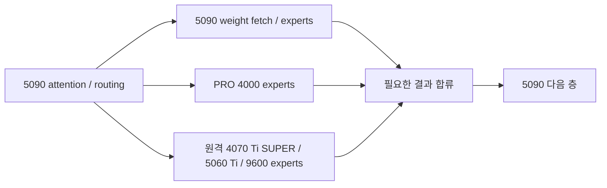

# 50 tok/s 엔진 개발: 두 trunk GPU와 검증 파이프라인 설계

2026-10-29, 시작점 `bbe5f1c`, 개발 브랜치 `codex/engine-50tps`입니다. 아래 소스 위치와 기존 구조 설명은 시작점 기준입니다. 이 문서는 코드 검토에 따른 개발 설계이며 새 실행 구조의 실측 결과가 아닙니다. 운영 엔진, 양자화, 하드웨어, 클럭은 변경하지 않았습니다.

## 목표와 판단 기준

단일 요청의 decode를 50 tok/s, 즉 출력 토큰당 20 ms로 만드는 것이 목표입니다. 기존 Claude qshort 하네스의 대화와 코드 결과를 따로 보고하며, TTFT와 긴 문맥 결과도 유지합니다. 여러 요청을 합친 처리량을 이 목표로 대체하지 않습니다.

| 비교 기준 | API decode | ms/output token | 20 ms까지 줄일 지연 |
|---|---:|---:|---:|
| 현재 T2 대화, 두 회 평균 | 39.35 tok/s | 25.41 | 5.41 ms, 21.3% |
| 현재 T2 코드, 두 회 평균 | 34.30 tok/s | 29.15 | 9.15 ms, 31.4% |
| 선택 설정 T3 코드, 두 회 평균 | 35.80 tok/s | 27.93 | 7.93 ms, 28.4% |

근거는 [T2 측정](home-window-route-ahead-20261029.md), [T3 측정](home-t3-route-20261029.md)입니다. T2와 T3는 같은 토큰열의 대응 비교가 아니므로 이 표는 각각의 기준 속도입니다. T3 코드 설정은 기본 운영 설정이 아닙니다.

현재 host 계측에서 T2 대화는 drafting round당 약 1.8575토큰/47.4613 ms, T2 코드는 1.8903토큰/55.3184 ms, T3 코드는 2.6161토큰/73.4081 ms였습니다. yield와 draft/commit 비용을 고정한 설계 예산은 다음과 같습니다.

| 항목 | T2 대화 | T2 코드 | T3 코드 |
|---|---:|---:|---:|
| 현재 verify ms/window | 46.338 | 54.238 | 71.170 |
| 50 tok/s에 맞춘 verify 예산 | 36.026 | 36.727 | 50.084 |
| verify에서 필요한 절감 | 10.312 | 17.511 | 21.085 |

이 계산의 분모는 host drafting round이며 API decode의 분모와 정확히 같지는 않습니다. 새 구조가 승인율이나 boundary 비용을 바꾸면 예산을 다시 계산합니다. 초안 정확도만 높이거나 drafting 시간만 없애는 것으로 이 차이를 메웠다고 주장하지 않습니다.

## 현재 실행 구조와 바꿀 구조

현재는 5090이 모든 trunk 층과 NextN을 처리합니다. PRO 4000과 원격 GPU/CPU는 각 층의 전문가 일부를 계산하고, trunk는 그 층을 마칠 때 필요한 결과를 기다립니다. 다른 GPU가 다음 trunk 층을 독립적으로 진행하지 않습니다.



두 trunk GPU를 사용하는 후보는 서로 다른 검증 행을 동시에 진행합니다. 같은 행의 다음 stage는 이전 stage의 결과가 있어야 하며, 각 stage의 KDA/DSA는 행 순서를 유지해야 합니다.

```text
시간 →
stage A:  [row 0] [row 1] [row 2]
stage B:         [row 0] [row 1] [row 2]
```

첫 장치 순서 후보는 **PRO 4000에 앞쪽의 짧은 stage, 5090에 뒤쪽 stage와 출력 head/NextN**입니다. 현재 빠른 5090에 출력 head와 drafting을 유지할 수 있기 때문입니다. 이는 성능 결론이 아니며, 반대 순서와 층 경계는 실제 stage 시간과 상주 용량으로 결정합니다. 층 수를 절반씩 나누지 않습니다.

## 이미 구현된 두 종류의 파이프라인

기존 코드에 재사용할 골격이 있으므로 전부 새로 만들 필요는 없습니다. 하지만 현재 운영 조합과 연결하는 계층이 빠져 있습니다.

| 경로 | 기존 동작 | 재사용 판단 |
|---|---|---|
| `window()` | T개 행을 한 stage에서 묶어 계산한 뒤 다음 stage로 보냅니다. stage 사이에서는 직렬입니다. | split MTP의 첫 정확성 기준 경로로 사용할 수 있습니다. |
| `window_pipe()` / `win_pipe_*` | stage별 worker/stream이 서로 다른 행을 진행하고, hop/pick event와 이중 bank로 수명을 관리합니다. | T2/T3 pipeline 골격입니다. 각 행은 `fast_layers()` 단일 행 경로를 쓰므로 현재 batched weight reuse가 자동으로 유지되지는 않습니다. |
| `decode_spec()` | NextN 초안으로 앞 stage가 다음 토큰을 미리 처리하는 동안 뒤 stage가 현재 토큰을 마칩니다. 틀리면 앞 stage의 상태를 복원하고 재실행합니다. | 이미 존재하는 연속 split speculation입니다. native T2/T3 전체 검증 창과 다른 후보이며, helper 연결을 해결한 뒤 먼저 비교할 가치가 있습니다. |

근거: `src/core/glm_window.cu:1128`의 stage별 전체 행 전달, `:1279`의 pipeline 계약, `:1331`의 행별 실행, `:1534`의 begin/crew, `:1774`의 wrapper입니다. `src/core/glm_fast_path.cu:7560` 및 `:7833`에 split `decode_spec()`가 있습니다. `:8032`의 NextN 단계, `:8036`의 불일치 재실행, `:8045`의 다음 tail/head enqueue 순서까지 이미 구현되어 있습니다.

기존 split 경로가 있다는 사실은 현재 홈 구성에서 50 tok/s가 가능하다는 증거가 아닙니다. 상주 배치, helper와 공유 RAM 경합을 보존한 실험이 아직 없습니다.

## 가드를 제거하면 안 되는 이유

1. **NextN과 출력 hidden state의 소유자가 바뀝니다.** `glm_mtp.cu:78`/`:96`은 native MTP를 단일 trunk로 제한합니다. `glm_model.cu:3359`는 split의 마지막 part에 NextN을 로드합니다. 반면 현재 `decode_mtp()`는 `this->fast_`에서 draft, cache, hidden state를 읽고, `glm_mtp.cu:706`에서 `F->win.head_x`가 최종 trunk 출력이라고 가정합니다. split의 최종 출력은 tail의 버퍼에 있으므로 가드만 제거하면 주소와 의미가 틀립니다.
2. **pipeline의 hidden row 주소도 다릅니다.** batched window는 `head_x + t*E`를 사용하지만 pipeline은 `bank*kPipeMax+t` 슬롯입니다(`glm_window.cu:1344`, `:1372`). 수락한 행을 NextN cache에 기록할 때 bank offset, device, 완료 event를 함께 다뤄야 합니다.
3. **각 part의 검증/복원 버퍼를 먼저 확보해야 합니다.** 현 native 초기화는 `glm_fast_path.cu:1025`의 단일 trunk 조건에서만 `win_reserve()`/`mtp_cache_setup()`를 호출합니다. split의 기존 speculative backup은 앞쪽 head group에 한정됩니다(`:1043`). native 전체 window는 양쪽 part의 KDA backup/입력 행/replay buffer가 필요하며, expert pool이 VRAM을 차지하기 전에 예약해야 합니다(`glm_window.cu:288`).
4. **현재 helper는 split을 지원하지 않습니다.** `glm_fast_path.cu:2089`는 `n_parts_ != 1`을 거부합니다. 네트워크 helper 초기화도 local helper setup 안에 있고(`:2128`), 실제 service 분기 역시 local helper 존재를 기준으로 합니다(`:5243`). PRO 4000을 trunk로 바꾸면서 local helper만 끄면 원격 GPU/CPU 경로가 그대로 남지 않습니다.
5. **원격 helper는 현재 한 세션씩 처리합니다.** `helperd.cpp:1023`의 accept loop는 `session(fd)`를 동기 호출하고, 세션 종료 시 cache를 해제합니다(`:990`). 두 part가 같은 daemon에 독립 연결하면 둘째 연결의 작업은 첫째 세션 종료까지 처리되지 않습니다. 단순히 part마다 기존 `GlmNetHelper`를 생성해서는 안 됩니다.

## 최소 개발 단계

### 0. 지금의 verify 비용을 층별로 확정합니다

T2/T3의 동일 요청에서 route 발행, route/disk 대기, main fetch, 전문가 계산, helper 합류와 층 종료를 기록합니다. helper 측 총 계산 시간을 모두 더하지 않고 실제 노출된 대기와 겹친 구간을 나눕니다. 기존 상세 HostT 계측은 `glm_fast_path.cu:5253`에서 `!in_win` 조건으로 MTP를 제외하므로 과거 plain-token breakdown을 현재 MTP 값으로 사용하면 안 됩니다.

동일 window/layer/row/route sequence 키로 payload와 시각을 연결하고, GPU 간 event 절대 시각이나 서로 다른 PC의 host 시각을 그대로 빼지 않습니다. 각 장치의 local elapsed와 메인에서 본 request RTT를 사용합니다. 기본 OFF, 실행 중 추가 층별 synchronize 없이 계측하며 OFF 대비 오버헤드도 측정합니다.

이 계측은 pipeline에 앞서 stage별 병목·cache 이동 효과·노출된 helper 대기를 구분하는 개발 기반입니다. 계측만 추가하고 성능 개선으로 보고하지 않습니다.

### 1. 원격 helper와 local expert helper의 결합을 풉니다

local PRO helper 없이도 네트워크 GPU/CPU helper의 초기화·소유권·route·prefill을 사용할 수 있는 경계를 만듭니다. 우선 기존 단일 trunk+모든 helper 구성의 결과와 작업량을 그대로 보존하는 리팩터링을 검증합니다.

두 part의 원격 접근 방식은 다음 두 단계가 현실적입니다.

- 작은 구조 실험에서는 각 part가 서로 다른 helper endpoint 하나씩을 소유할 수 있습니다. 다중 세션 문제를 피할 수 있지만 기존 배치와 RAM 사본의 접근성이 달라지므로 이것만으로 운영 대비 순수 pipeline 이득을 주장하지 않습니다.
- 최종 구성에서는 **메인에 helper별 단일 session coordinator**를 두고, part별 route key와 answer slot을 구분하여 요청을 전달하는 방식을 우선 검토합니다. 공유 cache를 유지하면서 daemon의 모든 세션 구조를 동시에 다시 만들 필요를 줄입니다. socket response framing, 요청 순서, queue 상한, 실패 전파는 명시적으로 보장해야 합니다. mutex로 begin/end만 감싸는 것은 GPU 대기를 잘못 직렬화할 수 있습니다.

expert key는 기존 전역 layer/expert 의미를 유지하고, 각 trunk part의 local layer 범위와 소유권 table을 정확하게 투영합니다. mandatory cold 전문가와 optional CPU 사본을 구분하여 유일한 가중치 공급 경로를 없애지 않습니다. `fast_service()`의 `static xk_buf`, 프로토콜 probe 상태 등 단일 서비스 스레드를 가정한 상태도 part 병렬 실행 전에 점검합니다(`glm_fast_path.cu:5272`).

### 2. 기존 연속 split speculation을 먼저 비교합니다

helper 연결이 보존된 두-stage에서 기존 `decode_spec()`를 정확성 기준과 함께 실행합니다. 이 경로는 native T2/T3 cache writeback 개조 없이 큰 병렬화 가설을 먼저 확인할 수 있습니다. 초기에는 선택적 speculative sampling을 켜지 않아 기존 sampler counter와 출력 대응을 유지합니다.

이 실험에서 필요 정보는 stage별 평균/상위 지연, 앞 stage 재실행률, NextN 시간, main RAM 읽기/쓰기, 원격 queue와 경합, 전문가 cache miss입니다. 단순 GPU utilization이나 stage의 enqueue 시간으로 실제 동시 계산을 판정하지 않습니다.

### 3. native MTP를 명시적인 coordinator와 tail owner로 분리합니다

`decode_mtp()`의 제어 상태는 root coordinator에 두고, NextN/출력 head/cache의 장치와 객체를 명시적으로 참조하게 합니다. 첫 토큰의 logits, plain-token fallback, `mtp_hx_pos_`, draft chain, cache 보충, 종료 drain까지 같은 소유권 규칙을 씁니다.

처음에는 split `window()`를 직렬 기준으로 연결하고 기존 token-by-token 결과와 검증합니다. 그 다음에만 `window_pipe()`로 교체합니다. 처음부터 cancellation/비동기 commit까지 한꺼번에 켜지 않습니다. current batched-only `WIN_FETCH_REUSE`/`WIN_ROUTE_AHEAD`는 그대로 지원 불가로 유지하고, 별도의 수명 검토 후 microbatch stage에 맞게 확장합니다(`glm_window.cu:614`, `:623`).

### 4. 작은 window의 pipeline 비용을 줄입니다

단일 행 pipeline의 dense weight 재읽기와 기존 T2/T3 batching 이익 손실을 측정한 뒤, stage 내부 두 행 microbatch나 연속 speculation 중 더 유리한 경로를 선택합니다. 승인된 마지막 hidden row가 다음 draft에 필요하므로 라운드 경계를 무조건 겹칠 수 있다고 가정하지 않습니다.

## 정확성 계약

검증은 성능 테스트와 별개로 다음을 통과해야 합니다.

- T2/T3의 full accept와 각 rejection 위치에서 모든 part의 `pos_`, KDA state/conv history, accepted hidden row가 token-by-token 기준과 일치해야 합니다.
- `window_commit()`는 각 part를 복원하고 수락한 행만 replay합니다(`glm_window.cu:1864`, `:1951`). pipeline은 enqueue 완료(`win_pipe_settle`)와 실제 GPU 완료를 구분하고, 늦은 row가 새 bank나 NextN cache를 덮지 않아야 합니다.
- DSA의 rejected KV는 위치 재사용 전에 덮어쓰며 completed pooled index만 읽어야 합니다. pool 경계, context 끝, EOS, 사용자 중단, 짧은 max_new, 새 요청과 prefix 재사용을 포함합니다.
- greedy 토큰 해시와 고정 sampler seed/counter 결과를 비교합니다. row batching/합산 순서가 바뀌면 logits 또는 필요한 중간값까지 확인하고, 출력 불일치를 속도 향상으로 채택하지 않습니다.
- helper 응답은 part/window/row/sequence가 일치하는 slot에만 씁니다. 같은 전문가가 인접 행과 stage에 걸려도 scratch, disk staging, RAM slot lifetime이 유지되어야 합니다.
- 중간 오류와 취소에서도 양쪽 장치와 service 작업을 안전하게 drain하고 다음 요청이 진행돼야 합니다. snapshot 저장/복원 직전의 speculative state도 별도 검증합니다.

로컬 B200에서 GPU 테스트를 실행하지 않습니다. 개발 빌드는 CPU 작업으로 진행하며 실제 모델/CUDA 검증은 홈 장치에서 독립 실험 설정으로 수행합니다. 사용자의 후속 지시에 따라 기존 운영 설정의 자동 복구는 하지 않고 개발 구성을 유지합니다.

## 성능 가설을 빠르게 기각하는 방법

두 stage의 행별 실측 시간을 A, B라고 하고 통신·경합이 없다고 가정하면, T행 pipeline의 시간은 `A+B+(T-1)*max(A,B)`입니다. 같은 행별 작업을 직렬로 T회 한 비용은 `T*(A+B)`입니다. A=B일 때 이 단순 모형은 T2 25%, T3 33.3%의 시간 절감을 줍니다. **현재 batched window가 T개의 단일 행 비용과 같지 않으므로 이 비율은 현재 성능의 개선 예측이 아닙니다.**

현재 yield와 draft/commit 비용을 고정한다면 T2 대화의 verify 예산 36.026 ms는 완전 균형의 이상적 행별 stage가 각각 약 12.009 ms 이하일 때에만 맞습니다. T3 코드의 50.084 ms 예산은 각각 약 12.521 ms입니다. 실제 조건은 이보다 엄격해집니다. 측정 A/B를 넣은 통신 없는 이상값부터 이 예산을 넘으면 해당 배치를 **50 tok/s를 위한 pipeline 단독 해법으로 기각**합니다. 작은 추가 이득의 가능성까지 부정하는 기준은 아닙니다.

다음도 중단/설계 변경 기준입니다.

- 같은 전문가 작업량에서 GPU 간 동시 실행이 main DRAM/H2D 대역폭을 나눠 가져 stage 시간을 늘려, 실제 overlap 절감보다 경합 증가가 큽니다.
- PRO에 trunk dense/state/window를 배치하면서 잃는 전문가 상주 용량 때문에 H2D·원격 cold fetch·prefill 비용이 목표 절감량을 상쇄합니다.
- 한 helper session의 직렬 queue가 여러 stage의 공통 병목이 되어, trunk를 나눠도 필요한 합류 시각이 앞당겨지지 않습니다.
- 단일 행 pipeline의 dense 재읽기와 줄어든 fetch reuse가 현재 batching 이득을 소모합니다.
- 정확성 또는 필수 긴 문맥/TTFT 검사에서 회귀합니다.

GPU 전체 상주 bytes를 그대로 유지한다고 가정하지 않습니다. dense/state는 이동하는 부분과 중복으로 생기는 부분을 나누고, 각 GPU의 실제 expert pool bytes 및 유일한 전문가 수를 다시 계산합니다. CPU의 DDR5 대역폭도 두 stage가 공유하는 한 자원입니다.

## 이번 개발에서의 결론

현재 코드는 두 GPU pipeline을 만들 기반을 이미 갖고 있습니다. 가장 먼저 풀어야 할 구조적 문제는 **단일 local helper에 묶인 원격 expert 공급 경로**이며, native MTP는 **coordinator와 NextN/head owner 분리**가 추가로 필요합니다. 기존 `decode_spec()`는 이 큰 가설을 상대적으로 적은 개조로 검증할 후보입니다.

층별 계측과 이 설계를 바탕으로 실제 절감 가능한 ms를 확인한 후 구현 순서를 정합니다. 50 tok/s 달성 가능성은 아직 실측으로 입증되지 않았으며, 설정 몇 개나 단일 가드 변경으로 해결된다고 보지 않습니다.

## 첫 구현: local helper 없이 원격 helper를 연결합니다

개발 브랜치에서 `MAYA_GLM_NET_HELPER`만 지정해 원격 전문가 공급 경로를 초기화하도록 연결했습니다. `MAYA_GLM_EXPERT_HELPER`는 선택 사항입니다. local helper가 있던 경로의 초기화·전문가 배치·계산 순서는 유지하며, local helper가 없을 때에도 GPU router ownership table은 전체 `n_keys` 길이로 생성합니다. CPU 배치 응답 경로가 원격 소유 전문가를 가로채지 않도록 분기와 token/window/grouped-row의 helper lane 활성 조건도 함께 바꿨습니다.

이 첫 단계의 NET_HELPER 단독 경로는 단일 trunk까지만 지원합니다. 자동 multi-GPU split은 억제하고 explicit split은 시작 전에 거부합니다. 뒤에서 설명하는 별도 opt-in 경로가 두 trunk의 서로 다른 endpoint를 연결합니다. shared session coordinator와 native split MTP는 아직 구현하지 않았습니다.

`tests/glm_helper_ownership_test.cpp`는 CUDA 없이 ownership upload의 크기, 원격 helper index의 boolean 변환, 기존 local-only/combined 결과, model key 범위와 원본 불변성을 검사합니다. `g++ -std=c++20 -Wall -Wextra -Werror -fsanitize=address,undefined`로 빌드·실행하여 통과했습니다. 이 단위검사는 GPU 계산이나 네트워크 통신, full-model 정확성과 속도를 검증한 결과가 아닙니다. 해당 실행 검증은 별도 단계입니다.

## 두 번째 구현: 두 trunk를 서로 다른 helper endpoint에 직접 연결합니다

`MAYA_GLM_SPLIT_NET=1`에서만 두 trunk와 각각 하나의 독점 helper session을 연결하는 경로를 추가했습니다. 공유 coordinator를 기다리지 않고 기존 `decode_spec()`의 실제 동작과 비용을 검증하기 위한 제한된 프로토타입입니다.

현재 홈 배선에 맞춘 설정 예시는 다음과 같습니다. 이는 코드 인터페이스 예시이며 속도 검증 결과가 아닙니다.

```text
MAYA_GLM_SPLIT_NET=1
MAYA_GLM_SPLIT=18
MAYA_GLM_DEVS=1,0
MAYA_GLM_NET_HELPER1=listen:18800
MAYA_GLM_NET_HELPER0=listen:18801
MAYA_GLM_NET_COPY=0
MAYA_GLM_COPY_AWARE=0
MAYA_GLM_NET_PROTO=1
MAYA_GLM_WIN_FETCH_REUSE=0
MAYA_GLM_WIN_SCRATCH_ROWS=0
MAYA_GLM_SPEC_SAMPLE=0
MAYA_GLM_SPEC_DECODE=1
MAYA_GLM_RAM_GB=92
```

`NET_HELPER<n>`의 n은 stage 순번이 아니라 CUDA device index입니다. 현재 visibility를 유지하면 위 예시에서 PRO 4000/CUDA1이 앞 18층과 4070 Ti SUPER helper를, 5090/CUDA0이 나머지 층·출력 head·NextN과 5060 Ti/9600 helper를 담당합니다. `CUDA_VISIBLE_DEVICES`를 재정렬하면 CUDA index도 바뀌므로 함께 확인해야 합니다. 기존 helperd의 reverse-dial 프로세스는 서로 다른 listen port로 다시 연결할 수 있습니다.

초기 parser는 다음 조건을 모델 메모리 할당과 네트워크 연결 전에 검사합니다.

- 정확히 두 개의 서로 다른 GPU와 명시적 층 경계가 있어야 합니다.
- global `MAYA_GLM_NET_HELPER` 및 local `MAYA_GLM_EXPERT_HELPER`는 없어야 합니다.
- 각 장치에 endpoint가 하나씩 있어야 하며, listen 두 개 또는 canonical IPv4 두 개만 허용합니다. 두 방식을 섞거나 hostname, endpoint 목록을 지정하는 것은 첫 버전에서 지원하지 않습니다.
- port를 정규화하여 같은 endpoint에 두 session을 열지 않도록 검사합니다. IP 라우팅 별칭이나 외부 proxy가 서로 다른 주소를 같은 daemon으로 연결하는 구성까지 탐지하지는 않습니다.
- NET_COPY/COPY_AWARE는 각각 0 또는 1만 허용합니다. `COPY_AWARE=1`은 `NET_COPY=1` 및 `NET_COPY_LOCAL=0`을 요구합니다. copy index 1은 각 part에 연결된 유일한 helper를 뜻하며, 양쪽 part가 사본이나 session을 공유하지 않습니다. NET_PROTO는 1이어야 합니다.
- `NET_TRACE`, `CPU_LANE_VERIFY`는 unset이어야 합니다. 이 계측은 공용 비원자 상태를 사용하므로 0으로 설정해도 presence 조건에 걸립니다. protocol 2의 공용 activation scratch도 첫 버전에서는 사용하지 않습니다.
- 단일 trunk 전용 `WIN_FETCH_REUSE`와 `RAM_CLASS_SLOTS`를 차단합니다.

각 part의 helper 초기화 시에도 같은 parser를 사용하고, 실제 `part_`, CUDA device, `l0_`/`l1_`가 검증한 plan과 같은지 다시 확인합니다. native `mtp_decode_wanted()`/`mtp_ready()` 가드는 유지했습니다. 활성 상태는 다음 형태의 로그로 확인합니다.

```text
glm split net: CUDA1 layers [0,18) endpoint listen:18800; front trunk part
glm split net: CUDA0 layers [18,45) endpoint listen:18801; output head and NextN on this part
```

RAM_GB=92는 기존 split loader의 **전체 메인 RAM budget**입니다. 각 part가 92 GiB씩 받는 설정이 아닙니다. stage별 예약분을 `remaining`에서 차감하고, 남은 budget을 다음 part에 넘기는 기존 로직을 유지합니다. 추가 prefill staging과 클래스별 최소 슬롯 등은 별도로 확인해야 하므로 최종 pinned bytes와 여유 RAM을 실제 로그에서 합산합니다.

이 배치에서는 RAM helper가 연결되지 않은 앞 stage의 cold expert가 디스크에 남을 수 있습니다. 첫 benchmark 전에 각 stage의 유일한 전문가 공급 경로, 남은 disk expert 수, helper VRAM/RAM 소유 범위를 확인합니다. 위 예시는 선택 CPU 사본을 끈 상태이므로 기존 단일 trunk와 작업 배치가 같은 실험은 아닙니다.

**pipeline 자체의 A/B는 `MAYA_GLM_SPEC_DECODE=0`과 1로 비교합니다.** 이 새 switch는 `spec_ready()`에서만 읽습니다. `NO_SPEC=1`은 KDA backup 사전 예약과 expert pool까지 바꾸므로 같은 배치를 보존하는 비교에 사용하지 않습니다. 두 조건에서 모델 load, helper 소유권, 초기 pool/RAM inventory가 같은지 확인한 뒤 greedy/동일 seed 결과와 속도를 비교합니다.

`tests/glm_split_net_plan_test.cpp`는 실제 loader와 공유하는 parser를 호출하며, device 순서, reverse-dial/direct endpoint, 중복 정규화, 불완전 설정, 정수 overflow, 계측 제한, part별 복사 옵션과 필수 조합, 실패 시 plan 불변성, 기존 OFF 경로를 검사합니다. 복사 옵션 확장 후 125개 검사가 ASan/UBSan에서 통과했습니다. 실제 두 trunk GPU의 모델 정확성·성능은 별도 홈 실행 검증 결과로 기록합니다.

### part별 RAM 복사본 재사용

두 part가 독립된 helper session을 갖는 조건에서는 기존 RAM copy 경로를 그대로 사용할 수 있습니다. 현재 홈 배선에서 5090/CUDA0의 tail만 9600 RAM 복사본을 사용하는 설정은 다음과 같습니다.

```text
MAYA_GLM_NET_COPY=1
MAYA_GLM_COPY_AWARE=1
MAYA_GLM_NET_COPY_LOCAL=0
MAYA_GLM_CPU_LANE0=1
MAYA_GLM_CPU_LANE1=0
```

`CPU_LANE1=0`인 앞 part는 `fast_cpu_lane_setup()`에서 pool을 만들지 않습니다. copy 초기화는 `cpu_plan != 0 && cpu_pool != nullptr` 조건을 만족할 때만 실행되므로, global COPY_AWARE=1이어도 이 part에는 copy metadata나 선택 CPU 작업이 생기지 않습니다. RAM이 없는 helper에 CPU lane을 켜 놓은 경우까지 자동 skip하는 변경은 포함하지 않았습니다.

tail은 먼저 원래 디스크에 남을 cold expert를 helper RAM에 배치하고, 그 뒤 남은 `ram_available()`에 선택 복사본을 넣습니다. 따라서 helper의 54 GiB 제한 안에서 필수 cold share와 선택 copy share가 함께 계산됩니다. 메인 RAM의 원본과 `net_of` 소유권은 보존합니다. `copy_of`, `copy_r`, GPU copy-kind/계획, 검증 해시 및 통계는 각 part의 `FastState`에 속합니다. copy-aware router는 실제 복사본이 있는 RAM expert만 후보로 삼고, 같은 helper에 이미 필요한 필수 RAM 계산량도 비용에 넣습니다.

기존 `NET_COPY_PROFILE`도 재사용할 수 있습니다. 각 part의 키 테이블은 전체 `(n_layers+1) × n_expert` 크기이며, profile도 같은 전역 geometry로 읽습니다. 실제 선택 후보는 해당 part의 `[l0,lt)` 범위에 한정됩니다. 다른 배치에서 얻은 profile이 새 배치에 최적인지는 별도 성능 문제입니다.

CPU lane 보정이 plan=0을 선택하면 기존 동작대로 pool을 해제하여 복사를 초기화하지 않습니다. 그러므로 `CPU_LANE0=1`만으로 활성화를 단정하지 않으며, 시작 로그의 CPU plan, copy 수, 해시 일치, copy-aware 활성 메시지를 확인해야 합니다. 이 단계는 CPU pool 수명이나 GPU route의 enable 조건을 바꾸지 않았습니다. 보정 plan이 0인 실제 사례가 나오면 remote copy용 보정과 local CPU 선택을 분리하는 후속 변경이 필요합니다.

동시 실행 제한은 그대로 유지합니다. protocol 1은 protocol 2의 공용 activation scratch를 쓰지 않으며, `NET_TRACE`와 `CPU_LANE_VERIFY`는 금지합니다. 초기 helper 설정은 part 순서로 실행되고, 각 helper 설정 마지막에 CPU retime과 calibration 파일 갱신 키를 끄므로 copy 실행 중 두 part가 calibration 파일을 동시에 다시 쓰지 않습니다.

### 앞 stage의 완전 상주 가설을 확인할 때

PRO의 좁은 PCIe 링크에서 가중치 전송을 없애려면 앞쪽 층 수를 줄여 PRO pool과 앞 helper VRAM의 합집합이 모든 expert를 덮게 해야 합니다. raw GiB 합계 대신, `warm_pool_slots()`가 층마다 spare 3개를 뺀 실제 expert 수와 helper의 서로 겹치지 않는 소유 키를 합산해야 합니다. 층별 blob 크기와 pool 분할도 확인합니다.

초기 적재 때 이 조건이 맞아도 batched prefill은 pool의 lendable tail을 빌려 일부 expert를 RAM으로 이동합니다(`glm_prefill.cu`의 `lend_tail()`). `prefill_return()`은 해당 슬롯을 Free로 돌려주며, 기본 경로에서 원래 expert를 즉시 전부 복원하지는 않습니다. 그러므로 처음 몇 토큰과 충분히 warm한 decode 구간을 구분하여 앞 stage의 실제 H2D bytes/token이 0에 수렴하는지 확인합니다. 원격 GPU에 있는 expert는 가중치 H2D가 없어도 activation 전송과 helper 응답 시간이 필요합니다.
