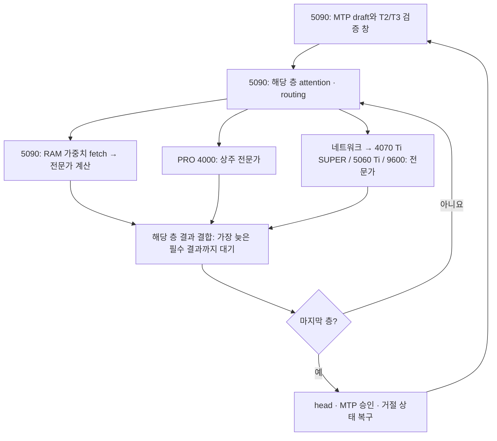

# 50 tok/s 엔진 개발

최신 구현·측정·실행 상태는 [재개 문서](home-engine-development-20261029.md)에 있습니다.
아래의 초기 구조와 개발 순서는 개발 시작 시점의 기준입니다.

2026-10-29. 기존 포크 `caterpillar321/project-maya`의 검증된 `bbe5f1c`에서
`codex/engine-50tps`를 분기했습니다. 운영 소스와 별도 worktree에서 개발합니다.

## 목표와 판단 기준

현재 집의 5090, PRO 4000, 4070 Ti SUPER, 5060 Ti, 9950X3D2, 9600을 사용해
**단일 요청의 GLM-5.3-Flash decode 50 tok/s**를 목표로 합니다. 모델의 양자화,
전문가 선택 수, 출력 품질 기준을 낮추지 않습니다. 하드웨어 추가 구매와 CPU 오버클럭은 제외합니다.
동시 요청을 늘린 aggregate throughput을 단일 요청 속도로 보고하지 않습니다.

| 최근 측정 조건 | tok/s | ms/output token | 50에 필요한 시간 감소 |
|---|---:|---:|---:|
| T2, chat, route-ahead ON 2회 평균 | 39.35 | 25.41 | 5.41 ms, 21.3% |
| T2, code, 같은 비교 | 34.30 | 29.15 | 9.15 ms, 31.4% |
| T3, code, 별도 후속 2회 평균 | 35.80 | 27.93 | 7.93 ms, 28.4% |

T3와 T2의 표 전체는 동시 무작위 비교가 아닙니다. 근거는
[route-ahead 측정](home-window-route-ahead-20261029.md),
[T3 후속](home-t3-route-20261029.md)입니다.

현재 round 비용을 그대로 둔 가정에서는 MTP 승인율을 100%로 올려도 T2 chat은
약42.1, T3 code는 약40.9 tok/s입니다. 이것은 물리적 성능 상한이 아니라
**현재 verify 비용 자체를 줄여야 한다는 계산**입니다.
같은 승인율을 유지하는 설계 예산은 T2 chat의 verify 약46.34→36.03 ms/window,
T3 code 약71.17→50.08 ms/window입니다. API 토큰당 시간과 host round 시간의
집계 범위는 다르므로 두 수치를 정확한 항등식으로 취급하지 않습니다.

## 현재 실행 구조

다른 GPU들이 전체 trunk 층을 나누어 진행하는 구조가 아닙니다. 5090이 모든
trunk 층을 진행하면서 각 층의 전문가 결과를 헬퍼에서 받습니다. 비용은
층별 `attention + max(main branch, helper readiness) + combine`의 합으로
보아야 합니다. 장치별 시간을 모두 더하거나, 전체 장치 시간의 최댓값 하나로
대체하면 병목을 잘못 해석할 수 있습니다.

T2의 논리적 mapped H2D payload는 chat 약0.551 GB/output token,
code 약0.751 GB/output token입니다. D2H enqueue는 약0.271/0.282 GB입니다.
이 카운터들은 PCIe 전체 실측 트래픽이나 노출된 대기 시간이 아닙니다.
기존 backing 실험에서 D2H를 약67~70% 줄여도 decode 개선은 약2~5%였으므로,
복사 바이트 감소만으로 남은 시간 차이를 메울 수 있다고 주장하지 않습니다.

## 개발 순서

1. **현재 T2/T3의 층별 지연 계측.** 기본 OFF, 표본 수 제한, 층마다 추가 sync
   없이 route / host wait / fetch / expert compute / exposed helper wait를
   구분합니다. 연속 CUDA event 구간 합과 전체 span을 검산합니다. 계측 ON/OFF는
   같은 엔진과 원래 Claude 하네스로 비교하고, 출력·승인·경로 수가 바뀌었는지도 확인합니다.
2. **trunk와 helper 관리 분리.** 원격 helper가 local expert-helper의 존재에
   종속된 초기화·dispatch를 분리합니다. 각 trunk part의 층과 expert key를
   관리하고, 같은 helper 연결에서 답변이 잘못 배달되지 않도록 해야 합니다.
3. **분할 trunk + helper의 정확성.** 우선 일반 decode/prefill에서 연결을
   검증합니다. helperd는 현재 한 연결을 끝까지 처리하므로 part마다 단순히
   연결을 여는 방법은 사용하지 않습니다. 공유 coordinator 또는 프로토콜
   변경이 필요합니다. 가중치 소유권·RAM 크기·부팅 시 VRAM 할당을 함께 검증합니다.
4. **분할 trunk의 MTP 검증.** 기존 pipeline 코드 중 재사용 가능한 경로를
   활용하되 NextN 입력의 위치, 모든 part의 KDA snapshot/commit, 거절된 토큰의
   KV 가시성, head 결과 전달, 중단·복구를 검증합니다.
5. **실제 성능 판정.** 같은 품질 조건과 원래 하네스에서 chat/code를 분리하고,
   긴 prompt의 TTFT와 decode를 별도로 봅니다. 속도가 나빠지면 운영으로 반영하지
   않고 계측으로 이유를 밝힙니다.

계측 결과에 따라 통합 전문가 배치/캐시 admission 개선과 resident compute–cold
fetch 중첩도 비교합니다. 단순 인기순 재배치나 비용 상수 조정을 반복하는 것이
이 브랜치의 주목적은 아닙니다.

## 분할 pipeline의 가능성과 비용

기존 코드에는 split speculative pipeline이 있으나 native MTP window는 단일
trunk만 허용하며 현재 expert-helper setup도 split을 거부합니다. 따라서 지원
조건만 제거하는 변경으로는 연결되지 않습니다.

두 stage가 완벽히 균형 잡히고 기존 연산·전송 비용이 그대로라는 이상적 가정에서
T2/T3 row pipeline의 시간 감소는 각각25%/33%입니다. **성능 예측이 아닙니다.**
PRO와5090의 비대칭 성능, 같은 메인 RAM의 대역폭, batched dense 가중치 재사용
상실, 작은 창의 pipeline 빈 구간, trunk 이동으로 줄어드는 전문가 VRAM,
helper 세션 직렬화가 이 이득을 줄이거나 뒤집을 수 있습니다.

[구체적인 연결 설계와 코드 근거](engine-50tps-pipeline-design.md)에서 구현 단계와
진행/중단 조건을 관리합니다. 50 tok/s 달성 여부는 아직 미정입니다.

## 운영과 재현

- 운영: `maya-early-route-20261029`, SHA256
  `b59380b34f7311c8225f6e93430327d132f634c274b3dc40a13208acfec4b2d9`.
- 운영 기본값: T2, scratch3, fetch reuse와 route-ahead ON.
- 개발 worktree: `/home/caterpillar/Agent/project-maya-50tps`.
- 로컬은 CPU로 빌드하고 파서/프로토콜 검사를 수행합니다. 로컬 B200 GPU와
  idle keeper는 건드리지 않습니다. 실제 모델 검증은 집 장비에서 합니다.
- 사용자는 2026-10-29 개발 중에 **50 tok/s 전까지 운영 구성을 다시 띄울 필요가
  없으며 개발에 집중하라**고 지시했습니다. 자동 운영 복구는 제거하고, 성공한
  개발 엔진을 유지합니다. 실패한 실험 프로세스만 정리합니다.
- 모델 성공 응답, correctness 증거, API 속도와 trace overhead를 별도로 기록합니다.
