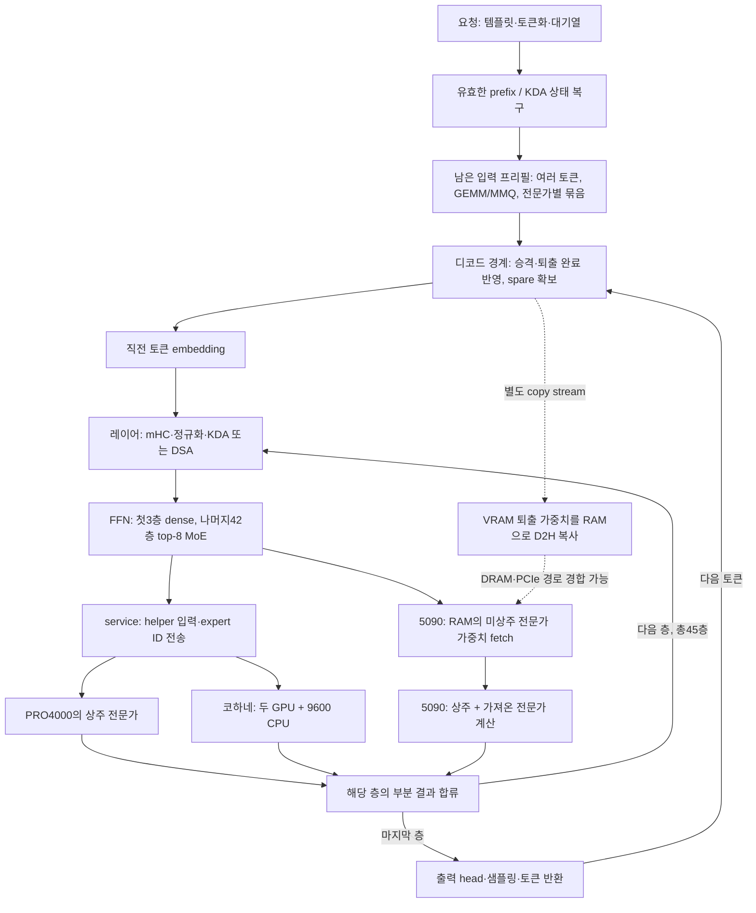

# 추가 구매·양자화 변경 없이 50 tok/s에 접근할 수 있는가

2026-10-27. `codex/decode-cycle-audit`에서 홈 구성의 소스, 기존 Claude 실험,
현재 5200 MT/s 코하네컴 환경을 함께 점검한 보고서입니다.

현재 측정으로 **50 tok/s를 달성했다고 말씀드릴 수는 없습니다.** 기본 디코드는
짧은 대화 36.3–36.5, 코드 31.7 tok/s입니다. 병목은 단일 CPU의 연산 부족보다
레이어마다 발생하는 전문가 가중치 이동과 helper 결과 합류에 있습니다.
MTP는 초안의 채택률이 충분히 높아도 검증 창의 비용을 잘 나누지 못하면 빨라지지
않습니다. 다음 우선순위는 스레드 수나 커널 launch 수보다 **MTP의 검증 경로와
RAM/VRAM 중복·승격·퇴출 정책**입니다.

50 tok/s는 한 출력 토큰당20ms입니다. 현재 코드31.7 tok/s의 약31.55ms에서
11.55ms, 즉36.6%의 지연을 줄여야 합니다. 여러 요청을 동시에 처리한 합산
throughput을50으로 만드는 것과는 다른, 단일 요청의 출력 속도 목표입니다.

## 비교 조건과 실험의 범위

- 원래 IQ4_XS pack과 그 안의 NextN 형식을 유지했습니다. KV INT8, 활성값 및
  helper 응답 정밀도, top-8 expert 선택, 최대 문맥 262144를 바꾸지 않았습니다. 256K 전체 입력·vision·동시 사용자 검증은
  이번 실험에 포함하지 않았습니다.
- 메인컴: 9950X3D2, RAM128GB/4800 MT/s, RTX5090 32GB + PRO4000 24GB입니다.
  코하네컴: Ryzen9600, RAM64GB/5200 MT/s, 4070 Ti SUPER16GB + 5060 Ti16GB입니다.
  두 컴퓨터는2.5GbE로 연결되어 있습니다.
- 코하네 CPU helper는6스레드, RAM예산54GiB입니다. 메인 CPU의 expert 계산은
  이번 short 하네스에서0회였습니다. 메인 CPU 사용률에는 service polling과
  CUDA 제출·완료 대기가 포함됩니다.
- 기존 Claude `qshort.py`를 그대로 썼습니다. pass당 대화4×200, 코드4×200,
  greedy120 출력 토큰입니다. 속도는 실제 출력 토큰 기준입니다.
- 같은 서버의 반복 pass와 별도 서버의 설정 비교입니다. 많은 독립 재시작과
  다양한 실제 agent 작업을 대표하는 대규모 벤치마크는 아닙니다.
- 긴 입력은 기존 Claude 과제16524토큰의 첫 요청과 동일 입력 재사용입니다.
  답변이 EOS로 끝나므로 각 설정의 출력 길이는 조금 다릅니다.
- stage profile은 GPU event 등으로 약6–8% 느려집니다. 계측 없는 속도와
  계측한 stage 시간을 서로 빼서 성능 향상을 계산하지 않았습니다.

## 전체 요청과 토큰 하나의 사이클

이 구성은 전문가 계산을 여러 GPU/CPU에 나누는 구조입니다. 현재 레이어의
합산이 끝나야 다음 레이어의 실제 입력을 알 수 있습니다. 레이어별 대략적인
임계 경로는 다음과 같습니다.

`attention/routing + max(main fetch + expert math, helper answer) + combine`

**각 레이어에서의 max를 더해야 합니다.** 모든 helper 시간과 main 시간을
한꺼번에 더하거나, 전체 helper 시간을 통째로 숨길 수 있다고 계산하면 틀립니다.
fetch를 줄이면 그 뒤에 가려져 있던 helper 대기가 새로 드러날 수도 있습니다.

또한 fetch는 CUDA copy engine 명령이 아니라 GPU SM이 mapped RAM을 읽는
커널입니다. fetch 뒤에 같은 stream의 expert 계산이 오므로, 이미 VRAM에 있는
전문가도 기다립니다. helper 결과를 기다리는 커널도 GPU busy에 포함됩니다.
따라서 GPU사용률100%만으로 연산 성능이 부족하다고 판단할 수 없습니다.

### 프리필은 왜 다르게 보아야 하는가

입력 토큰을 모두 아는 프리필에서는 여러 토큰이 쓰는 같은 전문가를 묶어,
가중치 전송 한 번을 여러 행의 계산에 사용할 수 있습니다. 이미 별도 copy
stream과 staging ring을 씁니다. 일반 디코드는 다음 토큰을 아직 모르므로
이 재사용을 그대로 얻지 못합니다. MTP가 미래 토큰을 추측하는 이유입니다.

현재 `NET_PREFILL_MAX=1280`보다 긴 입력에서는 main prefill 경로로 전환됩니다.
원격 GPU에만 있는 가중치를 메인에서 읽어야 하는 비용도 생깁니다. 이를 무조건
원격 실행으로 바꾸면, 현재 helper의 행별 실행·RPC 비용이 프롬프트 길이만큼
증가할 수 있습니다. helper의 batched prefill은 별도 검증 과제입니다.

긴 입력의 새 로그는 chunk wall11.845초, copy lane11.406초, copies7.999초,
RAM source24.43 + reader source45.94 = 70.37을 보고합니다. **이 로그의 GB는
실제 계산상 GiB이며, prestage5149개 전문가 전송을 누락한 부분 합계입니다.**
따라서 전체 H2D는70.37GiB보다 큽니다. reader 경로는 O_DIRECT가 가능한 경우
page cache를 우회하지만 fallback도 있으므로45.94GiB를 물리 SSD 읽기 실측으로
단정하지 않았습니다. copies의 event 사이에도 host의 reader 공급 대기가 섞일
수 있어8.8이라는 값 역시 순수 DMA 대역폭은 아닙니다. 출력되는 disk wait0은
해당 카운터가 증가하지 않는 구현이므로 I/O 대기가 없었다는 증거가 아닙니다.

프리필은 전문가 묶음 계산뿐 아니라 **가중치를 공급하는 host/reader/copy 파이프라인**을
함께 개선해야 합니다. 유효한 입력 상태를 재사용한 요청은 프리필12.175초가
32.7ms로 줄었으므로, 대화·agent 사용에서는 prefix 재사용률도 큰 변수입니다.

32768 chunk용 임시 공간은 디코드에서는 expert cache로 사용합니다. chunk를
8192로 낮춘다고7.9GiB가 새로 생기지는 않습니다. 층별 최소 슬롯 제약은34→28로
완화할 수 있지만16524입력이3개 chunk로 나뉘어 TTFT가 늘 수 있습니다.
이미 비교한 슬롯 재배분 이득은 약1% 수준의 변동 범위였습니다.

## 현재 디코드 시간은 어디로 가는가

동일5200/.16 환경의 새 profile입니다. 표는 한 출력 토큰의 compute-stream
구간을 합한 값이며 반올림했습니다. helper는 main과 겹치고 **남아서 기다린
시간만** 표시합니다.

| 구간 | 대화 ms/token | 코드 ms/token |
|---|---:|---:|
| RAM → 5090 expert fetch | 9.5 | 12.9 |
| 노출된 helper 결과 대기 | 6.0 | 6.5 |
| 5090 routed/shared expert 계산 | 2.7 | 2.5 |
| attention, mHC, route, head, setup 등 | 11.5 | 11.8 |
| 계측된 합계 | 29.7 | 33.7 |

코드에서는 fetch+남은 helper 대기가 약58%입니다. 나머지도 전부 제거 가능한
overhead는 아닙니다. KDA projection2.78ms와 output1.03ms, route1.59ms,
shared/router0.97ms, mHC 약1.21ms 등 실제 계산이 포함됩니다.

새 route 기록에서 mapped fetch에 해당하는 `fetch|miss` payload는 대화
약0.494GB/token, 코드 약0.672GB/token이고, fetch 구간의 유효 전송률은
약51.8/52.2GB/s였습니다. `miss_mask`는 host가 source를 해결해야 한다는
뜻으로, 그 전부가 SSD 읽기라는 뜻은 아닙니다. warm short decode에서 엔진이 집계한 요청 시점의
pack-reader 호출은 적었습니다. 이는 물리 SSD I/O 전체 계측은 아닙니다.

fetch bytes의99.9%는 후반19–44층에 몰려 있습니다. helper GPU 소유가 앞쪽
레이어에 집중된 결과입니다. 그렇다고 helper를 모든 층에 흩으면 레이어마다
RPC가 늘 수 있습니다. 과거 trace의 frequency 배치는 miss를12–15% 줄이는
대신 helper가 동작하는 층을 약16→40개로 늘렸습니다. 이는 replay 계산이며
실제 속도 개선이 아닙니다. 배치는 hit rate가 아니라 층별 종료 시간을 줄여야 합니다.

### 메모리 대역폭과 역방향 전송

메인 RAM의 명목 대역폭은2채널 DDR5-4800의76.8GB/s이며 실제 지속 대역폭은
측정하지 않았습니다. PCIe5 x16도 encoding 기준 약63GB/s/방향이라는 상한일
뿐, 엔진이 그 속도에 도달할 수 있다는 보장은 아닙니다. 현재 payload를 유지한 채
fetch만 명목63GB/s까지 높이는 낙관적 계산에서도 절감은 대화약1.7ms,
코드약2.2ms입니다. 이것만으로50 tok/s의 차이를 메우기는 어렵습니다.

현재 exclusive tier는 RAM의 가중치를 VRAM으로 승격하면 RAM 복사본을 반환합니다.
나중에 VRAM에서 밀려나면 변하지 않는 가중치를 다시 RAM으로 씁니다. 이는 별도
copy stream에서 일어나며 compute-stream profile만으로 분리되지 않습니다.
PCIe는 full duplex이므로 H2D+D2H를 한 방향의63GB/s와 단순 비교하면 안 됩니다.
하지만 두 방향이 같은 DRAM과 루트 경로를 사용하므로 경합 가능성은 있습니다.
이를 구분하기 위해 요청의 decode 구간만 세는 `TIER_AUDIT`를 추가했습니다.

더 구조적인 후보는 **로컬 PRO4000과 main RAM의 중복을 재배정하는 것**입니다.
새 profile 시작 상태의 배치를 재현하면 중복1135전문가, 약15.06GiB가 있습니다.
현재 fetch가 집중된 후반층의 main GPU pool 전체는 약11.72GiB입니다. 따라서
용량상으로는 후반층의 GPU 가중치를 RAM에도 남겨, 퇴출 때 D2H를 피하는
selective backing을 검토할 수 있습니다.

단순 free로 해결되지는 않습니다. 현재 prefill은 이 RAM 복제를 읽으며,
helper 교체와 RAM size class도 기존 배치를 가정합니다. 로컬 helper의 batched
prefill 연결, arena 재배분, GPU/RAM 동시 소유 상태기계가 필요합니다.
15.06GiB는 재현한 profile 시점의 값이며 다른 startup에서 슬롯 수가 조금
달라집니다. 확보 가능한 저장 공간의 근거이지 보장된 tok/s 이득은 아닙니다.

## MTP가 높은 채택률만으로 빨라지지 않는 이유

현재 경로는 같은 trunk의 NextN으로 draft를 만들고, 여러 토큰을 window에서
검증합니다. fixed-1은 현재 입력+초안1개, 즉2행을 검증합니다. 그 뒤 채택된
prefix만 남기도록 KDA 상태를 복원·재실행하고 NextN cache를 확정 hidden으로
갱신합니다. rejected suffix의 상태를 그대로 남겨 두면 올바른 MTP가 아닙니다.

1토큰 초안의 지속적인 round에서 평균 출력은 `E = 1 + 채택률`입니다.
처리량은 대략 `1000 * E / (draft+verify+commit의 ms)`입니다.
이번 기본 fixed-1의 짧은 요청을 round 수로 가중하면 E≈1.857,
phase 합≈52.70ms였습니다. 50 tok/s에는 round가37.14ms 이하이어야 합니다.
채택률만100%로 올려도 출력이1.857→2개로 늘 뿐입니다.

코드만 보면 E≈1.878, phase 합≈57.68ms로, 50을 위해37.56ms 이하가 필요합니다.
즉 round 비용을약35% 더 줄여야 합니다. commit 로그는 host enqueue이며
일부 작업이 뒤 round와 겹칩니다. 이 식은 비용 규모를 판단하는 근사이고,
최종 승패는 API의 실제 출력 속도로 정합니다.

MTP를 켜면 NextN MoE288개, 원래 형식의 가중치 약3.797GiB가 저장 계층에
추가됩니다. GPU state/검증 버퍼도 약428MiB 증가합니다. 측정에서 trunk pool은
1520→1451슬롯, 코하네 RAM의 선택적 복제는51.51→47.30GB로 줄었습니다.
작은 초안 계산기의1ms만 추가되는 구조가 아닙니다.

또한 연속 토큰이 선택하는 전문가의 중복률과 **실제로 fetch해야 하는 전문가의
중복률**은 다릅니다. 이미 cache가 재사용을 처리하고 있기 때문입니다.
이번 plain trace의 adjacent fetch-ID 중복은 대화약2.8%, 코드약4.5%였습니다.
두 토큰의 fetch 집합을 완벽하게 합쳐도 해당 plain trace에서 절감되는 양은
약1.4/2.2%에 불과합니다. 이는 MTP draft trace가 아니지만, MTP가 PCIe 전송을
자동으로 절반으로 만든다고 기대하면 안 된다는 근거입니다.

## 이번 비교 결과

| 설정 | 짧은 대화 tok/s | 짧은 코드 tok/s | 판단 |
|---|---:|---:|---|
| plain | 36.3 / 36.5 | 31.7 / 31.7 | 현재 기준 |
| NextN을 올리고 fixed-0 | 35.4 | 31.0 | 메모리·추가 cache 유지 비용이 있음 |
| fixed-1, stagger0 | 38.0 / 38.1 | 32.1 / 33.4 | 소폭 개선, workload 변동 있음 |
| KDA graph | 36.2 / 36.4 | 31.5 / 31.4 | 이득 없음 |

KDA graph는 실제34 captures/116926 replays/0 invalidations로 작동했습니다.
옵션이 적용되지 않아 차이가 없었던 실험은 아닙니다. 메인 CPU 사용률도 약163%
에서 의미 있게 줄지 않았습니다. host enqueue 시간을 전부 없앨 수 있는 이득으로
계산하지 않아야 한다는 결과입니다.

16524입력의 plain 첫 프리필은12.175초, decode31.0 tok/s였습니다.
fixed-1은 프리필12.774초, decode32.6 tok/s였습니다. 입력 재사용 시에는 각각
32.3/34.2 tok/s였습니다. 첫 요청 전체 wall time은19.43/19.51초였으며 생성 길이도
조금 달랐습니다. 출력 속도의 개선과 첫 요청 전체 시간의 개선은 구분해야 합니다.

fixed-1의 별도 WIN_PROF에서 최종 attempt는 약51.15ms/window였습니다.
그중 route/fetch25.02ms와 노출된 helper wait9.07ms가 약66.6%를 차지했습니다.
재실행 시간은 이 stage profile 밖에 있을 수 있어 WIN_AUDIT의 inclusive host
시간과 구분했습니다. stage 계측은36.9/32.4 tok/s로 추가 overhead도 있었습니다.

WIN_AUDIT의 fixed-1에서는916 windows 중8회(0.87%)만 scratch 재실행했습니다.
버려진 attempt의 비용은 전체 window 평균0.57ms였습니다. 따라서 fixed-1의
주된 비용을 scratch 재실행만으로 설명할 수 없습니다. T2/T3 private scratch를
기본 off인 실험 옵션으로 추가해 재실행 제거와112/224MiB cache 비용을 비교합니다.

### private scratch 실험의 최종 결과

| 설정 | 대화 tok/s, pass1/2 | 코드 tok/s, pass1/2 | scratch replay |
|---|---:|---:|---:|
| shared, draft2개 | 28.2 / 미실행 | 22.1 / 미실행 | 217/700 windows,31.0% |
| private T2, draft1개 | 37.6 / 38.5 | 33.3 / 33.6 | short1837 + long231 windows 모두0 |
| private T3, draft2개 | 36.0 / 36.3 | 33.5 / 32.8 | short1370 + long176 windows 모두0 |

shared T3는 코드에서44.5%가 재실행되어 느렸습니다. 버퍼 분리로 이 문제가
사라지고 코드22.1→약33 tok/s로 회복했습니다. 하지만 **MTP2개의 정상 검증도
1개 초안보다 빠르지 않았습니다.** T3는 short의 round 가중 E≈2.4905,
draft2.092 + verify69.380 + commit enqueue0.207 = 약71.679ms입니다.
50 tok/s에 필요한49.810ms까지 약30.5%를 더 줄여야 합니다. 코드만 따로 보면 E≈2.5645, round77.679ms에서
51.290ms 이하로약34.0%를 줄여야 합니다. 현재 전체 평균 round 비용을
유지한 채 전부 채택되더라도 최대3토큰/round이므로 약41.9 tok/s입니다.

T3 private의 긴 입력 decode는 첫31.4/재사용34.1 tok/s로, T2 private의
32.6/34.4보다 좋지 않았습니다. T2/T3 추가 scratch는112/224MiB이며 pool을
1485→1476/1468 slots로 줄였습니다. 재실행을 없애는 이득과 cache 감소가
동시에 생깁니다. 정상 검증의 가중치 공급·helper 처리 비용을 함께 줄여야 합니다.

private scratch는 `MAYA_GLM_WIN_SCRATCH_ROWS=2/3`인 기본 off 옵션입니다.
실험은 `WIN_STAGGER=0`, 기존 `WIN_SPARES=0`으로 했습니다. 소스 검토와 빌드,
실제 생성·긴 입력은 확인했지만, IQ4_XS 고정 plan의 blob/출력 및 KDA rejection
위치별 동등성 검증은 남았습니다. 기존 plain끼리도 greedy hash가 달라
전체 출력 hash 하나를 정확성 증명으로 사용하지 않았습니다. 운영 기본값으로
올리지 않습니다.

추가로 T3 dense multi-column GEMV가 현재NC=4 커널에서 세 번째 입력을
한 번 더 계산하고 네 번째 출력만 버리는 경로를 확인했습니다. NC=3 specialization은
산술 순서를 보존하며 불필요한 열을 없앨 작은 후보입니다. 다만 가중치 읽기량은
그대로이고 expert 공급 병목을 없애지는 않으므로 큰 향상으로 가정하지 않았습니다.

### decode-only 전송량 계측

plain-tier의 각 workload1600 emitted tokens,1592 실제 forward를 합산했습니다.
프리필은 제외했고 모든 요청의 `metadata_missing=0`, `service_pending=0`입니다.
여기서GB는10^9bytes입니다. DMA는 성공한 enqueue payload이며 완료 시간이나
전체 PCIe 사용량을 측정한 값은 아닙니다.

| emitted token당 expert payload | 대화 GB | 코드 GB |
|---|---:|---:|
| mapped RAM → GPU, fetch+host-resolution miss | 0.488354 | 0.676483 |
| background RAM → GPU | 0.000367 | 0.000294 |
| 퇴출 GPU → RAM | 0.394012 | 0.469813 |
| 위 경로 합계 | 0.882734 | 1.146590 |

역방향 복사는 대화29.47/코드35.14 experts/token으로, 계측된 payload의
44.6%/41.0%였습니다. 이는 저장 공간을 확보하기 위한 exclusive tier의 실제
비용입니다. 선택적 backing으로 전부 없앤다는 가정의 **전송량 상한**이며,
토큰 지연도41% 줄어든다는 뜻은 아닙니다. 일부는 이미 다른 작업과 겹칩니다.

같은 토큰당 전송량으로50 tok/s를 가정하면 가중치의 host read/write 합계는
대화44.1/코드57.3GB/s입니다. DRAM 명목76.8GB/s보다 낮으므로 이 산술만으로
50이 물리적으로 불가능하다고 결론 내릴 수 없습니다. 실제 burst의 겹침, 다른
메모리 수요, 레이어별 의존성을 해결해야 합니다. plain-tier 속도는36.2/36.5,
31.6/31.6으로 계측 없는 기준 범위에 가까웠습니다.

앞선 stage profile과 route는 요청의 마지막 prompt forward도 포함하며, tier는
그 뒤부터 시작합니다. 두 자료의 분모와 구간은 조금 다릅니다. stage의52GB/s는
서로 정렬한 route와profile로 계산한 값이며, tier 표는 엄격한 decode 구간을
emitted token 수로 나눈 값입니다.

### 다음 레이어 선읽기는 이번 구성에서 느려졌습니다

같은 tier binary에서 `PREFETCH_N=1, AT=fetch, BLOCKS=4, RANK=2`를 켜고
동일 하네스를 두 번 실행했습니다. 시작 로그와 실제 prefetch payload로 활성화를
확인했습니다.

| 설정 | 대화 tok/s | 코드 tok/s |
|---|---:|---:|
| 선읽기 off | 36.2 / 36.5 | 31.6 / 31.6 |
| 제한된 선읽기 on | 35.4 / 35.6 | 30.6 / 30.7 |

평균 대화−2.34%, 코드−3.01%입니다. ordinary mapped fetch는 줄었지만 선읽기
바이트를 포함한 H2D는 대화+4.22%, 코드+6.31% 늘었습니다. D2H까지 더한 왕복량도
각각+2.67%/+4.04%였습니다. 예측으로 miss count를 낮추는 것이 token latency를
낮춘다는 뜻은 아니라는 실제 대조입니다. 이 옵션도 운영에 채택하지 않습니다.
이 선읽기는 ordinary decode에만 연결되어 있어 MTP 성능과 합산하지 않습니다.

16524입력의 decode도 first31.3→29.9, repeat32.5→31.3 tok/s로 느려졌습니다.
첫 prefill은12.1374→12.1354초로 비슷했습니다. 출력 길이는225/225 대224/224로
조금 달라 native per-token 시간도 함께 비교했습니다. 두 startup의 main RAM
슬롯은7299/7298로1개 차이가 있었습니다.

기존에 있는 다음 레이어 선읽기는 현재 층 입력을 다음 층 router에 넣어 예상
전문가를 미리 가져오는 경로입니다. 실제 다음 층 top-8은 그대로 계산하므로
잘못 예측하면 전송과 cache 공간만 낭비합니다. 별도 SSD→RAM `AHEAD`와는
다릅니다. `N=1, AT=fetch, BLOCKS=4, RANK=2`의 제한된 구성을 이번 마지막
비교에 포함했습니다. 결과는 위 tier 계측 절에 기록합니다.

## 다음 구현을 선택하는 기준

1. **MTP 검증 창의 캐시·helper 비용을 같이 최적화합니다.** 채택률만 보고 초안
   길이를 늘리지 않습니다. window당 실제 출력, 재실행, fetch payload, helper의
   잔여 대기, 줄어든 cache를 같이 측정합니다. row별 offload 비용을 더하는 대신
   같은 레이어의 window 전체 작업량과 helper queue를 고려해야 합니다.
   현재도 각 row의 요청을 먼저 보내고 마지막 row에서 답을 회수하므로 host가
   row마다 응답까지 기다리는 구조는 아닙니다. helper 서버는 메시지별 한 row를
   계산합니다. T행 batch는 후보지만 모두 모을 때까지 기다리면 첫 row 계산과
   뒤 row fetch의 기존 overlap을 잃을 수 있습니다. 기존 kRows/kTokRows는
   FP16 입출력이므로 그대로 decode에 연결하지 않고 FP32 batch 경로가 필요합니다.
2. **약15GiB 중복 공간을 이용한 선택적 RAM backing을 설계합니다.** 우선 동일
   가중치의 D2H를 줄일 수 있는지 검증하고, 그다음 spare 회복·cache hit 개선이
   실제 출력 속도로 이어지는지 봅니다. quantization·원래 expert 선택은 유지합니다.
3. **resident 전문가 계산과 fetch overlap은 제한된 후보입니다.** 이미 VRAM에
   있는 expert만 먼저 계산하고 원래 순서로 partial을 합치는 구현이 필요합니다.
   숨길 수 있는 것은2.5ms 전체가 아니라 그중 resident 부분이며, helper가 늦는
   층에서는 그만큼 이득도 드러나지 않습니다. 추가 kernel과 메모리 경합도 있습니다.
4. **작은 용량 정리는 TTFT/안정성 목적과 구분합니다.** NextN prefill scratch는
   실제 carve보다 크게 예약하는 후보가 있습니다. 정리하면32K에서최대1GiB,
   이번16K에서약516MiB의 일시적 차용을 줄일 수 있지만 상시 decode VRAM이
   새로 생기는 것은 아닙니다. image/prefill loan 분리도 allocator 변경입니다.

코하네12스레드, fetch block 수만 변경, 단순 슬롯 재배분, KDA graph, 더 짧은
네트워크 payload는 지금까지 큰 개선을 입증하지 못했습니다. NIC `rx-usecs=0`도
이미 적용된 상태입니다. 코하네 CPU에 일을 더 몰면 main fetch가 줄어도 helper
답이 늦어져 이득이 없어질 수 있습니다. 새 하드웨어 없이50을 목표로 삼는다면
여러 개의 독립적인 몇% 개선을 더하는 계산보다, 검증·전송·cache 경로를 함께
바꿔 한 토큰 또는 한 round의 실제 임계 경로를 줄이는 작업이 필요합니다.

## 외부 구현·연구와 이 장비에 적용할 때의 제약

- [NVIDIA의 GLM-5.3-Flash 모델 설명](https://docs.nvidia.com/nemo/automodel/latest/model-coverage/vision-language-models/thudm/GLM-5.3-Flash)은
  45층,34KDA/11DSA,288개 중top-8 구조를 확인하는 근거입니다. 실제 실행 순서는
  이 저장소 소스를 기준으로 감사했습니다.
- [TensorRT-LLM 배포 가이드](https://nvidia.github.io/TensorRT-LLM/1.4.0rc1/deployment-guide/deployment-guide-for-glm-5.3-flash-on-trtllm.html)는
  B200 다수와FP8의 검증 조건입니다. 현재IQ4_XS·서로 다른 GPU·RAM/CPU offload의
  직접 대체로 같은 속도를 기대할 근거가 되지 않습니다.
- [SpecFit](https://arxiv.org/html/2610.15417v1)의 비용 기반 검증 선택은 참고할
  만합니다. 하지만 논문은 target route의 사전 atlas를 요청 타이머 밖에서
  사용하며 실제 예측기 배포는 남은 과제라고 설명합니다. 보고된 향상을 현재
  엔진에 곧바로 가져올 수 있는 결과로 취급하지 않았습니다.
- [SP-MoE](https://arxiv.org/html/2510.10302v2)는 draft 정보로 target expert를
  prefetch하는 방향입니다. 여러 층 draft의 hidden을 이용하는 조건과 이 모델의
  한 층 NextN은 다릅니다. 현재 약1ms draft 동안 숨길 수 있는 전송도 제한됩니다.
- target 전문가를 생략하거나 출력 정밀도를 줄이는 기법은 이번 목표의 달성
  수단으로 포함하지 않았습니다.

## 재현 자료와 운영 상태

원본 설정·로그·하네스 stdout·status는 홈 PC `~/fn/codex-*-20261027/`에 있으며,
로컬 `../maya-cycle-audit-20261027/`에 복사했습니다. 하네스SHA256은
`278b008e7e6f889407f257b57725057fb61839a8dba025fbf09a38d1dc653a64`입니다.
진단기와 실험 옵션은 기본 off입니다. [기계 판독용 측정 요약](home-cycle-measurements-20261027.json)에
설정별 결과, 입력 재사용 결과, 바이너리/하네스/원본 파일의 SHA256을 보관했습니다.

2026-10-27 22:55 KST에 네 실험 묶음 모두 완료·복원 상태를 확인했습니다.
운영은 기존 `start-maya-kohane5200.sh`와 `maya-copy-profile-cc80982`로 복원했고,
설정 파일도 실험 전과 일치했습니다. MTP·진단·graph·prefetch는 꺼져 있습니다.
helper PID2107/2096과54GiB/6스레드 설정을 유지했습니다. `/health`의 정상 상태,
262144문맥 설정·images 지원 표시와 실제 `2+3 → 5` 응답을 확인했습니다.
이 짧은 복구 확인의 token/s는 성능 평가에 사용하지 않았습니다. 남은 benchmark나
후속 자동 실행 프로세스도 없습니다.

운영 복구의 원본은 로컬 `../maya-cycle-audit-20261027/codex-tier-audit-20261027/`
`final-verification.json`입니다. 기능 검증과 전체 수치 동등성 검증은 구분하며,
private scratch는 후자의 검증이 남아 있어 실험 브랜치에만 보존했습니다.

상세 근거:
- [디코드 실행 경로와 동기화](decode-pipeline-audit-20261027.md)
- [MTP 채택·검증·메모리 회계](mtp-decode-audit-20261027.md)
- [배치·대역폭·RAM 중복·네트워크](placement-roofline-audit-20261027.md)
