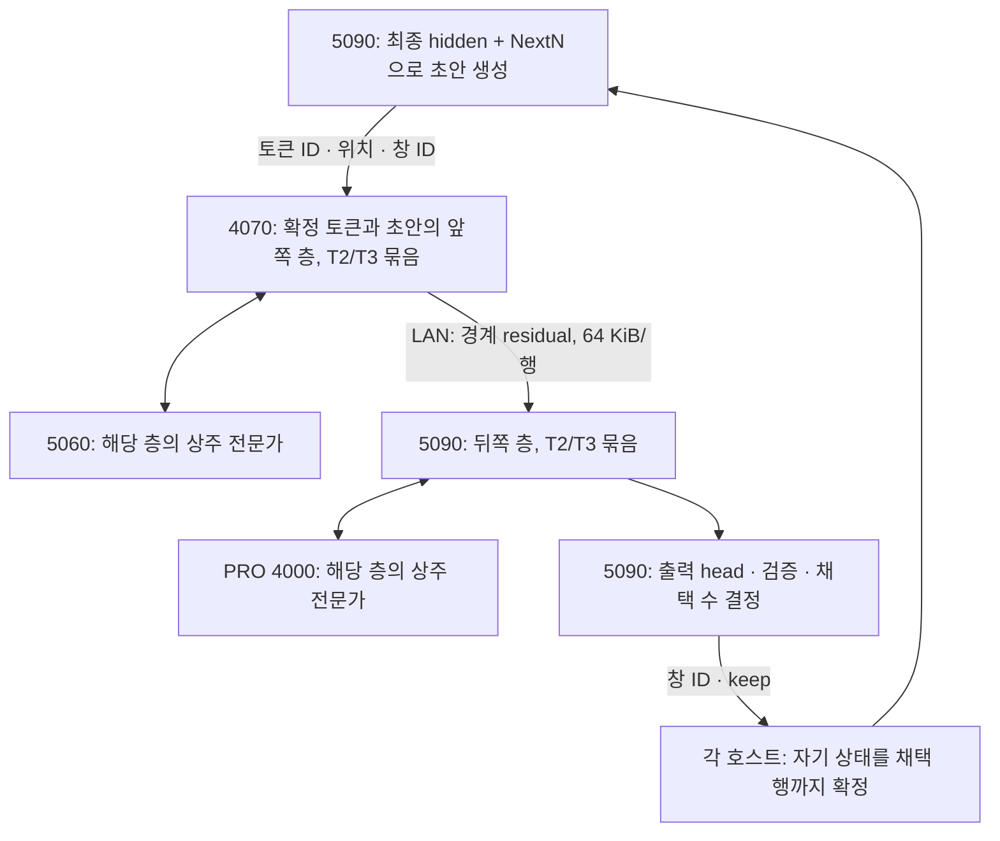

# 두 호스트 trunk와 상주 전문가: MTP 영향 분석

2026-10-29. `df626e4` 소스와 기존 측정의 읽기 전용 분석입니다.
새 모델 실행·GPU 실험이나 서버 설정 변경은 하지 않았습니다.

## 판단

사용자 제안은 타당한 개발 후보입니다. 보조컴의 4070 Ti SUPER를 앞 trunk,
5060 Ti를 그 층의 상주 전문가로, 메인컴의 5090을 뒤 trunk와 head/NextN,
PRO 4000을 뒤층의 상주 전문가로 사용합니다. 모델의 전문가 선택과 양자화는 바꾸지 않습니다.

기존 PRO→5090 분할과 달리 4070의 Gen4×16 및 보조컴 RAM을 앞층의 가중치 공급에
사용합니다. 각 호스트가 자기 층의 계산을 완결하면 매층 원격 전문가 요청을 줄일 수 있습니다.
고정 레이어만 지정하고 가중치를 좁은 링크로 계속 공급하는 방식은 이 목적을 달성하지 못합니다.

Native T2/T3의 정확성과 가중치 재사용을 유지하는 것이 우선입니다. 두 GPU의 계산을
겹치는 것은 별도 최적화이며, 행별 pipeline 때문에 묶음 계산을 잃으면 오히려 느릴 수 있습니다.
현재 native MTP와 연결한 원격 trunk는 구현되어 있지 않습니다. 50 tok/s는 미확정입니다.

## MTP 한 라운드의 실행

NextN 초안은 앞 trunk를 다시 실행하지 않습니다. 직전 확정 trunk hidden, 다음 토큰
embedding, NextN 자신의 가중치와 DSA cache로 계산합니다. 여러 초안은 NextN 자신의
hidden으로 연쇄합니다. 따라서 head/NextN/최종 hidden과 embedding 조회 수단을 5090
호스트에 두면 초안 토큰마다 원격 trunk를 호출할 필요가 없습니다.
근거: `src/core/glm_mtp.cu:605`, `src/core/glm_fast_path.cu:7208`.

수학적으로 같은 연산·상태·샘플을 유지한다면 물리적인 분할 자체는 초안의 채택률을
낮추지 않습니다. 실제 CPU/GPU 계산 경로와 합산 순서가 달라지면 수치 차이가 생길 수
있으므로 동일한 강제 prefix와 sampler 상태에서 검증해야 합니다. 기존 cut11 실험의
greedy 불일치는 아직 원인이 확정되지 않았습니다.

## 통신과 거절 처리

- 현재 경계 형식은 FP32 `4×4096` residual, 행당 64 KiB입니다. T2/T3는 128/192 KiB입니다.
- 과거 확인된 2.5Gb/s 링크에서 payload 직렬화만의 하한은 약 0.42/0.63 ms입니다.
  현재 링크 실측이나 왕복 지연이 아니며 TCP, host/GPU 복사, 동기화, commit 비용은 제외한 값입니다.
- 토큰 ID, position, window ID, keep은 작지만 동기화 지연은 별도로 측정해야 합니다.
- KV/KDA 전체를 LAN으로 옮기지 않습니다. 각 호스트가 자기 층의 상태·백업을 유지합니다.
- `keep<T`이면 양쪽 호스트가 KDA/convolution을 창 시작 백업과 저장된 입력으로 복원·재생합니다.
  기존 `win_commit_part()`는 전체 attention/FFN을 다시 계산하지 않습니다.
- DSA 미채택 위치는 다음 처리에서 덮어쓰고 미래 위치를 읽지 않아야 합니다. 메인의 NextN cache는
  채택된 실제 trunk hidden으로 수정합니다. 각 호스트의 commit과 이후 작업 순서를 보장해야 합니다.
- 네트워크의 지연·재시도·취소가 이전 창의 작업을 새 창 상태에 적용하지 않도록 식별과 drain이 필요합니다.

근거: `src/core/glm_window.cu:1160`, `:1910`, `:1995`, `src/core/glm_mtp.cu:699`.
Tail 전문가를 계속 보조컴 RAM에서 요청한다면 매층 RPC가 남습니다. 이를 없앤 설계의
효과를 주장하려면 RAM 원본·복사본의 소유권도 함께 바꿔야 합니다.

## 실행 방식의 선택

| 방식 | MTP의 배치 재사용 | 두 trunk 계산 중첩 | 주요 판단 |
|---|---|---|---|
| 앞 T행 → 뒤 T행 | 유지하기 가장 쉬움 | 없음 | 첫 정확성·성능 기준 경로 |
| 행별 pipeline | 현재 구현에서는 손실 | 가능 | 중첩 이득이 반복 fetch/연산 비용보다 커야 함 |
| T3의 2+1 microbatch | 일부 유지 | 가능 | 새로운 scheduler와 버퍼 수명 관리 필요 |
| 연속 `decode_spec()` | native T2/T3와 다름 | 가능 | 오답 시 앞 stage 재실행, 별도 비교 후보 |

묶음 시간을 A_T/B_T, 단일 행 시간을 a/b라고 할 때 통신을 제외한 단순 모형은 다음과 같습니다.

- 전체 묶음 직렬: `A_T + B_T`.
- 행별 pipeline: `a + b + (T-1) × max(a,b)`.
- T3의 2+1: `A_2 + max(A_1,B_2) + B_1`.

이 값들에 실제 draft·통신·동기화·거절/commit 비용을 더해야 합니다. `A_T=T×a`라고
가정하면 기존 batching 효과를 지워 버립니다. 기존 PRO/5090의 7/26 ms를 새로운
4070/5090의 stage 시간으로 대입할 수도 없습니다. 전체 묶음 직렬은 두 호스트의 RAM을
동시에 읽는 가속을 자동으로 얻지 않으며, 가중치 배치와 원격 요청 감소에서 이득이 나와야 합니다.

## 50 tok/s의 조건부 시간 예산

과거 host round의 채택 토큰 수와 draft/commit 비용을 유지하는 가정입니다.

| 조건 | 출력 토큰/round | 기존 verify ms | 목표 verify ms |
|---|---:|---:|---:|
| T2 대화 | 1.8575 | 46.338 | 약 36.0 |
| T2 코드 | 1.8903 | 54.238 | 약 36.7 |
| T3 코드 | 2.6161 | 71.170 | 약 50.1 |

산식은 `목표 verify = 1000 × 출력토큰/round ÷ 50 - 기존 draft/commit`입니다.
API tok/s와 집계 분모가 다른 설계 예산이며, 새 통신·commit 비용이 증가하거나 채택률이
바뀌면 다시 계산합니다. T2는 검증 시간을 약 10~17.5 ms, T3 코드는 약 21 ms 줄여야 합니다.
통신 없는 균형 행별 pipeline이라도 stage당 대략 12~12.5 ms 수준이 필요합니다.
단순히 초안 수를 늘리면 승인되지 않은 작업과 복원 비용도 늘어납니다.

## 메모리 검토의 숨은 제약

현재 pack의 trunk routed experts는 152.15625 GiB입니다. NextN expert는 현재 형상·Q4_0
저장 기준 약 3.796875 GiB입니다. 이는 기존 pack의 혼합 형식이며 양자화를 변경한 것이 아닙니다.
예를 들어 cut11은 앞 experts 30.2344 GiB, 뒤+NextN experts 약 125.7188 GiB입니다.

4070이 trunk가 되면 dense/state/workspace가 추가되므로 기존 전문가 전용 약 14.9 GiB를
그대로 쓸 수 없습니다. 기존 PRO front 실측을 옮긴 거친 예산에서는 pool이 약 11 GiB
안팎이며, 5060의 약 14.9 GiB를 합쳐도 front 일부는 RAM 경로가 필요합니다.
새 4070 실행과 양쪽 native MTP의 실제 할당량은 측정하지 않았습니다.

메인 5090/PRO가 약 21/22 GiB의 서로 다른 전문가를 가지고 나머지 약 82 GiB를 RAM에
두면 92 GiB RAM 예산 안이라는 용량상 계산은 가능합니다. 그러나 현재 local PRO helper는
전문가의 RAM 원본을 보존합니다. **GPU와 RAM의 단순 합산은 중복 때문에 과대평가될 수 있습니다.**
고정 전문가의 RAM backing을 정리하면서 prefill의 가중치 공급도 함께 설계해야 합니다.
또한 보조컴의 기존 54 GiB 복사본과 새 front RAM을 동시에 예약하지 않습니다.

각 stage의 native window와 KDA backup은 expert pool보다 먼저 예약해야 합니다.
Prefill의 pool 대여·반환은 decode 초기 상주 상태를 바꾸므로, 정상 상태와 prefill 직후를
나누어 검증합니다. 근거: `src/core/glm_fast_path.cu:2130`,
`src/core/glm_window.cu:289`, `src/core/glm_prefill.cu:1578`.

## 권장 개발·검증 순서

1. 호스트별 층 범위와 유일 가중치/RAM backing을 먼저 계획합니다. cut10~11은 용량 검토의
   출발점일 뿐 성능상 최적 경계가 아닙니다.
2. NextN/head/채택 coordinator를 메인에 두고, 앞 stage의 window/commit transport를 만듭니다.
   현 `mtp_ready()`와 tail hidden 참조는 수정해야 하며 지원 guard만 제거하지 않습니다.
3. T2/T3 전체 묶음 직렬 경로에서 기존 plain과 행별 logits, 첫/두 번째 거절, 전부 채택,
   DSA 경계, NextN cache, EOS/취소/재개, sampler counter를 검증합니다.
4. 양쪽 A2/A3/B2/B3, 실제 residual 전송, commit, remote expert 호출 잔량을 측정합니다.
   같은 상태의 correctness 검사를 통과한 뒤 원래 qshort 하네스의 chat/code 속도를 비교합니다.
5. 이 시간들로 전체 묶음과 2+1/행별 중첩 후보를 비교한 뒤 scheduler를 선택합니다.

원리 참고: [Leviathan et al., speculative decoding](https://proceedings.mlr.press/v202/leviathan23a.html).
이 논문의 성능 수치를 본 장비에 적용하지 않습니다. 본 엔진의 sampling/commit 계약은 위 소스를 기준으로 합니다.
