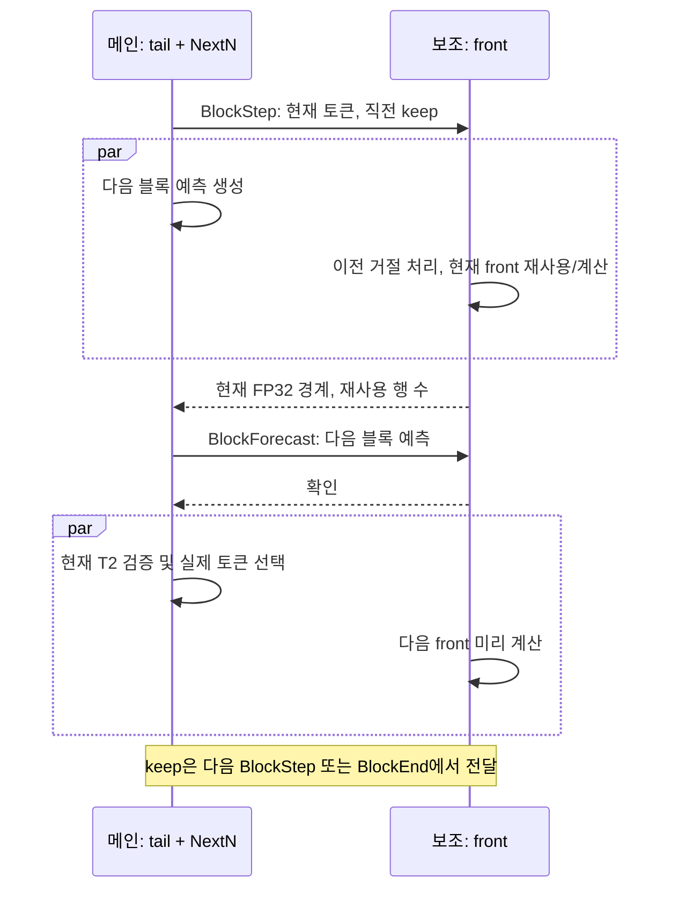

# 50 tok/s: 원본 RAM 유지와 두 호스트 파이프라인

2026-10-29. 원래 qshort 하네스, 같은 모델 가중치와 KV 양자화입니다.

| 개발 구성 | 대화 tok/s | 코드 tok/s |
|---|---:|---:|
| 최초 원격 cut18 | 24.5 | 21.1 |
| 고정 CPU를 보조에만 사용, cut12 | 35.9 | 29.8 |
| 프롬프트 뒤 helper 갱신 | 35.4 | 31.1 |
| window prefetch | 36.1 | 30.0 |
| prefetch16 blocks | 36.1 | 30.1 |
| main canonical RAM, cut12, T2 | **41.5** | **35.6** |
| 같은 구성 T3 | 40.2 | 35.8 |

canonical RAM은 고정 local helper의 RAM 중복을 제거하고 primary GPU expert 원본을 RAM에 유지합니다.
실제 모델 검사에서 helper 중복22.56GiB 제거,21.90GiB의 원본 추가,99.57GiB 유효 원본,
전체 pinned RAM101.13GiB였습니다. 예산을 늘리지 않았습니다. T2/T3 출력 비교75회 max_abs0,
greedy/고정 seed sampled MTP 검사 통과. qshort greedy 해시도 직전과 일치합니다.
디코드 계측의 boundary/background D2H count와 bytes는0입니다.

옵션은 `MAYA_GLM_STAGE_RAM_CANONICAL=1`; stage+discrete fixed local helper에 한정합니다.
재배치(`STAGE_HELPER_REFRESH`)와 함께 쓰지 않습니다. class별 슬롯 수가 모자라면 변경 전에 거부합니다.
cut12 main은 RAM_GB106/headroom10/RAM_CLASS_SLOTS=7800,304를 사용했습니다.

선행 전송은 `MAYA_GLM_WIN_PREFETCH=1`, private T2/T3, unstaggered 한 trunk에서만 동작합니다.
다음 층 router를 현재 입력에 적용한 후보를 별도 스트림에서 복사합니다. 실제 router/weights는 그대로입니다.
레이어 parity별 목록과 완료 event로 수명을 관리하며, 실제 사용 전 복사를 기다립니다.
`WIN_PREFETCH_T1=1`은 단일 행도 묶음 커널에서 실행하여 같은 전송 선행 경로를 사용합니다.
이는 별도 opt-in이며 T1/T2/T3 및 rollback 정확성 검사를 통과했습니다.

prefetch는 요구 시 fetch를 줄였지만 expert math/helper wait를 늘려 이득이 상쇄됐습니다.
SM 점유량16 blocks만으로는 해결되지 않았고, canonical RAM을 더한 뒤 실제 가속이 나왔습니다.
기존 RAM backing 유지 경로를 재사용하며, fixed helper는 VRAM에, 나머지는 모두 RAM 원본을 갖습니다.

## 실제 중첩을 위한 시간 예산

cut16, 양쪽 canonical RAM, main CPU0/front CPU6, front fixed CPU50%, 양쪽 T1 prefetch16blocks.
main RAM92/headroom20/class slots6600,304; front RAM44/headroom8.
이 구성도 실제 모델 정확성 검사를 통과했습니다.
`STAGE_TIMING=1`은 decode audit 구간에서 front RPC와 local tail을 따로 계측합니다.

원래 하네스, MTP_FIXED0으로 확인한 단일 행 시간:

| 항목 | front RPC ms | tail ms |
|---|---:|---:|
| 대화4개 평균 | 15.380 | 13.558 |
| 코드4개 평균 | 16.012 | 16.308 |

직렬 기준선은 합쳐서 기다립니다(대화34.5/코드30.9tok/s). 실제 파이프라인에서는 느린 단계에
추가 drafting/통신/오예측 복구 비용이 붙습니다. 이 수치는 파이프라인에서50이 나왔다는 뜻이 아닙니다.
구현한 경로는 보조가 다음 토큰의 front를 추측해서 계산하고, 메인이 현재 토큰의 tail을 계산하는
단일 토큰 파이프라인입니다. 틀린 front 추측은 recurrent state를 복원하고 정확한 token으로 재실행합니다.
최종 출력은 항상 main verifier의 샘플만 사용합니다.

원자료: 메인 `/home/caterpillar/fn/remote-stage-*20261029*`, 로컬
`/home/caterpillar/Agent/maya-dual-host-design-20261029/home/`.
주요 실행은 canonical-test/speed-20261029k, canonical-t3-speed-20261029l,
timing16-test-20261029m, timing16-t1-speed-20261029m입니다.

## 실제 파이프라인 검증 및 첫 50 tok/s 통과

`MAYA_GLM_REMOTE_PIPELINE=1`로 위 cut16 구성을 사용합니다. 양쪽 stage protocol v2 바이너리가
필요하며 v1과 섞지 않습니다. 이 경로는 `MTP_FIXED`의 배치 길이 대신 매 단계 NextN 한 토큰
예측을 사용합니다. 실제 토큰의 front 결과를 먼저 전송한 뒤, worker가 다음 예측의 front를
계산하는 동안 main은 현재 토큰의 tail을 실행합니다. 예측 일치 시 결과를 재사용하고,
불일치 시 front recurrent/conv 상태를 복원한 뒤 실제 토큰을 다시 계산합니다.
목표 모델의 샘플러가 최종 토큰을 결정하며 가중치/KV/전송 정밀도를 낮추지 않았습니다.

T1은 무조건 채택한다는 기존 가정 때문에 front T1의 상태 백업이 누락되어 있었습니다.
front stage는 T1도 백업하도록 수정했습니다. 수정 후 실모델 검사에서 전체 어휘 logits
130회 비교 모두 max_abs=0. 강제 hit/miss/교대, pooling 경계, stream 종료/reset,
greedy 및 고정 seed sampled 24-token 출력 일치, callback 취소 후 snapshot을 통과했습니다.
CPU CTest 4개와 transport 103 checks, transport ASan/UBSan도 통과했습니다.

원본 qshort 첫 실행 (chat/code 각각4개×200토큰):

| 구성 | 대화 tok/s | 코드 tok/s |
|---|---:|---:|
| 이전 최고 cut12 T2 canonical | 41.5 | 35.6 |
| 새 cut16 토큰 파이프라인 첫 실행 | **55.5** | **50.4** |
| 같은 엔진 원본 하네스 재실행 | **55.7** | **50.6** |

두 실행 모두 같은 greedy MD5였고 재실행 RAM fetches도18.6/27.2였습니다.
첫 실행은 이전 최고 대비 +33.7%/+41.6%; 직렬 cut16 대비 +60.9%/+63.1%입니다.
main RAM fetches/output-token은 대화18.6, 코드27.2. 첫 실행 전체 CPU 사용률은
main174.6%, front659.0% (논리 코어 하나=100%)였습니다.
greedy MD5는 `8a689b1f560a3b1e6f2c4f2edc2021af`입니다.
고정 CPU 소유권/분할이 다른 cut12 최고 구성의 해시와 같다고 주장하지 않습니다.
같은 cut16 구성 안의 일반 디코드/파이프라인 출력 동등성은 별도로 실모델 검사했습니다.

첫 실행 front 예측 재사용률: 대화689/792=87.0%, 코드700/792=88.4%.
코딩의 더 느린 속도는 낮은 예측 적중률이 아닌 더 많은 RAM 전문가 전송과 tail 비용에
대응합니다. 이전 cut12 T2에서도 main RAM fetches는 대화28.5/코드43.1 per output token으로
코딩이51% 많았습니다. 요청별 전문가 분포가 달라 고정 공통 배치만으로는 한계가 있으며,
이번 변경은 두 단계의 시간을 합산하던 실행 의존성을 겹쳐서 큰 개선을 얻었습니다.

실행 원자료: `remote-stage-stream-test-20261029o`, `remote-stage-stream-speed-20261029o`.
API18100은 새 개발 엔진으로 유지합니다. 이 결과는 짧은 하네스의 평균 디코드 속도이며,
긴 문맥/긴 출력/프리필까지 모두50을 보장하는 측정은 아닙니다.

## 2026-10-30: 배치 프리필과 대화 재사용 복구

Claude의 `HANDOFF-remote-stage-prefill.md`에서 4,873토큰/197초, 18K 입력 중단을 확인했다.
원인은 길이 임계값만이 아니었다. stage 모드가 `prefill_setup`을 생략하여 `prefill_chunk()==0`이
되었고, 서버가 배치 프리필 호출 자체를 건너뛰었다. 디코드용 토큰 경로로 긴 입력까지 읽었다.

`MAYA_GLM_STAGE_PREFILL=1`은 기존 `prefill_run`/GEMM/MMQ/메모리 대여 경로를 그대로 사용한다.
앞쪽은 임베딩부터, 뒤쪽은 수신한 FP32 residual부터 같은 배치 레이어 루프를 실행한다.
NextN 캐시와 마지막 hidden/logits를 보존한다. 입력 가중치, KV, 경계 활성값의 정밀도는 낮추지 않았다.

`MAYA_GLM_PREFILL_PIPE=1`, `MAYA_GLM_PREFILL_PIPE_ROWS=8192`는 세 단계를 중첩한다:
앞 GPU의 다음 청크 계산 → 이전 청크의 네트워크 전송 → 뒤 GPU의 수신 청크 계산.
worker 송신 스레드와 coordinator 수신 스레드는 각각 하나이며, 송신 대기 중 계산 가능한 청크도
하나로 제한한다. 모든 청크의 position/rows/session/sequence/window와 마지막 표시를 검증한다.
취소 시 이미 요청한 유한한 프롬프트를 drain한 뒤 reset하여 연결을 재사용한다. 현재 취소는 실행 중인
GPU 커널을 즉시 끊는 방식이 아니므로 남은 front 청크 처리까지 기다릴 수 있다.
프로토콜은 **v5**이며 main/worker를 같은 빌드로 배포해야 한다.

`MAYA_GLM_PREFILL_LOCAL_HELPER=1`은 고정 local helper가 소유한 전문가를 해당 GPU에서 MMQ로
계산한다. 기존 helper MMQ 구현을 재사용하며 FP32 입력/가중합을 전송한다. 최대2048토큰/6144전문가행
단위로 나누어 기존512MiB headroom 안에서 처리한다. 현재 구성은 `PREFILL_CPU=0`을 함께 사용한다.
이 경로 덕분에 helper 전문가를 프리필 때 SSD에서 다시 읽지 않는다.

GLM 서버가 `--prompt-cache-every 0`을 무시하고 기본16K 체크포인트를 넣던 분기도 수정했다.
명시한 `MAYA_GLM_CKPT_EVERY`가 없으면 CLI 값을 따른다. 턴 경계 체크포인트와 keep-answer는 유지한다.
32K를 불필요하게 두 프리필 호출로 나누어 가중치를 재전송하던 비용이 사라진다.

양쪽 checkpoint save/save-snapshot/restore, RAM 및 파일 conversation slot을 연결했다.
슬롯은 main+front 상태를 하나의 blob/파일에 넣어 worker 재시작 후에도 복원할 수 있다.
기존 최소 슬롯 길이1024토큰은 유지한다. 그보다 짧은 대화는 현재 대화의 다음 턴은 재사용하지만,
다른 대화로 바뀌면 자동으로 디스크에 보관하지 않는다.

### 실측

같은 IQ4_XS/INT8 KV, 262144 context, Claude qshort 원본. 긴 입력은 실제 토크나이저로
8,192/32,768토큰을 맞춘 코드 문서이며 `reused=0`을 확인했다. 모델 시작 시간은 제외한다.

| 경로 | 8K 프리필 tok/s | 32K 프리필 tok/s |
|---|---:|---:|
| 퇴행한 토큰별 처리 (Claude) | 약25 | 약25 |
| 배치 연결, 기본16K 체크포인트 | 535.9 | 853.5 |
| 주기적 체크포인트 분할 제거 | 538.8 | 1126.7 |
| local helper 배치 계산, 순차 처리 | 962.5 | 1022.8 |
| **8K청크 계산/전송/계산 중첩** | **962.1** | **1712.2** |

최종 첫 토큰: 짧은 새30토큰 요청1.08초, 동일 대화 다음 턴0.62초,
8K입력8.52초,32K입력19.47초(엔진 프리필19.14초). 32K이후80토큰 디코드52.3tok/s.
원본 qshort 최종 **대화53.4/코드50.8tok/s**. 프리필을 배치로 바꾸면서 산술 경로가 달라졌으므로
greedy 해시는 예전 토큰별 프리필과 동일하다고 주장하지 않는다. 최종 해시는
`3ced0d2040f5b85d5c70005348fb028f`이다.

대화 A(2020토큰, 기억 기호 포함) → 다른 대화 B → A로 돌아온 실제 API 검사에서
**2021토큰을 디스크 슬롯에서 복원,24토큰만 추가 처리,TTFT1.00초**, 기억 기호도 정확히 반환했다.
이는 짧은 동일대화 keep-answer만 확인한 결과와 별도다.

이전 운영의32K 약2000~2200tok/s를 완전히 회복했다고 주장하지 않는다.
현재는 제안한1500tok/s 목표를 넘었고, 디코드50tok/s와 양쪽 대화 재사용을 함께 유지한다.
2.5Gbps 링크의FP32 경계값은32K당약2GiB이므로 전송 자체가 중요한 비용이다.
실제 residual 표본에서 LZ4 raw/byte shuffle/XOR shuffle을 비교했지만 최선의 압축률이 약1.07배여서
압축 기능은 추가하지 않았다.

### 검증 범위

- 실제CPU소켓139검사,관련CTest4개,ASan/UBSan 통과.
- 기존T1/T2/T3 및 keep/reset/일반디코드 대 MTP 검사 유지.
- 양쪽 체크포인트/슬롯,배치 프리필 뒤 snapshot/parking,다중청크 상태,
  프리필 취소 후 reset 비교는 전체 어휘 logits 차이0. 배치 상태에서 고정 seed 일반/MTP 생성 일치.
- 같은4070TiS와 같은 캐시 사용 순서에서 기존 front 배치 루프와 새 경로의
  1/2/16/33토큰 경계값은 바이트 단위 일치.
- helper MMQ를 독립적으로 읽은 가중치의 primary MMQ와 대조: main141검사의 최대상대L2
  1.25e-7,front64검사의 최대6.75e-4. 전문가 단위 기준은 상대L2와최대오차/최대값 각각0.005;
  GPU/그룹 모양에 따른 기존MMQ 재양자화 차이가 있으며, 상태/전송/디코드 검사 기준을 낮추지 않았다.
- native GEMM 프리필과Q8 GEMV 토큰 경로,혹은다른GPU전체실행을 동일 비트 기준으로 비교하면
  기존 엔진에서도 큰 차이가 났다. 이를 원격 전송 오류의 검증으로 혼동하지 않았다.
- RAM교체후48GiB/12스레드90초 stressapptest PASS 기록은 `home-resume-20261028.md`와
  코하네 `/tmp/codex-ram-check-20261028.log`에 있다. 이번 작업에서30~60분 RAM검사를 수행한 것은 아니다.

원자료(main `~/fn/`,local `maya-dual-host-design-20261029/home/`):
`remote-stage-prefill-test-20261029v/ab/ac`, `remote-stage-prefill-speed-20261029v/w/ab/ac`.
최종 운영 배포 및 후속 검사는 아래와 같다.

### 최종 운영 배포와 Pi/에이전트 검사

운영 설정은 `PREFILL_MIN=32`, `PREFILL_PIPE_ROWS=8192`, `SLOT_RAM_GB=2`이다.
작은 마지막 청크를 앞 청크에 합쳐 8319토큰을8192+127로 나누던 낭비를 줄였다.
주요32K 검사는 위 ac 구성에서 수행했고, 이 마지막 청크/임계값 조정 후에는 실제Pi,
원본qshort, RAM슬롯 복원과 짧은코딩 에이전트를 재검사했다.

- 원본qshort: **대화54.0/코드50.4tok/s**, RAM fetch19.6/29.2 per output token.
- RAM슬롯 A/B/A:2021토큰복원,24토큰추가처리, 첫토큰0.971초, 기억기호정답.
- 같은폴더에서 별도Pi프로세스를 두번 실행: 최초8342토큰의 첫delta10.071초,
  두번째8320토큰재사용/22토큰추가처리, 첫delta1.249초. 모델로딩시간은 제외했다.
- 최종설정 코딩첫턴 확인: 첫요청8397토큰 프리필9.805초;3요청699출력토큰,
  하네스가중평균44.3tok/s. 이는 아래45요청전체벤치의 대체측정이 아니다.
- ac설정의 전체코딩3턴:45요청13376출력토큰, 하네스가중평균41.1tok/s.
  일반에이전트3턴:9요청2011출력토큰,49.4tok/s.
  동일구간의 main RAM fetch는 각각38.2/24.1 per output token,
  front guess재사용률84.2%/84.5%였다. 문맥길이는 중앙값17.6K/9.3K이고
  코딩최대30.4K로32K KV상주한도를 넘지 않았다.

문맥길이와 작업종류가 함께 달라진 벤치이므로 길이가 속도저하의 원인이라고 단정하지 않는다.
모델은 sparse/linear 혼합attention이며,32K문서뒤52.3tok/s도 관측했다.
현재 코딩의 RAM전문가전송 증가가 더 직접적인 단서다. 예전정적코딩프로필은효과없음;
요청별 실제라우팅에 따른헬퍼소유권/레이어별캐시조정은 다음개발대상이며 아직구현하지 않았다.

메인컴에 이미 적용돼 있던 Claude의 KEEP_ANSWER 서버패치도 포크에 보존했다.
응답을문자열로돌려받아재토큰화할때 ID가달라지는경우, 텍스트가동일한지검사한뒤
모델이실제로생성한토큰을재사용한다. 기존64개교체기록도유지한다.
RAM슬롯2GB는 SSD대화슬롯쓰기를피하는기존운영선호를복구한것이며, 재시작하면RAM캐시는사라진다.
폴더/도구/시스템프롬프트가바뀌어공통prefix가줄어든경우도 최초지연이생길수있다.

메인컴 실행: `~/fn/start-maya-remote-prefill.sh start|restart|stop|status`.
이 스크립트는 양쪽 엔진을 같은설정으로 실행하고 기존자기서버만 식별해정지한다.
`~/fn/pi-maya.sh`도 서버가없으면 이새런처를사용한다.
현재실행위치는 `~/fn/remote-prefill-active-run.txt`; 이검사시
`~/fn/remote-prefill-runs/20261030-011405-437126`이다.
포크의 대응소스는 `tools/home_remote_prefill.sh`, `tools/home_stage_runner.py`,
`tools/home_stage_stop.py`이다. 현배포는 이미지입력이연결되지않았으며,
56K/111K/262K장문검사를새로수행했다고주장하지않는다.

## 2026-10-30 오전: 코딩 에이전트 병목 분리

모든 실험은 동일 IQ4_XS / INT8 KV와 cut16을 유지했습니다. 이 절의 단일 요청 수치는
코딩 3턴 전체의 속도가 아닙니다. 오늘 재부팅 후 원본 코딩 3턴 기준은 27요청 / 8,332출력토큰,
하네스 가중평균42.3tok/s(총토큰/총디코드시간42.19), RAM fetch38.36/토큰이었습니다.

고정 헬퍼의 원본을 RAM으로 되돌려 주는 경로를 구현했습니다. 같은 레이어 안에서 헬퍼→임시버퍼,
RAM→헬퍼, 임시버퍼→기존RAM슬롯 순서로 교환하고 양쪽 소유권 테이블을 갱신합니다.
교환 전 진행 중인 복사/승격을 종료하고, 교환 후 원본 누락과 중복 소유권을 검사합니다.
검사 모드에서는 나가는 blob을 pack과, 들어간 blob을 RAM 원본과 바이트 단위로 비교합니다.
교환은 요청 경계에서만 허용하며 생성 중의 MTP 소유권은 고정합니다.

- `MAYA_GLM_STAGE_HELPER_REFRESH=1`: 프리필 후 교체. `..._MAX`는 최대 교체 수(기본128).
- `..._WIDE=1`: 기존 primary-cold 제한을 제거하되 primary/CPU가 가진 전문가는 후보에서 제외합니다.
- `..._AFTER=1`: 프리필 이후 관측 기준을 잡고 실제 디코드 이력만 사용합니다. 128토큰 이상 응답을
  완료한 뒤 DONE을 보낸 다음 교체합니다. 다음 요청이 일찍 오면 남은 교체 시간을 기다리므로,
  이 비용이 완전히 사라진다고 주장하지 않습니다.
- `..._VERIFY=1`: 가중치 원본 대조용이며 성능 실행에서는 끕니다.

처음의 자유 생성 코딩3턴에서는 19요청/7,247토큰,45.0tok/s가 관측됐지만, 생성량/도구호출이 달랐습니다.
RAM fetch34.36/토큰, 교체1,792회/8.71초였으며, 이 결과만으로 개선율을 확정하지 않습니다.

### 동일 입력·출력의 단일 요청 대조

| 입력/조건 | 디코드 tok/s | 설명 |
|---|---:|---|
| 코드 문서2,852토큰,768출력,기존 | 47.7 | 그리디 생성의 토큰 ID를 그대로 재생 |
| 같은 요청,일반 헬퍼 교체 | 47.9 | 실제52개 교체252.6ms; 교체 포함하면 손해 |
| 같은 요청,최대32개 교체 | 47.8 | 교체155.4ms; 순이득 입증 안 됨 |
| 같은 요청,프리필 빈도 보정 | 47.8 | 기존47.7과 사실상 같은 속도 |
| 같은 요청,빈도 보정+LFU | 46.6 | 기존 LRU보다 느림 |
| 같은 문서,temperature1/seed12345 | 47.9 | 별도의 확률적 생성 비교 |
| 같은 확률적 요청,난수 공유 예측 | 47.9 | 768개 출력 토큰 ID 일치; 속도 이득 없음 |
| 실제 Pi 입력8,408토큰,249출력,기존 | 44.9 | 도구17개를 포함한 첫 요청 캡처 |
| 같은 Pi 입력/출력,넓은 후보128개 | 44.5 | 총응답15.64→16.32초 |
| 같은 Pi 입력/출력,넓은 후보256개 | 44.6 | 총응답16.94초 |

`MAYA_GLM_PREFILL_HEAT_TOKENS=64`는 레이어 순차 프리필이 앞 레이어 카운터를 계속 감쇠시키는
편향을 분리한 실험입니다. 기존2,852토큰 프리필 직후 main레이어16~31의 빈도 합계는 모두0,
레이어44는11,331이었습니다. 보정은 레이어별로 동등한 길이의 이력을 반영합니다.
기본값은0으로 기존 정책이며, 정확성 검사 통과와 속도 개선은 구분합니다.
`MAYA_GLM_PREFILL_HEAT_AUDIT=1`로 레이어별 합계를 출력합니다.

`MAYA_GLM_REMOTE_SAMPLE_GUESS=1`은 예측에 target의 seed/counter/필터/이력을 사용합니다.
target의 샘플링과 counter는 바꾸지 않으며, 실제로 선택된 토큰과 일치할 때만 앞단 상태를 재사용합니다.
전체 어휘 head가 필요합니다. 이 모드도 기본적으로 꺼져 있습니다.

파이프라인 계측을 적중/실패별로 분리했습니다(`MAYA_GLM_STAGE_TIMING`). 코드 문서 대조에서
메인 계산은 약17.6ms/토큰, 앞단 RPC대기는 평균2.5ms였습니다. 적중한 토큰은 약0.93ms,
실패한 토큰은 약17.97ms를 기다렸습니다. 이는 문맥 길이만으로 코딩 속도를 설명할 수 없으며,
메인 계산과 앞단 재계산을 구분해야 함을 보여 줍니다.

각 기능의 실모델 검사는 기존 T1/T2/T3 keep/reset, 전체어휘 logits, paired snapshot/slot,
프리필 취소/복원, greedy 및 고정seed sampled MTP 일치를 유지했습니다. 관련 CPU CTest4개도 통과했습니다.
원자료는 main `~/fn/remote-stage-{helper-refresh,heat,coupled,wide,after}-test-20261030a`,
`~/fn/helper-refresh-controlled-20261030/`에 있습니다. 캡처된 실제 Pi 프롬프트/도구 설정은
개인 구성일 수 있으므로 저장소에 추가하지 않습니다.

### 코딩3턴 전체 재생

기존 Claude 하네스의 세 과제는 그대로 사용합니다. 로컬 프록시에서 실제 요청과 엔진이 생성한
토큰 ID를 기록하고, replay에서는 같은 요청/같은 출력/같은 도구 대기 시간을 재현합니다.
`MAYA_GLM_SPEC_FOLLOW_RELOAD=1`은 매 요청 전에 벤치마크가 원자적으로 갱신한 continuation 파일을
다시 읽습니다. 일반 서비스에서는 사용하지 않는 검사 옵션입니다.
전체 재생 결과는 아래에 이어 기록합니다.

동일3턴 재생의 최종 결과(15요청,8,696출력토큰):

| 항목 | 기존 | 디코드 이력 기반 응답 후 교체 |
|---|---:|---:|
| 기존 하네스 방식 가중평균 tok/s | 42.39 | 44.04 |
| 총출력/총디코드시간 tok/s | 42.28 | 43.96 |
| 디코드 합계 | 205.687초 | 197.817초 |
| 기록된 도구 대기를 포함한 재생 시간 | 266.459초 | 260.123초 |
| RAM fetch/출력토큰 | 39.31 | 36.07 |
| 앞단 예측 재사용률 | 89.44% | 89.56% |
| 전문가 교체 | 0 | 1,280개 / 6.219초 |

입력, 모든 출력 토큰 ID, 요청별 prefix 재사용량이 같은 것을 검사했습니다.
교체 비용 일부는 클라이언트의 도구 작업과 겹쳤고 일부는 다음 요청의 대기에 남았습니다.
위 시간은 기록된 요청의 재생 시간이며, 새 코드를 자유 생성한 에이전트 전체 시간과 혼동하지 않습니다.
50tok/s에는 아직 미달합니다. 원자료는 main `~/fn/agent-replay-20261030/{capture,off,after128b}`입니다.
최초 `after128` 실행은 HTTP의 정상 종료 뒤 STOP 확인 메시지로 교체가 건너뛰어져 비교에서 제외했습니다.
수정은 완료된 요청의 `finish`를 기준으로 취소를 판단합니다. 재검사는 실제 교체 실행도 필수로 확인합니다.

전체 코딩 재생의 기존 실행은 main 구간20.36ms, 앞단 대기2.49ms, draft0.81ms/step이었습니다.
파이프라인 step은 프리필 head에서 바로 나오는 첫 출력 토큰을 제외한 디코드 단계입니다.
그대로 두고 앞단 대기만0으로 가정해도 약47tok/s이므로, 메인 구간의 개선도 필요합니다.
T1 파이프라인이 기존 T2/T3 전용 세부 계측에서 누락되던 문제를 고쳤습니다.
`MAYA_GLM_WIN_HOST_PROF=1`은 CUDA 이벤트를 추가하지 않고 host 구간을 보고합니다.
`MAYA_GLM_WIN_TRACE=1`은 T1도 제한된 횟수로 측정하며 coordinator의 프리필은 제외합니다.
분석기는 T1/T2/T3를 각각 분리하고 누락/오류/불완전 구간을 계속 거부합니다(21개 CPU검사 통과).

별도14,432토큰 코딩 입력의256출력을 추적한 결과, 전체8개 sample 중 최초 sample을 제외한7개는
stream 구간평균18.92ms, `moe_fetch_all`8.29ms, `moe_prefetch_join`0.48ms였습니다.
`dsa_attn`은0.68ms였으며 이는 DSA의 attention 계산 구간만이고, DSA projection이나 KDA 전체 시간이 아닙니다.
이 값들은 대기와 host 제출 간격을 포함한 CUDA stream 구간으로, 순수 PCIe 전송 시간이라고 단정하지 않습니다.
host 측정은 setup0.30 / enqueue0.93 / GPU대기17.81 / after0.02ms였습니다.
가중치 fetch 구간이 큰 비중을 차지하므로 다음 주요 대상은 RAM 전문가의 전송/중첩 경로입니다.

최종 정상 서비스는 응답 후 교체128개와 decode-only 관측을 켰습니다. 빈도 보정, 난수 공유 예측,
고정 출력 재생은 끈 상태입니다. 원본 qshort는 대화53.3 / 코드50.8tok/s이고 greedy MD5는 이전과 같습니다.
Pi 런처가 사용하는 `~/fn/start-maya-remote-prefill.sh`도 새 설정을 시작하도록 반영했습니다.
배포 설정은 `~/fn/maya-config/agent-adapt-20261030`, 현재 실행은
`~/fn/remote-prefill-runs/20261030-084042-57492`입니다. 최종 원자료 요약은
`home-agent-adaptation-20261030.json`을 참고하시면 됩니다.

## 2026-10-30 추가: 상주 전문가 계산과 RAM 전송 중첩

T1 디코드에서 RAM 전문가가 모두 도착하기 전에 VRAM에 이미 있는 전문가를 계산하도록
`MAYA_GLM_WIN_RESIDENT_OVERLAP=1`을 추가했습니다. private scratch와 기존 window prefetch가
있는 비분할 T1에만 적용하며, 일반 기본값은 꺼짐입니다. T2/T3, EXL3 및 기존 배치 프리필 경로는
변경하지 않습니다. GPU에 미리 도착한 전문가를 먼저 계산하고, 나머지 전문가 전송을 기다린 뒤
그 전문가들을 계산합니다. 마지막 합산 순서와 가중치/양자화는 기존 그대로 유지합니다.
메인에서만 켜고 앞단에서는 끕니다.

앞 레이어의 선읽기가 설치한 포인터는 실제 복사가 끝나야 사용할 수 있습니다. 따라서 해당
완료 이벤트를 기다린 후 기존 선읽기 스트림에 현재 레이어 전송을 넣습니다. 정상 경로의
합류 이벤트 외에 reset/해제 시에도 이 스트림을 비워, 실패한 요청의 복사가 다음 요청의
scratch를 덮지 않도록 했습니다.

같은 코딩3과제의 15요청/8,696출력토큰, 입력/출력 ID/prefix 재사용/도구 대기를 고정한 비교입니다.
모든 실행은 이전의 응답 후 전문가 교체128개 정책을 유지합니다.

| 방식 | 하네스 가중평균 tok/s | 총출력/총디코드시간 tok/s | 재생 전체 시간 |
|---|---:|---:|---:|
| 중첩 끔 | 43.96 | 43.90 | 260.399초 |
| 기존 선읽기 스트림에서 중첩 | 44.57 | 44.49 | 257.785초 |
| 같은 중첩, 복사 커널64블록 | 44.52 | 44.46 | 257.942초 |
| 현재 전송에 별도 스트림 사용 | 44.09 | 44.01 | 259.898초 |
| 선택한 첫 방식, 최종 빌드 재측정 | 44.49 | 44.42 | 258.076초 |

RAM fetch는 모두36.066/출력토큰, 앞단 예측 재사용률은89.557%, 교체는1,280개로 같습니다.
프리필 시간 합계도44.06초로 같습니다. 별도 스트림은 앞선 선읽기와 현재 전송을 일찍 겹치지만
실제 전체 속도가 낮아 채택하지 않습니다. 복사 블록 제한도 추가 이득이 없어 채택하지 않습니다.
원자료는 main `~/fn/remote-stage-overlap-{off,on,on64,stream}-20261030a/`입니다.

첫4요청의 최초 T1 window 각1개를 추적하면, 기존 fetch/선읽기 합류/전문가 계산의 합계는
16.688ms입니다. 첫 중첩 방식의 resident 구간(선읽기 합류 포함)/demand 합류/나머지 전문가
구간 합계는16.146ms, 별도 스트림은16.428ms입니다. CUDA 이벤트 구간은 대기와 제출 간격을
포함하므로 순수 커널 시간으로 해석하지 않습니다. 블록64는 resident 구간을 줄였지만 demand
합류가 늘어 총합이 같았습니다. 전송과 계산의 자원 경쟁이 남는다는 해석과 부합하며,
원인을 특정 마이크로아키텍처 자원으로 확정한 측정은 아닙니다.

별도의 pinned RAM 복사 검사(5090,13,369,344바이트 전문가1/2/4/8개,32회,3라운드,
바이트 전체 대조)는 SM 복사약53GB/s, DMA 복사약56~58GB/s였습니다. 이는 모델 속도 수치가
아닙니다. DMA를 엔진에 적용하려면 GPU 라우팅 결과를 CPU에 전달하고 복사 완료를 GPU에
다시 알려야 합니다. 이미 기록하지 않은 CUDA 이벤트를 GPU가 먼저 기다리면 안 되므로,
완료 sequence까지 포함한 별도 프로토콜이 필요합니다. 50tok/s를 향한 다음 큰 검증 대상은
이 경로가 절약하는 GPU 자원과 host 통지 비용의 실제 손익입니다. 스트림만 더 늘리는 것으로
50tok/s가 된다는 근거는 이번 실험에서 나오지 않았습니다.

첫 중첩 실행의 전체 디코드 환산은22.48ms/출력토큰입니다. 50tok/s는20ms이므로
약2.48ms/토큰을 추가로 줄여야 합니다. 독립 복사의 대역폭 개선율을 모델 전체 개선율로
곱할 수는 없으며, DMA만으로 목표를 보장하지 않습니다. DMA 검증에서는 전체 디코드 시간과
상주 전문가 계산 구간이 함께 줄어드는지, CPU 통지가 새 병목이 되는지를 측정해야 합니다.

최종 빌드 재측정에서도 모든 출력 ID와 prefix 재사용량이 일치했습니다. 실모델 검사는
139회 logits 비교의 최대 절대/상대 오차0, 총21,529,004검사를 통과했습니다. T1/T2/T3의
채택/거절, snapshot/slot, MTP, 프리필 취소/복원을 포함하며 관련 CPU CTest4개도 통과했습니다.
원자료는 `~/fn/remote-stage-overlap-test-20261030d/`,
`~/fn/remote-stage-overlap-final-20261030a/`이며 요약은
`home-resident-overlap-20261030.json`에 있습니다. 최종 재측정의 디코드 합계는195.772초,
프리필 합계44.041초, 응답 후 전문가 교체6.213초입니다.

일반 생성 엔진에서도 원본 qshort 하네스는 대화54.0 / 코드51.6tok/s, greedy MD5
`3ced0d2040f5b85d5c70005348fb028f`로 통과했습니다. 이는 코딩3과제 전체44.49와 다른 짧은
벤치마크입니다. 정상 실행의 고정 출력/trace/가중치 대조 옵션은 꺼져 있으며,
`~/fn/start-maya-remote-prefill.sh`도 새 버전을 시작합니다. 배포 설정은
`~/fn/maya-config/resident-overlap-20261030`, 활성 실행은
`~/fn/remote-prefill-runs/20261030-094610-93639`입니다.

## 2026-10-30 추가: T1 전문가 전송의 DMA 경로

`MAYA_GLM_WIN_DEMAND_DMA=1`은 앞 절의 resident overlap 안에서 RAM 전송만 DMA로 바꿉니다.
GPU가 `moe_wait` 이후 확정된 source/destination 목록을 host-mapped 요청에 쓰고 sequence를
마지막에 게시합니다. 전용 CPU 스레드가 UVA 주소로 `cudaMemcpyAsync`를 제출하고, 같은
DMA 스트림의 작은 커널이 device completion sequence를 기록합니다. 메인 GPU는 그동안
상주 전문가를 계산한 뒤 완료 번호를 기다립니다. 미기록 CUDA 이벤트를 먼저 기다리는
방식을 사용하지 않습니다. 전문가 선택, 가중치, 양자화, 합산 순서는 그대로입니다.

`MAYA_GLM_WIN_DEMAND_DMA_EARLY=1`은 현재 RAM 전송 요청을 이전 선읽기의 합류보다 먼저
게시합니다. 현재 demand의 private scratch와 선읽기의 resident slot은 서로 다릅니다.
상주 전문가 계산은 여전히 선읽기 완료를 기다리므로 아직 도착하지 않은 가중치를 읽지 않습니다.
복사 오류/시간 초과는 요청 실패로 전달하고, reset/해제는 GPU 요청을 마친 후 제출 스레드와
DMA 스트림을 정리합니다. 일반 기본값과 선택한 홈 구성은 DMA 꺼짐입니다. CPU 비용에 비해
속도 이득이 작다는 사용자 판단에 따라 실험 기능으로만 남깁니다.

CUDA의 지연 커널 로딩은 GPU가 DMA 완료를 기다리는 동안 context 동기화를 걸어 CPU의
완료 커널 제출을 막을 수 있었습니다. 완료 커널을 초기화 때 미리 실행하는 것만으로는
뒤쪽 attention 커널의 최초 로딩까지 해결되지 않았습니다. 실제 생성 프로그램은 원래
`CUDA_MODULE_LOADING=EAGER`를 기본으로 설정하고 있었으므로, 모델 검사기도 같은 조건으로
맞췄고 DMA 경로는 EAGER 없는 구성을 복사 시작 전에 거부합니다. 이전 일반 서비스와 이번
성능 비교의 VRAM expert pool은 모두21.91GiB/1,756slots입니다. 검사기의 LAZY 실행에서만
관측된22.34GiB/1,791slots를 서비스의 이전 용량으로 잘못 비교하면 안 됩니다.

새 GPU 검사는 실제 제출 스레드로21개 복사 사례를 확인합니다. 빈/부분/전체 mask,
작은/큰 복사, 변경하면 안 되는 바이트, sequence 순환, host 실패 전달을 포함합니다.
실모델 검사는 늦은 제출과 이른 제출 모두139회 logits 비교에서 최대 절대/상대 오차0,
모든 pick 일치로 통과했습니다. T1/T2/T3 keep/reject, pool 경계, snapshot/slot, MTP,
프리필 취소/복원을 포함합니다. T1이 빠져 있던 선읽기 발행/다음 층 선택 집계도 보완했습니다.

같은15요청/8,696출력토큰을 재생한 비교입니다. CPU%는 메인 서버와 엔진의 CPU시간 합계이며
100%가 한 코어입니다. 도구 대기를 포함한 재생 벽시계 시간으로 나눴습니다.

| 방식 | 가중평균 tok/s | 총출력/총디코드시간 tok/s | 전체 재생 | 메인 CPU |
|---|---:|---:|---:|---:|
| 기존 SM 전송+resident overlap | 44.45 | 44.40 | 258.169초 | 164.1% |
| DMA, 선읽기 합류 후 요청 | 44.73 | 44.64 | 257.139초 | 227.9% |
| DMA, 선읽기 합류 전 요청 | 44.96 | 44.88 | 256.074초 | 227.8% |

위 두 실행은 RAM fetch36.066/출력토큰, 앞단 예측 재사용89.557%, 전문가 교체1,280개,
프리필44.072초가 같습니다. 입력/출력 ID/prefix 재사용/기록된 도구 대기를 모두 대조했습니다.
따라서 첫 DMA의 개선은 약0.6%이고 CPU 비용은 약0.64코어입니다. DMA 자체로50tok/s를
달성했다거나, 별도 복사 벤치마크의 대역폭 개선을 모델 전체에 그대로 적용하지 않습니다.

이 코딩 재생의 main route payload 계측은 demand4.199TB + prefetch2.149TB,
출력당약730MB입니다. 이는 요청된 전문가 payload이며 총 PCIe 실측값은 아닙니다.
DMA lane 자체의 복사 카운터는4.104TB이고, 이 lane은 T1 window demand만 처리하므로
NextN 등 다른 전송까지 포함한 route payload와 범위가 다릅니다. 전송 방식 외에 다음 층에서
선택되지 않는 선읽기 요청량을 줄일 수 있는지도 구분해서 검토해야 합니다.

이른 제출은 기존 대비약1.16% 빨라졌지만 CPU 비용은 여전히약0.64코어 늘었습니다.
사용자는 이 교환을 상시 운용에 채택하기 어렵다고 지적했고, DMA는 기본 구성에 넣지
않기로 했습니다. 정상 런처/바이너리는 이전 resident-overlap(a1d313b)을 유지합니다.
DMA 코드와 검사는 opt-in 실험 경로로만 남기며, 측정 요약은
`home-demand-dma-20261030.json`에 있습니다.

이른 제출 실행의 window 선읽기 집계는161,199개 발행/110,656개 다음 층 선택
(68.65%)입니다. 작은 window 프리필 꼬리가 포함될 수 있는 집계이며,
즉시 선택되지 않은 약31.4%가 이후 토큰의 캐시에 도움이 되는지는 별도 검증이
필요합니다. 이를 전부 제거 가능한 전송량으로 간주하지 않습니다.

## 2026-10-30 추가: 선읽기 예측 순위 제한

`MAYA_GLM_WIN_PREFETCH_RANK`로 window 선읽기의 후보 순위를 제한합니다. 기본4,
허용0..8이고0은 예측 선읽기만 끕니다. 실제 router가 선택한8개 전문가는 전부 계산하며,
선읽기에서 제외한 전문가도 필요하면 RAM에서 정상적으로 가져옵니다. quantization과
합산 순서는 유지하고 DMA는 끕니다. 보조컴은 기존 상위4개 정책 그대로 둡니다.

`MAYA_GLM_WIN_PREFETCH_RANK_AUDIT=1`은 기존 CPU 서비스 스레드에서 발행한 전문가의
예측 순위와 다음 층 선택 횟수를 집계합니다. 추가 스레드는 없고 기본 계측은 꺼짐입니다.
집계는 실제 발행한 복사를 기준으로 하므로 이미 VRAM에 있어 복사하지 않은 예측은 제외됩니다.
전체 재생에서는 선읽기 payload뿐 아니라 demand payload와 CPU 시간도 함께 비교합니다.
다음 층에서 선택되지 않았더라도 이후 토큰의 캐시에 기여할 수 있으므로 그 비율만으로
낭비를 확정하지 않습니다.

상위2개 검사의 최초 실패는 복원 직후 MTP의 첫 토큰을 비교하는 테스트 절차에 있었습니다.
`snapshot_save/restore`는 이어지는 prompt를 처리할 KDA/DSA 상태와 위치를 저장하며,
cached logits/`last_tok_`는 저장하지 않습니다. 검사기가 continuation을 생성한 뒤 snapshot만
복원하고 곧바로 샘플링해 continuation의 마지막 선택값을 읽었습니다. 마지막 prompt 토큰 직전에
snapshot을 저장하고 양쪽 모두 그 토큰을 다시 처리하도록 수정했습니다. 복원 전후 head logits
직접 대조도 추가했으며, 강화된 검사는140회 비교에서 최대 절대/상대 오차0으로 통과했습니다.
검사의 출력 일치 조건이나 오차 허용치를 느슨하게 바꾸지 않았습니다.

일괄 상위2개 제한은 전송 요청 payload를6.347→5.846TB로7.9% 줄였지만,
demand fetch가36.07→41.98/출력토큰으로 늘었습니다. 전체 재생 속도는44.51→44.28tok/s,
벽시계258.044→258.953초로 오히려 소폭 악화되어 채택하지 않습니다.
필요한 가중치가 늦게 도착하는 비용 때문에 선읽기 총량의 감소가 곧 시간 절감은 아닙니다.

대안인 `MAYA_GLM_WIN_PREFETCH_ADAPT=1`은 T1에서 층별 후보 순위를1..4로 조절합니다.
기존 CPU 서비스 스레드가 직전 층의 예측과 실제 선택을 대조하며, host tier map상 VRAM/helper에
없고 RAM에 있는 후보만 관찰합니다. 이미 복사한 후보에만 학습하면 줄인 순위가 회복할 수 없으므로,
선읽기하지 않은 후보도 계속 관찰합니다. 각 층64개 T1 route마다 갱신하고, 해당 순위의 후보를
32개 이상 관찰했을 때 선택률65% 미만인 끝 순위를 줄입니다. 각 순위의 관측 수가256에 도달하면 관측/선택 횟수를 반감합니다.
관측이 부족하면 기존4를 유지하며, 관측이 좋아지면 다시4로 회복할 수 있습니다.
실제 router의8개 전문가 계산은 유지합니다. source layer128개까지 지원하며 그 밖에는
정적 순위 제한을 유지합니다. shadow 관찰은 host tier metadata 기반이며 총 버스 실측이 아닙니다.
기본값은 꺼짐이고, DMA나 추가 CPU 스레드는 사용하지 않습니다.

동일 코딩3과제/15요청/8,696출력토큰의 결과:

| 정책 | 가중평균 tok/s | 총출력/총디코드시간 tok/s | 전체 시간 | main CPU 시간 | demand+prefetch payload |
|---|---:|---:|---:|---:|---:|
| 기존 rank4 | 44.51 | 44.43 | 258.044초 | 423.40초 | 6.347TB |
| 일괄 rank2 | 44.28 | 44.22 | 258.953초 | 426.00초 | 5.846TB |
| 층별 adaptive | 44.66 | 44.60 | 257.335초 | 422.69초 | 5.908TB |

기존 정책의 발행 전문가 선택률은 rank1 87.46%, rank2 75.77%, rank3 64.56%, rank4 54.59%입니다.
Adaptive는 관측이 쌓인 층에서 실제로1..4 제한을 적용했습니다. 하지만 전송량을 약6.9% 줄여도
속도 차이는약0.35%, 전체 시간 차이는0.71초에 그쳤습니다. 작은 단일 비교 이득만으로 기본
구성을 복잡하게 바꾸지 않으며, 정적rank4와 DMA off를 유지합니다. 두 실험 정책은 opt-in으로
보관합니다. 계측/원자료 요약은 `home-prefetch-rank-20261030.json`에 있습니다.

후속 구조 검토에서는 `decode_mtp`가 `MAYA_GLM_REMOTE_PIPELINE=1`일 때 바로
`decode_remote_stream`으로 들어가며 메인 검증은T1이라는 점을 기준으로 삼아야 합니다.
일반 T2/T3 MTP로 단순 전환하면 두 호스트의 직렬 대기가 돌아옵니다. 여러 토큰의 가중치 재사용과
현재 호스트 간 겹침을 동시에 유지하는 경로가 필요하며, 이것의 이득은 아직 검증하지 않았습니다.
이번 선읽기 실험만으로50tok/s가 불가능하다고 결론 내리지 않습니다.

## 2026-10-30 추가: 2토큰 블록 파이프라인

`MAYA_GLM_REMOTE_BLOCK_PIPELINE=1`은 메인 검증을 T2로 묶고 보조가 다음 블록의 front를
미리 계산하는 실험 경로입니다. 가중치/KV/경계 정밀도는 그대로입니다. protocol v7이므로
두 호스트 바이너리를 함께 바꿔야 하며, 이전 v5/v6와 혼용하지 않습니다.

직전 블록의 두 번째 토큰이 거절되면 보조는 이미 맞은 첫 토큰의 전체 front를 재계산하지
않습니다. 기존 recurrent replay로 만든 첫 행 상태를 GPU checkpoint에 보관하고 즉시 복원합니다.
두 개의 GPU checkpoint는 일반 대화 snapshot과 별개이며, 교환 전에 기존 비동기 checkpoint
작업을 기다립니다. KV 전체를 이중 복제하거나 CPU 스레드를 추가하지 않습니다.
예측이 일부만 맞으면 맞은 prefix의 경계값/상태를 살리고 나머지 행만 계산합니다.
취소/끝은 BlockEnd로 정리하고, 입력·세션·순서·위치·재사용 행 수가 틀리면 연결을 거부합니다.

`MAYA_GLM_WIN_RESIDENT_OVERLAP_T2=1`은 기존 상주 전문가/전송 겹침을 T2에도 적용합니다.
공유 전문가 그룹의 어떤 행이라도 fetch를 요구하면 그룹 전체를 전송 뒤에 계산합니다.
디스크 staging을 사용하는 행은 다음 route 전에 즉시 복사하며, RAM-only 행만 늦춥니다.
row-private wait sequence를 사용하여 disk marker가 다음 행에 덮이지 않게 했습니다.
공유 가중치를 일부러 지운 뒤 phase1을 실행하고, 복사 완료 후 phase2를 실행하는 GPU 검사도
추가했습니다. IQ4_XS 및 혼합 gate/up의 그룹 출력은 기존과 bitwise 일치했습니다.

`MAYA_GLM_REMOTE_BLOCK_CACHED_ONLY=1`은 현재 두 입력 모두 보조의 예측 캐시와 일치하고
직전 블록이 모두 채택된 경우에만 T2를 선택합니다. 그 외에는 실제 토큰 하나를 처리하며,
이미 생성한 한 단계 NextN 예측을 다음 front 예측으로 재사용합니다. 이 정책의 성능은
별도 측정으로 판단하며, 전체 출력은 항상 메인의 검증/샘플러가 결정합니다.

초기 진단은 기존 코딩 캡처의 **앞쪽4요청/1,945출력토큰**만 재생했습니다. 코딩3과제
전체 결과와 혼동하지 않습니다. 요청·출력 ID·prefix reuse는 같고 DMA는 꺼져 있습니다.

| 방식 | 가중평균 tok/s | 전체 재생 | main CPU 시간 |
|---|---:|---:|---:|
| 기존 T1 파이프라인 대조 | 45.40 | 60.250초 | 97.62초 |
| 최초 T2 블록 구현 | 40.99 | 64.861초 | 101.37초 |
| 현재 요청/다음 예측 겹침 + 거절 시 재계산 제거 | 42.51 | 63.188초 | 99.67초 |
| T2 상주 전문가 겹침 + fetch64블록 | 43.37 | 62.278초 | 97.83초 |
| 두 예측 ID가 모두 맞는 경우에만 T2 | 45.82 | 59.883초 | 95.63초 |

초기 T2 검증의 draft 채택률은92.8%였지만, 다음 블록 front의 재사용은73% 정도였습니다.
단계가 깊은 예측이 틀리면 front를 기다리는 시간이 늘었습니다. 네 번째 요청의 tail은
36.80→35.98ms/T2로 줄었고, 겹침/복구 수정으로 노출된 front 대기는8.77→7.07ms/T2로
줄었습니다. 이 개선만으로 기존 T1보다 빨라지지는 않았습니다.

통신 CPU 검사190개와, 실모델의 강제 전체/부분 적중·거절·pool 경계·중간 취소·reset·
일반 greedy 및 고정 seed sampled 출력 비교를 통과했습니다. 여섯 실모델 실행은 각각
250회 logits 비교에서 최대 절대/상대 오차0이었습니다. 최종 adaptive gate는
38,720,991 checks를 통과했습니다. 통신 검사는 ASan/UBSan에서도 통과했습니다. 신규 경로는 opt-in입니다. 최종 정상 서비스 채택 여부와 추가 검증은 아래에 기록합니다.

### 전체 코딩 재생과 적응형 복귀

코딩3과제 **15요청 / 8,696출력토큰** 전체에서는 cached-only만 적용한 정책이 오히려
느려졌습니다. 앞쪽4요청의 이득을 전체 결과로 확대하지 않습니다.

`MAYA_GLM_REMOTE_BLOCK_ADAPTIVE=1`은 cached-only를 전제로, 연속 두 번 두 토큰 예측의
prefix가 맞지 않으면 T1 검증 + 한 단계 예측으로 돌아갑니다. 32개 window 뒤에 다시 두 단계
예측을 시도합니다. 매 요청에서 새로 시작하며 추가 CPU 스레드는 없습니다.
`block_reusable_prefix`는 **토큰 ID와 위치가 맞는지**를 검사합니다. 보조 GPU의 계산 완료를
보장하지 않으며, 아직 계산 중이면 BlockStep 응답을 기다립니다.

| 전체 재생 정책 | 가중평균 tok/s | 총출력/총디코드시간 tok/s | 전체 시간 | main CPU초 | front CPU초 |
|---|---:|---:|---:|---:|---:|
| 기존 T1 대조 | 44.50 | 44.41 | 258.118 | 423.90 | 1385.06 |
| cached-only T2, front CPU batch on | 43.98 | 43.75 | 261.030 | 418.40 | 1392.65 |
| 적응형 T1/T2, front CPU batch off | 45.24 | 45.16 | 254.841 | 414.76 | 1344.61 |
| 적응형 T1/T2 반복, 동일 설정 | 45.24 | 45.20 | 254.664 | 414.55 | 1343.79 |
| 기존 T1 반복, 최종 바이너리 / front batch off | 44.48 | 44.41 | 258.116 | 423.65 | 1384.88 |

첫 두 실행은 front CPU batch on, 세 번째는 off입니다. T1 경로에는 CPU batch가 적용되지
않지만, 정책만의 효과를 분리한 실험은 아닙니다. 최종 후보와 대조를 같은 최종 바이너리,
front CPU batch off로 반복 비교했습니다. 반복 비교에서도 가중평균 속도 약1.73% 향상,
main CPU 시간 약2.15% 감소, front CPU 시간 약2.97% 감소가 재현됐습니다. 모든 재생에서 입력, 출력 token ID, prefix reuse를
동일하게 유지합니다. CPU 시간은 처리량과 별도로 실제 두 프로세스 그룹을 측정한 값이며,
전력 측정값은 아닙니다. 프리필 누적 시간은 세 실행 모두 약44.0초였습니다.

첫 adaptive 실행은 T1 4,445회, T2 2,143회였습니다. T2에서 실제 검증 draft는 2,093/2,143개
채택됐지만, 기존 T1의 `glm spec`은 보조 front 예측 적중을 세므로 직접 비율 비교하지 않습니다.
블록 경계 재사용은7,767/8,731행이며, 한 행만 맞는 경우도 포함합니다.

관측한 main tail 평균은 T1 17.85ms/window, T2 36.72ms/window, 노출된 front 응답 대기는
각각4.98ms와1.36ms였습니다. 서로 다른 토큰이 T1/T2로 선택되므로 이 평균만으로 배치 효과를
인과적으로 비교할 수는 없습니다. 다만 T2에서도 tail이 두 토큰에 약37ms를 차지하여, 50tok/s의
40ms/두 토큰 예산 중 NextN·front 대기·상태 정리에 쓸 여유가 작다는 점은 확인됩니다.
따라서 예측 채택률만 높인다고 자동으로50tok/s에 도달하는 구조는 아닙니다.

후속 구현의 구체적인 확인 지점은 T1 복귀 구간입니다. 현재는 fresh draft를 만든 뒤 현재
BlockStep을 전송하므로, 한 단계 예측 모드에서는 실제 토큰의 front 요청을 먼저 보내 draft와
겹칠 여지가 있습니다. 이는 아직 구현/측정하지 않았으며 예상 속도를 성과로 계산하지 않습니다.
더 큰 이득을 위해서는 T2 main tail에서 전문가 가중치 재사용이 실제 전송/계산 시간 절감으로
이어지는지도 같은 토큰의 T1 두 회와 T2 한 회로 분리 측정해야 합니다.

전송 계측에서도 T2의 기대 이득이 제한된 이유가 보입니다. main decode의 demand+prefetch
전문가 payload는 기존 T1 **6.347TB**, 최종 adaptive **6.337TB**로 거의 같습니다.
이미 기존 T1도 연속 토큰 사이에 같은 층의 scratch 가중치를 재사용합니다. 블록을 두 토큰으로
묶었다고 이 전송량이 절반이 되지는 않았습니다. adaptive에서 demand count는313,632→322,481,
prefetch count는160,709→151,033으로 바뀌었습니다. 재사용으로 피한 payload 카운터는
5.592→4.806TB이며, 이를 별도의 총전송량으로 더하지 않습니다.
이 계측은 decode expert payload의 발행·route metadata 범위이고, prefill/헬퍼/KV/activation과
실제 DMA 완료 시간을 포함한 PCIe 전체 측정은 아닙니다.

### 일반 생성 검사와 출력 차이 원인

변경하지 않은 클로드 `qshort.py`의 일반 생성 결과는 새 경로 chat51.7/code51.9tok/s,
기존 선택 바이너리 `a1d313b` 재실행은 chat54.1/code52.7tok/s였습니다. 각각 단일 실행이며,
출력을 강제하지 않아 전체 코딩 재생처럼 동일 출력·동일 배치를 비교한 수치는 아닙니다.

역사적 greedy MD5 `3ced0d2040f5b85d5c70005348fb028f` 검사는 **양쪽 모두 실패**했습니다.
새 경로는 `bde9193a1a03c9647115830774e85fa6`, 기존 경로도
`8a689b1f560a3b1e6f2c4f2edc2021af`로 달라졌습니다. 각 서버에서 같은 요청을 다시 실행하면
각자의 답변은 재현됐습니다. 검사 실패를 숨기거나 무조건 통과시키지 않고 다음 검사로 분리했습니다.

- 실제25토큰 한국어 질문에서160토큰 native greedy: plain decode와 block MTP 전체 ID 일치.
- 같은24토큰 prefix snapshot을 복원하고 마지막 prompt 토큰을 재실행한 후 MTP를 두 번 실행:
  두 번 모두 plain과160토큰 일치. 블록 rollback snapshot이 대화 snapshot을 덮지 않음.
- 전문가128개를 자동 재배치한 뒤 같은 비교를 반복: 새로운 배치 안에서도 전부 일치.
- 재배치 **전/후의 plain decode끼리**는27번째 출력에서 argmax가 달라짐. 같은 입력 prefix에서
  그 시점 logits 최대 절대차0.40531, 첫 불일치까지 관측한 최대차0.935367.

따라서 전문가 재배치에 따른 계산 경로 변화만으로도 greedy 답변이 바뀜을 재현했습니다.
이를 단순히 무해한 미세 반올림이라고 단정하지 않습니다. 기존 `fast_helper_adapt`도
트렁크/헬퍼 이동이 activation/reduction 경로를 바꾼다는 전제하에 요청 중 ownership을 고정합니다.
과거 답변 MD5를 다른 ownership epoch에도 절대 불변이라고 가정할 수 없습니다.
정확성 기준은 같은 입력과 같은 ownership에서 일반 경로와 MTP를 비교하는 것으로 유지했고,
기존 logits 검사 허용치를 넓히지 않았습니다. 새160토큰 검사를 integration test에 추가했습니다.
추가 실행 `remote-stage-block-test-20261030g`(초기 고정 배치),
`remote-stage-block-test-20261030h`(snapshot 반복 + 재배치 전후) 모두 통과했습니다.

**선택:** 코딩 전체 재생의 약1.7% 이득과 CPU 시간 감소는 재현됐지만, 일반 생성의 일괄 이득은
입증하지 못했습니다. 정상 실행기는 기존 resident-overlap `a1d313b`를 유지하며 DMA는 끕니다.
블록 파이프라인은 두 호스트 protocol v7 바이너리와 함께 opt-in 연구 경로로 남깁니다.
강제 출력 재생 설정은 정상 서비스에 남기지 않습니다. 목표50tok/s는 아직 달성하지 않았습니다.
측정 수치·바이너리 hash·검증 경로는 `home-block-pipeline-20261030.json`에 있습니다.

## 2026-10-30 운영 수정: helper refresh 실패와 SIGSEGV

운영 `a1d313b`에서 응답 뒤 helper 교체가 `incomplete source coverage`로 실패하고,
후속 prefill 오류와 SIGSEGV로 이어졌습니다. 기존 운영 바이너리에 main `MAYA_GLM_RAM_FREE=100`을
설정해 같은 실패와 크래시를 재현했습니다. GDB의 실패 스택은
`lane_experts → fast_cpu_experts → fast_service`였으며, main CPU lane0에서 없는 CPU pool을
역참조하는 경로였습니다. OOM으로 확인된 사건이 아닙니다.

두 문제가 연결됐습니다. 캐시 계층의 선택적 RAM 복사본 회수 규칙이 stage의 필수 원본 보존과
충돌할 수 있었고, background promotion이 끝나기 전에 foreground가 같은 전문가를 다른 슬롯에
올리면 늦은 background 완료가 최신 mapping을 덮었습니다. 이 중복 resident의 퇴출/프리필 lending은
다른 유효 mapping을 지우거나 helper가 소유한 전문가를 RAM에 다시 중복 생성할 수 있었습니다.
초기 방어 수정본은 크래시 없이 두 실행을 끝냈지만 두 번째에서 key5315/ram0/state1/vram-1로
재배치를11회 건너뛰었습니다. 이를 완료로 처리하지 않고 캐시 이동 경쟁을 추가 수정했습니다.

이전 refresh는 host 소유권을 바꾸고 **그 뒤** 원본을 검사했으며, 실패하면 GPU 소유권 표를
갱신하지 않고 반환했습니다. `stage_failed_`만 reset해도 이 소유권 불일치는 복구되지 않습니다.
다음 라우팅이 이미 helper에서 빠진 전문가를 CPU로 보내면서 CPU pool0인 main에서 충돌했습니다.

수정 내용:

- Canonical RAM은 일반 victim/GC/승격 정리에서 회수하지 않습니다. 프리필 lending도 다른
  canonical 원본을 덮어쓰지 않습니다.
- 늦은 background 승격은 더 최신 foreground slot이 있으면 목적 슬롯을 폐기합니다. 늦은
  강등도 새 GPU mapping을 지우지 않습니다. 퇴출과 lending은 mapping 없는 중복 resident를 정리합니다.
- 원본 coverage와 swap 계획 전체를 변경 전에 검사합니다. 변경 전 거부는 optional refresh만
  건너뛰며 유효한 대화 상태는 유지합니다. 완료된 교체마다 GPU 소유권도 반영합니다.
- CPU pool 없는 CPU 계산을 오류로 처리하며 GPU 대기는 정상 종료합니다. 실패/미완료 stage의
  checkpoint restore를 거부하고, 요청 실패 후 캐시 상태를 폐기하고 reset합니다.
- 교체 중 CUDA/가중치 복사 오류처럼 안전한 계속 실행을 보장할 수 없는 실패는 inference 오류로
  유지합니다. 오류를 숨긴 채 잠재적으로 잘못된 가중치를 사용하지 않습니다.

검증:

- 실제 GPU에서 foreground가 이미 승격한 뒤 background H2D 완료를 인위적으로 만들었습니다.
  최신 host/GPU table 보존, 늦은 슬롯 회수, canonical RAM 유지 검사를 통과했습니다.
- RAM_FREE100 조건의 native integration **21,838,785 checks**, logits141회 비교 모두 최대 절대차0.
  Pending checkpoint restore 거부 후 reset의 출력 일치도 확인했습니다.
- GDB로 변경 전 실패를 한 번 주입했습니다. 첫 refresh만 건너뛰고 이후 실제128개 교체와
  후속 긴 요청·`1+1?` 요청이 모두 성공했습니다. production에 주입용 환경변수를 추가하지 않았습니다.
- 변경하지 않은 클로드 `agentcode-log.py`의 Pi 코딩3턴을 같은 엔진에서 두 번 연속 실행했습니다.
  **29요청/7,940토큰/45.3tok/s**, **28요청/7,930토큰/46.6tok/s**. 총57요청 오류0,
  마지막 응답 뒤 작업까지 기다리고 확인한 helper refresh29회, 건너뛰기0, coverage 오류0.
- 최종 짧은 HTTP 요청도 성공했습니다. 두 하네스의 출력/요청 수는 과거 실행과 다르므로
  기존44.7tok/s 대비 수치를 동일 출력 A/B의 향상률로 해석하지 않습니다.

현재 운영은 `a1d313b`에서 분기한 `codex/helper-refresh-recovery` 수정본이며 protocol v5입니다.
main CPU0 / front CPU6, 기존 resident-overlap, DMA off, IQ4_XS를 유지합니다.
블록 MTP와 protocol v7 실험은 이번 운영 바이너리에 포함하지 않았습니다.
런처는 `maya-config/helper-refresh-recovery-v2-20261030` 및
`bin/maya-refresh-recovery-v2-20261030`을 사용합니다. 검증된 실행은
`~/fn/remote-prefill-runs/20261030-145439-259483`이며 강제 출력·RAM_FREE100·GDB를 제거했습니다.
수치, SHA256, GDB/검증 경로는 `home-helper-refresh-recovery-20261030.json`에 있습니다.
