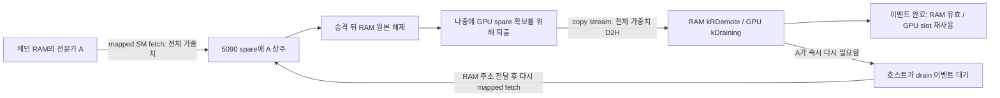

# GLM 집 추론: 가중치 배치·메모리·통신 분석

이 문서는 하드웨어 추가 구매와 가중치/KV/활성값/결과의 정밀도 하향 없이
50 tok/s에 접근할 수 있는지 분석한 자료입니다. 홈 장비는 읽기 전용으로
조사했으며, 이 분석에서 서비스·NIC·GPU 설정을 변경하지 않았습니다.
재현 계산은 분석 서버의 CPU만 사용했습니다.

## 현재 결론과 측정 시점

현재 선택된 copy-aware 0.16, 코하네 RAM 5200, CPU 6스레드/54 GiB 구성에서
새 비계측 대조군은 chat **36.3/36.5**, code **31.7/31.7 tok/s**였습니다.
50 tok/s는 20 ms/token이므로, 각각 약 **7.5 ms와 11.5 ms**를 줄여야 합니다.
단순 캐시 배치 변경의 불확실한 약 1% 차이로 설명할 수 있는 목표는 아닙니다.

새 프로파일에서 가장 큰 항목은 후반부 전문가의 RAM→GPU 가중치 전송과
보조 계산의 노출된 대기입니다. 같은 실행의 route trace를 정확히 세면
mapped 가중치 전송은 chat **0.49379 GB/token**, code **0.67174 GB/token**이며,
이 중 **99.88% 이상이 19–44층**에서 발생합니다.

추가로 중요한 구조를 확인했습니다. 현재 GPU에 승격한 전문가의 RAM 원본을
비운 뒤, GPU에서 퇴출할 때 전체 가중치를 다시 RAM으로 복사합니다. 이 역방향
전송을 줄일 수 있는 RAM 원본 보존 정책을 검토할 가치가 있습니다. 같은 시작
로그를 재현하면 로컬 PRO 4000과 메인 RAM 사이에 **15.0608 GiB의 중복**이
있으며, 전송이 집중된 후반부 GPU 풀 전체의 RAM 원본을 유지할 용량은 됩니다.
다만 프리필·RAM arena·보조 GPU 교체가 현재 중복 구조에 의존하므로, 설정 하나로
회수할 수 있는 공간은 아닙니다. 뒤의 decode-only 계측으로 D2H 규모까지 확인했습니다. 실제 지연 개선은 정책 A/B로 판단해야 합니다.

과거 측정은 뒤의 별도 절에 두었습니다. 과거 16.6 ms fetch 등의 시간을
현재 비계측 지연에서 빼지 않습니다. 아래 새 프로파일 역시 계측 비용이
있으므로, 비계측 baseline의 물리적 하한으로 해석하지 않습니다.

## 후속 decode-only 계측: 역방향 가중치 규모를 확인했습니다

Phase4 `plain-tier`는 동일한 기존 harness를 2회 실행했습니다. Chat36.2/36.5,
code31.6/31.6 tok/s로 비계측 baseline 범위였으며, 계측은 host counter만 추가했습니다.
파일은 홈 `~/fn/codex-tier-audit-20261027/plain-tier-engine.log`입니다.

각 workload는 **1600 emitted tokens, 1592 decode forwards**입니다. 요청의 첫
출력은 마지막 prompt token의 logits에서 나오고 마지막 출력 뒤에는 forward하지
않으므로, 200-token 요청의 strict decode는 199회입니다. 모든 요청에서
`metadata_missing=0`, `service_pending=0`을 확인했습니다.

| 두 pass 합산, emitted token 기준 | Chat | Code |
|---|---:|---:|
| Ordinary mapped H2D (`ram_fetch + host_miss`), GB/token | 0.488354 | 0.676483 |
| Background H2D, GB/token | 0.000367 | 0.000294 |
| **Boundary D2H, GB/token** | **0.394012** | **0.469813** |
| Boundary D2H 전문가/token | 29.47125 | 35.139375 |
| Background D2H | 0 | 0 |
| 계측한 양방향 가중치 합계, GB/token | 0.882734 | 1.146590 |
| 그 합계 중 D2H 비중 | 44.64% | 40.97% |

값은 decimal GB입니다. Forward당 수치는 표에 `1600/1592`를 곱하면 됩니다.
이제 D2H는 promotion 수에서 추정한 값이 아니라, decode 중 해당 copy가 성공적으로
**enqueue된 바이트**입니다. DMA 완료 바이트, 총 PCIe 트래픽, copy가 노출시킨
stall 시간과는 구분합니다. Prefill lending·preload worker·helper 벡터·KV·activation은
이 계측에서 제외되며, 요청 경계에 진행 중인 DMA도 있을 수 있습니다.

RAM 원본을 보존해 D2H를 전부 없앤다는 낙관적 가정의 상한은 현재 계측한 가중치
왕복 byte의 약41–45%입니다. **지연이41–45% 줄어든다는 뜻은 아닙니다.** D2H는 compute와
겹치고, 여전히 필요한 H2D도 남습니다. Spare 회복과 cache hit 개선은 별도 효과입니다.

현재 byte/token을 50 tok/s로 늘리면 가중치의 DRAM 읽기+쓰기 수요는 chat44.14,
code57.33 GB/s입니다. 메인 RAM 명목76.8 GB/s보다 낮으므로 평균 traffic만으로
50 tok/s 불가능을 말할 수는 없습니다. 약52-GB/s fetch burst와 D2H가 겹칠 때의
controller 경합과 층별 직렬 의존성은 아직 직접 분해하지 못했습니다.

### Next-layer prefetch 대조: 이번 설정은 채택하지 않습니다

같은 Phase4에서 fresh restart 후 `N=1 AT=fetch BLOCKS=4 RANK=2`를 켜고 같은
harness를 2회 실행했습니다. 가중치·KV·결과 정밀도나 trunk top-8은 변경하지 않았습니다.

| 항목 | Plain | Next-layer prefetch |
|---|---:|---:|
| Chat pass1/pass2, tok/s | 36.2 / 36.5 | 35.4 / 35.6 |
| Code pass1/pass2, tok/s | 31.6 / 31.6 | 30.6 / 30.7 |
| Chat ordinary mapped H2D, GB/emitted token | 0.488354 | 0.469055 |
| Chat prefetch H2D, GB/emitted token | 0 | 0.039922 |
| Chat 전체 H2D, background 포함 | 0.488721 | 0.509343 |
| Chat boundary D2H | 0.394012 | 0.396953 |
| Code ordinary mapped H2D, GB/emitted token | 0.676483 | 0.646084 |
| Code prefetch H2D, GB/emitted token | 0 | 0.073087 |
| Code 전체 H2D, background 포함 | 0.676777 | 0.719492 |
| Code boundary D2H | 0.469813 | 0.473401 |

보통 경로에서 fetch하는 byte는 줄었지만 prefetch까지 더한 H2D는 chat **4.22%**,
code **6.31%** 늘었습니다. D2H도 약0.75% 늘어 전체 계측 가중치 왕복은 **2.67%/4.04%**
증가했습니다. 출력 속도는 두 pass 평균 기준 **2.34%/3.01% 낮아졌습니다**.
모든 short 요청에서 metadata 누락과 service pending은0입니다.

긴 입력16524 token에서도 같은 방향이었습니다.

| 긴 입력의 출력 속도 | Plain | Prefetch |
|---|---:|---:|
| 첫 요청, tok/s | 31.3 | 29.9 |
| 동일 입력 재사용, tok/s | 32.5 | 31.3 |
| 첫 요청의 출력 token당 지연, ms | 31.991 | 33.405 |
| 입력 재사용의 출력 token당 지연, ms | 30.736 | 31.970 |

첫 프리필은12.1374/12.1354초로 같은 수준입니다. 출력 길이는 plain225/225,
prefetch224/224여서 전체 wall만으로 비교하지 않았습니다. Startup RAM은
plain7299 slots/91.81 GiB, prefetch7298/91.80 GiB로1-slot 자연 변동이 있었습니다.
이 실험도 모든 외부 상태를 고정한 대규모 교차 검증은 아닙니다.

Prefetch한 전문가 수는 emitted token당 chat2.986개, code5.466개입니다. 그 중 실제로
쓸모 있었던 비율은 이 aggregate만으로 확정할 수 없습니다. Ordinary fetch 감소량을
prefetch 양으로 나눈 값도 cache/CPU 경로 변화가 섞여 예측 정확도와 같지 않습니다.
그러나 현재 설정을 채택할 성능 근거는 없으며, **hit 개선만으로 속도 향상을 판단하면
안 된다**는 점은 실제 대조와 byte 계측이 함께 보여줍니다. 단일 순서의 두 pass 결과이므로
모든 workload의 일반적 실패로 확대하지 않습니다.

## 새 프로파일: 같은 실행의 시간과 바이트

입력 자료는 `/home/caterpillar/Agent/maya-cycle-audit-20261027/cycle/`의
`plain-profile-engine.log`, `plain-routes.0`, `profile-requests.json`입니다.
chat/code 각각 4개 요청, 요청당 200개 출력 token입니다. 첫 요청의 warmup
4 forward를 profiler가 제외하므로 chat은 796개로 맞췄습니다. 마지막 120-token
탐욕 생성 검사는 아래 표에서 제외했습니다. 시간은 forward 수로 가중 평균했습니다.
기존 profiler/route log에는 요청마다 마지막 prompt token의 단일 forward도 들어갑니다.
즉 일반 200-token 출력 요청은 prompt-tail 1회 + decode 199회입니다. 아래 바이트와
시간은 동일한 forward 범위로 맞춘 값이며, 엄밀한 decode-only 199회와는 다릅니다.
새 TierAudit의 begin은 prompt 뒤에 있어 이 경계도 별도로 확인할 수 있습니다.

| 항목 | Chat: 796 forward | Code: 800 forward |
|---|---:|---:|
| 계측된 compute stream 합계, ms/forward | 29.7416 | 33.6650 |
| `moe_fetch`, ms/forward | 9.5320 | 12.8735 |
| 노출된 `moe_cpu_wait`, ms/forward | 6.0041 | 6.5285 |
| 메인 GPU 전문가 gate/up + down, ms/forward | 2.6668 | 2.5028 |
| 나머지 stream 단계, ms/forward | 11.5386 | 11.7603 |
| RAM `fetch_mask` 전문가/forward | 35.8518 | 48.8225 |
| 호스트가 위치를 해결하는 `miss_mask` 전문가/forward | 1.0817 | 1.4213 |
| Fetch mask 가중치, GB/forward | 0.479319 | 0.652736 |
| Host miss 가중치, GB/forward | 0.014471 | 0.019001 |
| **전체 mapped 가중치, GB/forward** | **0.493790** | **0.671737** |
| 전체 mapped 바이트 / fetch 시간, GB/s | 51.8034 | 52.1799 |
| 전체 mapped 바이트 중 19–44층 비중 | 99.8882% | 99.8764% |
| CPU/helper mask 전문가/forward | 114.3141 | 128.8413 |

여기서 `miss_mask`는 SSD 읽기 횟수가 아닙니다. 진행 중인 demotion이나
lookahead RAM 읽기를 기다렸다가 해결되는 경우도 있습니다. `moe_wait_kernel`은
이 miss의 mapped RAM 주소를 넘기고, `moe_fetch_kernel`이 일반 RAM fetch와 함께
가중치를 복사합니다. 따라서 실제 fetch payload는 `(fetch_mask | miss_mask)`에
층별 `Ly.blob`을 곱해야 합니다. Fetch mask만 세면 약 1.5 GB/s 낮게 계산됩니다.

`cpu_mask`에는 로컬 GPU, 원격 GPU, 원격 CPU가 모두 들어갑니다. 표의 114/129를
CPU 전문가 수로 해석하면 안 됩니다. 실제 파일 읽기 요청은 `F->disk_reads`와
ahead reader를 따로 봐야 하며, 그것도 물리 SSD 트래픽과 완전히 같은 값은 아닙니다.

50 tok/s에서 현재와 같은 mapped payload를 유지한다면 token 전체에 걸친 평균
H2D 수요는 **24.69/33.59 GB/s**입니다. 실제 fetch가 실행되는 동안은 이미 약
52 GB/s가 나옵니다. PCIe 5 x16의 명목 한 방향 상한 약 63 GB/s를 낙관적 비교로
사용하면 fetch 시간은 7.84/10.66 ms이며, 같은 바이트에서 줄일 수 있는 차이는
약 **1.69/2.21 ms**입니다. SM-copy 구현·transaction 크기·DRAM 경합 때문에
그 속도에 도달한다는 보장은 없습니다. 이보다 큰 개선에는 전송 바이트 감소나
다른 단계 개선도 필요합니다.

이 계측 실행에서 fetch를 아예 0으로 놓아도 나머지 단계가 20.210/20.792 ms입니다.
이는 현재 구조에서 한 항목만 고치는 데 한계가 있음을 보여주지만, 계측 비용이
있으므로 비계측 실행의 50 tok/s 불가능을 증명하지는 않습니다.

## 층별 의존성과 보조 GPU 배치

한 token의 시간은 대략 다음과 같습니다.

```text
T = setup/head + Σ층 [attention + route
    + max(메인 fetch + 메인 expert math, 보조 답변 도착시간) + combine]
```

전체 메인 시간과 전체 보조 시간 중 큰 하나가 아니라 **층마다 큰 시간의 합**입니다.
5층에서 일찍 온 보조 답변으로 25층의 늦은 답변을 상쇄할 수 없습니다.

`fast_helper_setup()`은 메인 GPU의 초기 resident를 제외한 후보를 층/전문가
순서로 만든 뒤 `F->usage`로 stable sort합니다. 별도 usage 파일이 없으면 초기
usage가 0이므로 순서가 유지됩니다. 로컬 GPU 1674개, 원격 GPU 1198+1198개가
앞에서부터 배정되어 초기 층에 몰립니다. 현재 후반부에 fetch가 집중되는 이유입니다.

보조 GPU를 전 층의 인기 전문가로 채우면 hit만 좋아지는 것으로 끝나지 않습니다.
보조 요청이 없던 층에도 직렬 RPC 대기가 새로 생길 수 있습니다. 배치 목적함수에는
층별 전문가 동시 선택, 이미 존재하는 helper 요청, 줄어드는 fetch 바이트와
추가로 노출되는 helper wait를 함께 넣어야 합니다. 메인/보조 소유권도 같이
설계해야 합니다. 현재 remote RAM copy 배치 변경과 static GPU 소유권 변경은
서로 다른 최적화입니다.

모델에는 42개 MoE 층 × 288 = 12096개 routed expert object가 있습니다.
네이티브 전문가 총 바이트는 163376529408, 약 152.2 GiB입니다. 메인 풀은
spare/공유 tail 포함 1520 slots, 보조 GPU 3장은 약 4070개를 보유하므로,
모든 가중치를 GPU에 상주시킬 수 있는 구성은 아닙니다.

## 물리 경로와 측정 가능한 한계

읽기 전용 장비 조회 결과는 다음과 같습니다.

| 항목 | 확인 결과 |
|---|---|
| 메인 OS | Native Debian, Linux 6.12.113+deb13-amd64; WSL이 아니며 `/dev/dxg` 없음 |
| 메인 CPU | Ryzen 9 9950X3D2, 16코어/32스레드 |
| NUMA | 노출된 node 1개, CPU 0–31; GPU topology는 PHB |
| 메인 RAM | DMI 기준 32 GB DIMM 4개, 채널 A/B에 각각 2개, configured 4800 MT/s |
| NVIDIA driver | 615.71.09 |
| 메인 GPU link | 앞선 실제 추론 sample에서 5090 PCIe 5 x16 |
| 로컬 보조 GPU link | 앞선 실제 추론 sample에서 PRO 4000 PCIe 4 x4 |
| LAN | 메인 `eno1`, igc, 2500 Mb/s full duplex |
| 현재 NIC 읽기값 | `rx-usecs 0`, `tx-usecs 0`, NAPI defer 0, GRO flush 0 |
| 여유 VRAM snapshot | 5090 약 695 MiB, PRO 4000 약 511 MiB |

DMI 값은 실제 대역폭 측정값이 아닙니다. 추론이 끝난 뒤의 PCIe generation 1은
idle 절전 상태이므로 추론 중 link 하락 증거로 쓰지 않았습니다. 메인 RAM의
명목 대역폭은 2채널 × 8 byte × 4800 MT/s = **76.8 GB/s**입니다.

실제 decoder fetch는 mapped host memory를 읽는 GPU SM kernel입니다. 시작 시
큰 `cudaMemcpyAsync`로 재는 calibration과 같지 않습니다. 약 52 GB/s라는 값만으로
PCIe·DRAM·GPU load·스케줄링 중 무엇이 한계인지 확정할 수는 없습니다.

1536-MiB 설정 reserve는 현재 놀고 있는 1.5 GiB와 같지 않습니다. 실제 여유는
runtime allocation 뒤 700 MiB 미만이었던 시점도 있습니다. 최대 프리필·이미지·MTP
동시 점유를 확인하지 않고 reserve를 줄이면 안 됩니다. NUMA node도 하나이므로
메모리 binding 하나로 소켓 간 이동을 없앨 상황은 아닙니다. CCD/IRQ/service thread
위치는 별도의 작은 지연 문제로 조사할 수 있습니다.

PRO 4000 x4 link는 decode 때 상주 가중치 전체가 아니라 입력/출력 벡터를 주로
운반합니다. 이를 넓히면서 5090 fetch link를 좁히는 구성이 유리하다는 근거는 없습니다.

`nvidia-smi dmon -s t`로 RX/TX 계측은 가능합니다. Linux에는 `amd_umc_0/1`,
`amd_df` PMU가 보이지만 `perf` 실행 파일은 PATH에 없고 `perf_event_paranoid=3`입니다.
이 CPU 모델에 맞는 event 정의와 읽기 권한을 확인해야 DRAM counter를 해석할 수 있습니다.
다른 Ryzen 세대의 raw event 번호를 임의 적용해서는 안 됩니다.

## PCIe의 역방향 가중치 전송

현재 primary GPU와 main RAM은 exclusive tier입니다. RAM에서 GPU spare로
전문가를 올린 뒤 RAM 원본을 비우고, 나중에 GPU에서 퇴출하면 다시 RAM에 씁니다.
가중치는 불변이므로 원본이 유지되어 있었다면 피할 수 있는 복사입니다.



관련 소스는 `src/core/glm_fast_path.cu`의 다음 경로입니다. 다른 계측 패치가
작업 중이므로 줄 번호 대신 함수와 분기를 기준으로 정리했습니다.

- `fast_service`의 일반 `promo_mask` 처리: 승격 후 원본 RAM을 `kRRelease`로
  만듭니다. Next-layer prefetch와 host-miss staging에도 별도 release 경로가 있습니다.
- `fast_boundary` 1/2단계: release 슬롯을 비우고, 기본 `TIER_GC`가 GPU resident의
  중복 RAM도 정리하며, 완료된 demotion을 RAM 유효 상태로 바꿉니다.
- `fast_boundary` 3단계: `F->demotions.fetch_add` 직전 `Ly.blob`만큼
  `cudaMemcpyDeviceToHost`를 `F->copy` stream에 넣습니다. GPU slot은 이벤트가
  끝날 때까지 `kDraining`입니다. 적절한 RAM victim이 없으면 복사 대신 drop할 수도 있습니다.
- `fast_service`의 `kRDemote` miss 처리: 해당 drain 이벤트를 기다리고 RAM 주소를
  반환합니다. Trace miss가 반드시 SSD 읽기가 아닌 이유입니다.
- Background move에는 별도 H2D/D2H가 있고, background 승격도 RAM 원본을 해제합니다.
- `glm_prefill.cu::lend_tail`은 `F->cs`에서 D2H로 가중치를 park합니다. 프리필/이미지
  lending과 KDA/state snapshot, helper 벡터는 decode demotion과 따로 세야 합니다.

**Promotion 수와 demotion 수는 같지 않습니다.** Free slot, lending, drop,
background move, 진행 중인 이벤트, 요청 경계 때문에 다릅니다. Promotions 35/token을
D2H 35회/token으로 환산하면 안 됩니다. Copy stream은 compute와 겹치므로 그 시간을
compute stage 합계에 더하지 않습니다. 다만 DRAM을 함께 쓰고 spare를 늦게 반환하며,
일부 host miss에서는 이벤트 대기가 노출될 수 있습니다.

`TIER_GC=0`만으로 RAM 원본 보존 정책이 되지는 않습니다. 일반 promotion release는
그대로 실행됩니다. 실제 변경에는 모든 release 경로와 소유권 상태를 함께 다뤄야 합니다.

기존 `RAM_RESIDENT=1`도 inclusive cache는 아닙니다. 모든 전문가를 **primary GPU 또는
main RAM 중 적어도 한 곳**에 유지하며 SSD drop을 금지하는 exclusive 정책입니다.
이 모드에서도 promotion은 RAM 원본을 `kRRelease`로 만듭니다. 대신 RAM 슬롯이 없으면
GPU 퇴출을 미루고, D2H가 끝날 때까지 GPU table을 유지합니다. 따라서 이를 켠다고
왕복 복사가 사라지는 것은 아닙니다.

시작 시 class별 `n < cap` 검사(`fast_setup` 약1754행), warm 뒤 GPU|RAM coverage
검사(약1875행)가 helper setup보다 먼저 실행됩니다. 로컬/원격 helper의 용량을 넣어
조건을 충족시키는 구조가 아닙니다. 현재 32768 chunk/1520-slot geometry를 그대로
대입하면 기본 RAM slack16의 class cap 합은 **152.678 GiB**이며, slack0도 **144.225 GiB**입니다.
이는 소스상 allocation 요구량 계산이며 실제 활성화 실험은 하지 않았습니다.
메인128-GB 장비에서 그대로 켜는 해결책이 아니며, 제안한 선택적 RAM 원본 보존은
기존 tier 상태기를 재사용할 수는 있어도 별도의 inclusive 정책입니다.

### 필요한 최소 계측

공유 counter를 요청 중 초기화하기보다 요청/phase 경계의 누적 snapshot 차이를
사용하시는 편이 안전합니다. Enqueue와 completed 바이트, 요청 끝의 outstanding
바이트를 구분하고 MTP는 emitted token과 attempted row 기준을 모두 남겨야 합니다.

| Counter | 삽입 위치와 의미 |
|---|---|
| `mapped_ram_bytes`, `mapped_host_miss_bytes` | 서비스 route에서 각 mask popcount × `Ly.blob`; fetch bandwidth에는 둘 다 포함합니다. |
| `promotion_bytes`, `scratch_bytes` | `promo_mask`와 승격하지 않은 fetch/miss를 구분합니다. 둘 다 전송하지만 캐시 보존 여부가 다릅니다. |
| `prefetch_bytes` | `rq->pf_n` × 다음 층 blob; 나중의 useful/unused 판정도 별도입니다. |
| `demote_enqueue_bytes` | 일반 boundary D2H가 성공적으로 enqueue된 지점에서 층별 blob을 셉니다. Drop은 제외합니다. |
| `demote_completed_bytes`, `demote_pending_bytes` | Drain 이벤트 retire 시 완료를 세고, 남은 drain record의 바이트를 합칩니다. |
| `demote_wait_count/us` | 기존 `cudaEventSynchronize(d.ev)` 전후; 이미 완료된 경우와 실제 대기를 구분합니다. |
| `spare_shortage_routes` | 승격하지 못한 fetch에서 admission 거절과 spare 부족을 구분하고 draining 수를 함께 기록합니다. |
| `background_h2d/d2h_bytes` | Background copy의 두 enqueue 분기에 별도로 넣습니다. |
| `lend_d2h_bytes` | `lend_tail::park`에 넣고 prefill/vision을 구분합니다. |
| `local_helper_backing_bytes` | Held RAM 중 `helper.owns(key)`인 슬롯을 시작/요청 끝에 RAM class별로 합칩니다. |
| `backing_candidate_cycles` | Key별 승격·퇴출·재fetch·drain wait와 remote copy 보유 여부를 셉니다. |

기존 `MAYA_GLM_TIMING=1`도 종료 시 ordinary demotions/promotions/scratch/drops의
누적 횟수를 출력하므로 count만 확인하는 첫 검사는 새 kernel 없이 가능합니다.
바이트·요청 경계·background/lending 구분에는 추가 계측이 필요합니다. Copy batch에
이벤트 한 쌍을 넣는 방식은 stream 점유를 측정할 수 있지만, 점유가 곧 노출된 stall은 아닙니다.

### 현재 transport sample의 한계

`pcie-dmon.txt`는 epoch 1793106266.3127296에 시작했고 prefill/decode/전환/마지막
idle을 섞어 60개 GPU-0 sample을 기록했습니다. RX>1000 MB/s인 57개 sample에서
RX/TX 중앙값은 18790/19096 MB/s, TX 최대는 33592 MB/s입니다. 실행 중 상당한
역방향 트래픽이 있었다는 증거지만, 모두 decode demotion으로 귀속할 수는 없습니다.
요청별 절대 timestamp가 없어 이 파일에서 정확한 decode-only 구간을 나눌 수 없습니다.

NIC의 64개 interval도 `plain-profile:pass1`이라는 거친 phase만 갖고 있습니다.
RX/TX 중앙값 15.79/16.17 MB/s, 최대 16.87/17.28 MB/s이며 낮은 전환 구간을 포함합니다.
Decode 평균이라고 부르지 않으며, 지속적인 2.5GbE 포화의 증거는 없습니다.
Helper trace의 47643 samples도 전체 helper route보다 적으므로, class 평균 대기에
전체 route 수를 곱해서 총 대기를 만들면 selection bias가 생깁니다.

## 구매 없이 RAM 원본을 보존할 수 있는 두 후보

### 로컬 보조 GPU와 중복된 메인 RAM: 약 15 GiB

아래 계산은 **새 plain-profile의 7307 RAM slots/91.92 GiB 시작 로그**에 해당합니다.
후속 실행의 7294 slots와 섞지 않습니다. 시작 당시 8689개를 warm했고, 로컬 GPU
1674개, 원격 GPU 2396개를 배정한 뒤 원격 GPU 중복 RAM 1636개를 해제·재충전했으며,
남은 cold 472개를 원격 RAM으로 옮겼습니다.

`fast_helper_setup`은 `net_of` 소유자의 main RAM을 회수하지만 discrete local
`F->helper`에 대해서는 같은 회수를 하지 않습니다. Source의 warm round-robin을
재현하면 다음과 같습니다.

| RAM stride class | 전체 slots | PRO 4000과 중복된 RAM experts |
|---|---:|---:|
| 14 MiB | 696 | 692 |
| 13 MiB | 348 | 344 |
| 12.75 MiB | 6263 | 99 |
| 합계 | 7307 | **1135개, 15.06079 GiB** |

중복은 3/4/5/7층 각각 173개, 6/8층 각각 172개, 9층 99개입니다.
정확한 크기는 16171401216 byte입니다. 독립적인 inventory 검산도 맞습니다.

```text
8689 warm + 4070 helper owners − 1636 net duplicates − 1135 local duplicates
+ 1636 RAM refill + 472 remote cold = 12096 unique experts
```

이는 **소스/로그 재현 결과**이며 새 runtime memory dump는 아닙니다.
후반부 19–44층 primary pool 전체는 941 slots/11.71655 GiB이고, 초기 resident는
863 slots/10.74536 GiB입니다. 따라서 위 중복 메모리를 재배치하면 현재 전송의
99.88%가 발생하는 층의 GPU 캐시 전체를 RAM-backed로 만들 용량은 원리상 됩니다.
추가 원격 CPU/RPC를 강제하지 않는다는 장점도 있습니다.

다음 구현 제약을 해결해야 합니다.

1. 대부분의 중복은 14/13-MiB early-layer arena에 있고 후반부는 12.75 MiB입니다.
   현재 `layer_rc`는 층마다 RAM class 하나를 고정합니다. 시작 시 ownership을 고려한
   arena 배분이나 per-key backing locator가 필요합니다.
2. 프리필이 이 RAM 원본을 읽습니다. 현재 prefill helper 분기는 `net_of`만 검사합니다.
   로컬 helper의 `compute_rows/compute_tok/compute_tok_mmq`는 이미 있지만 연결과
   scratch 확보는 추가 구현입니다. SSD나 x4 GPU link에서 다시 읽으면 프리필 비용이
   늘어날 수 있으므로, decode만 보고 채택하면 안 됩니다.
3. `fast_helper_adapt`가 로컬 GPU 전문가를 교체할 때, 내보내는 전문가의 유효한 원본이
   먼저 확보되어야 합니다. 소유권·원본 수명·prompt lending을 함께 변경해야 합니다.
4. 선택한 GPU resident는 승격 후 RAM 원본을 유지하고 GC도 보존해야 합니다. 이
   resident를 퇴출할 때는 D2H 없이 GPU 슬롯을 바로 반환합니다. Background와 host-miss
   staging에도 같은 불변 조건을 적용하고, 반복 prefill/decode의 결과를 검증해야 합니다.

현재 약 17 GiB였던 `MemAvailable`에서 별도 19 GiB를 더 pin하는 것보다, 이미
중복된 용량을 재배정하는 쪽이 현실적인 조사 대상입니다. 바로 적용 가능한 옵션은 아닙니다.

### 원격 RAM의 optional copy: 의미가 다른 자원입니다

같은 시작 로그에서 remote CPU는 optional copy 3864개/51.66 GB, 약 48.11 GiB와
mandatory cold 472개/5.88 GiB를 보유합니다. 54-GiB 예산이 거의 차 있습니다.
Copy profile의 81.47%는 eligible CPU-lane demand score 포착률이며 cache hit rate가 아닙니다.

`copy_of`는 선택적 복제이고 `net_of`는 필수 소유권입니다. 현재 copy-aware route는
primary VRAM에 없고 **main RAM pointer가 있을 때만** optional copy를 CPU 후보로
삼습니다. Main RAM을 그냥 지워도 remote copy가 자동 fallback이 되지는 않습니다.
동적 ownership·CPU/RPC 예산·GPU promotion을 함께 바꿔야 합니다. 과거 소스 주석에도
warm expert를 mandatory remote owner로 바꿨다가 primary promotion을 굶긴 사례가 있습니다.

낮은 가치의 local duplicate를 remote-only로 바꿔 확보한 RAM을 자주 왕복하는 GPU
resident의 원본에 쓰는 정책은 가능성이 있습니다. 목적은 중복 byte 최대화가 아니라
줄어드는 D2H/stall에서 늘어나는 CPU/RPC 지연을 뺀 값입니다. 추가 remote workload는
계측해야 합니다. 13.37-MB 가중치 전체를 2.5GbE로 돌려받으면 명목 전송만 약 42.8 ms이므로,
원격에서는 activation/result를 주고받으며 계산하는 경로를 고려해야 합니다.

### 왕복 전송이 50 tok/s 목표에 미치는 영향

Mapped H2D를 `U GB/token`, 실제 demotion을 `D GB/token`이라고 하면, 50 tok/s에서
main DRAM은 다른 작업을 빼도 최소 `50*(U+D) GB/s`를 처리해야 합니다.
PCIe는 full duplex이므로 양방향 합계를 한 방향 63-GB/s와 비교하지 않습니다.
반면 DRAM controller는 양쪽 읽기/쓰기를 모두 처리합니다.

**측정값이 아닌 민감도 예시**로 `D=U`라면 weight traffic만 chat 49.38, code
67.17 GB/s입니다. 메인 RAM 명목 76.8 GB/s 대비 code의 여유가 작아집니다.
`D`가 작거나 충분히 겹쳐 있으면 원본 보존 효과도 줄어듭니다. D2H 제거만으로
필요한 7–12 ms 개선을 얻는다고 약속할 수는 없습니다. Spare 회복과 cache 유지의
추가 효과까지 실제 counter와 독립 A/B로 확인해야 합니다.

## MTP와 인접 token 재사용

새 ordinary decode trace의 인접 token overlap은 다음과 같습니다.

| 항목 | Chat | Code |
|---|---:|---:|
| 선택된 전문가 overlap / 현재 선택 수 | 38.65% | 29.80% |
| 실제 mapped-transfer 전문가 overlap | 2.846% | 4.591% |
| 두 token의 전송을 완벽히 합집합 처리할 때 절약 | 1.422% | 2.293% |

기존 캐시가 가까운 token의 재사용 상당 부분을 이미 흡수합니다. 이는 draft/verify
trace는 아니지만, MTP가 두 token을 처리하면 전송도 절반이라는 가정은 지지하지
않습니다. MTP에서는 acceptance와 함께 fixed/launch 비용 공유, verify window의
promotion/cache 동작을 봐야 합니다. Next-layer prefetch는 별개의 예측입니다.

### 기존 prefetch는 어떤 예측이며, 다음 후보로 가치가 있나요?

`fast_moe()`는 현재 층의 **FFN 입력**에 다음 층의 router 행렬을 미리 적용합니다.
실제 다음 층 입력은 현재 FFN 결과와 다음 attention 등을 거쳐 달라지므로, 이 값은
정답 route가 아닌 인과적인 추정입니다. `moe_route_kernel`이 다음 router의 bias와
기존 top-k 규칙으로 후보를 고릅니다. 실제 다음 층의 top-8 계산과 전문가 계산은
그대로 하므로 가중치 정밀도나 실제 선택 규칙을 낮추는 방식은 아닙니다.
캐시 변화가 CPU/GPU 분할을 바꿀 수 있으므로 bitwise 결과 일치 여부는 따로 확인해야 합니다.

`PREFETCH_N`은 그 후보 중 GPU/helper에 없고 **main RAM에는 있는** 전문가를
다음 층 spare에 먼저 복사합니다. 최대 두 개이고 실제 miss용 spare 하나는 남깁니다.
다음 층 계산 전에 copy event를 기다리므로, 맞는 예측이라도 늦게 끝나면 절약이 줄어듭니다.
`PREFETCH_AT=route`는 현재 fetch와 동시에, `fetch`는 현재 fetch 뒤에,
`cpu`는 현재 helper wait 뒤에 시작합니다. 기본 prefetch kernel은 SM 절반을 사용하므로
링크뿐 아니라 compute 자원도 경쟁합니다. `BLOCKS`로 이를 제한할 수 있습니다.

이와 달리 `AHEAD`/lookahead는 최대 네 층의 router를 현재 FFN 입력에 적용하고,
**VRAM/RAM 모두에 없는 전문가를 SSD에서 RAM으로** 읽는 경로입니다.
`AHEAD_READ=0`이면 예측/집계만 합니다. 현재 cold expert는 remote CPU가 보유하고,
짧은 요청의 실제 파일 읽기도 매우 적으므로 9–13-ms H2D fetch를 줄이는 주력 후보가
아닙니다. 기존 RAM_REFILL이 lookahead의 reader thread를 재사용한다는 기록을,
router predictor가 이미 효과를 입증했다는 뜻으로 해석하면 안 됩니다.

이번 Phase4 전 읽어본 Claude `PROGRESS-*.md`에는 **현재 홈 구성에서 ordinary decode prefetch를
직접 A/B하여 실패했다는 기록은 없었습니다**. MTP window에 prediction/prefetch가
없다는 분석과 RAM_REFILL 결과가 있습니다. 확인한 범위에서 발견하지 못했다는 뜻이며,
모든 과거 실행이 없었다는 보장은 아닙니다. Upstream 기록은 별도로 존재합니다.

- `docs/SETTINGS.md:58`, `CHANGELOG.md` v1.0.31: Maya-M/3090+3060/21K context에서
  off19.64 → 단순 `N=1`17.0으로 악화했습니다. `N=1 AT=fetch BLOCKS=4`는19.75,
  여기에 `RANK=2`를 넣으면20.22 tok/s였습니다. 같은 문서는 더 큰 Maya-L에서 이득이
  없었다고 기록합니다. 모델·장비가 달라 현재 수치로 옮길 수 없습니다.
- `FastState::max_pf` 주석에는 Mercury에서 prefetch 이득이 없었다고 적혀 있습니다.
  `bench/results/2026-10-06-glm-spec/README.md`는 Mercury의 SSD lookahead도
  4층 안에서 disk miss 약40%만 예측하고 틀린 읽기가 NVMe를 경쟁해 빨라지지 않았다고 기록합니다.

이 근거로 **`N=1 AT=fetch BLOCKS=4 RANK=2`의 제한된 A/B**를 Phase4에서 실제 수행했으며,
위 표와 같이 현재 구성에서는 느려져 채택하지 않습니다. RAM 원본 보존 등으로 비용 구조가
달라진 뒤에는 별도 후보로 다시 평가할 수 있지만 50 tok/s의 주력 해법으로 보지는 않습니다.
높은 예측 rank는
이미 GPU/helper resident일 수 있으므로 전체 top-8 예측률보다 **복사 가능한 후보의
정확도와 숨겨진 실제 fetch 시간**이 중요합니다. 틀린 예측은 fetch byte·demotion·spare
압력을 늘릴 수 있고, 원본 보존 정책 뒤에는 비용 조건이 달라질 수 있습니다.

측정할 때는 실제 복사한 `(층, expert)`가 다음 route에 쓰였는지, 잘못 복사한 바이트,
copy event가 노출시킨 wait, RAM/GPU hit 변화를 따로 세야 합니다. 기존
`pred_miss_hit/pred_miss`는 prefetch로 이미 resident가 된 정답을 miss에서 제외하므로,
그 비율 자체를 유용한 prefetch 성공률로 쓰면 안 됩니다. 또한 N>0 또는 AHEAD>0이면
KDA graph가 꺼집니다. `glm_rows.cu`와 `fast_moe_window`에는 아직 prediction/prefetch가
없어서 이 환경변수만으로 MTP verify window를 가속하지는 못합니다.

## 프리필 chunk와 최소 34 slots 제약

7.92-GiB 공유 tail은 decode 때 expert cache로 이미 쓰입니다. Chunk를 줄이면 그
전체가 새로 생기는 것이 아니라 층마다 lending용으로 남겨야 하는 최소 slots가
줄어 같은 풀을 더 불균등하게 배분할 수 있습니다.

`glm_prefill.cu`의 allocator를 재현했습니다. MTP off, 최대 context 262144,
embedding 4096, 기존 INT8 KV, prestage 160개/stride14MiB, 이미지 지원을 유지했습니다.

| Chunk | Activation MiB | 전체 borrow MiB | Lendable slots/층 | Vision 포함 최소 slots |
|---|---:|---:|---:|---:|
| 32768 | 5304.194 | 7824.194 | 15 | 34 |
| 16384 | 2945.991 | 5465.991 | 11 | 30 |
| 8192 | 1973.959 | 4493.959 | 9 | 28 |
| 4096 | 1487.944 | 4007.944 | 8 | 27 |

이는 **소스상 예측값**입니다. 32768 값은 시작 로그와 일치합니다. 층별 stride 합은
567279616 byte이며 borrow에 scratch112 MiB, group staging168 MiB, prestaging2240 MiB가
들어갑니다. MoE window 최소가 `682*32=21824` rows여서 chunk와 선형 비례하지 않습니다.
현재 vision lending은 전체 xpool을 빌리므로 19-slot 여유가 추가됩니다.

8K chunk로 앞선 28-slot 배치를 시험할 수는 있지만 16524-token 입력이 3 chunks가 되어
가중치를 다시 읽고 TTFT가 늘 수 있습니다. 손익분기는
`추가 prefill ms / token당 decode 절약 ms`로 판단해야 합니다. 예상 배치 효과가 수%라면
긴 출력을 해야 프리필 손해를 회수할 수 있습니다. Image loan을 분리하는 대안도
allocator 변경이지 guard 숫자를 임의 낮추는 작업은 아닙니다.

## 과거 자료: cache replay와 transport 실험

이 절은 `/home/caterpillar/Agent/maya-analysis-20261027/`의 **이전 실행**입니다.
현재 시간 분해와 합산하지 않습니다.

CPU/helper 선택을 기존 trace대로 고정하고, 각 층 `slots-3`로 replay한 결과입니다.
첫 100 token을 제외했습니다. Host miss를 disk read로 잘못 해석하지 않도록
표기는 fetch+host-miss로 통일했습니다.

| 이전 trace | Token 수 | 실제 fetch+host-miss/token | 단순 LRU 모델 | 미래를 아는 oracle |
|---|---:|---:|---:|---:|
| Chat | 820 | 45.58 | 44.47 | 24.22 |
| Code | 11972 | 65.67 | 63.32 | 33.57 |
| Agent | 1700 | 51.70 | 49.81 | 26.76 |

현재 단일 sequence 기본 GPU eviction도 LRU입니다. Replay와 실제의 2–4% 차이를
정책 스위치의 무료 이득으로 보시면 안 됩니다. Oracle은 미래 사용을 알고 admission도
선택하므로 실제 구현이 아닙니다. CPU 선택·promotion/demotion·prompt 경계도 고정/생략한
모델입니다. 원인 분석에는 유용하지만 약 절반의 miss를 실제로 없앤다는 예측은 아닙니다.

같은 과거 자료에서 전역 빈도 위주의 helper 재배치는 generic miss를 chat
63.93→56.37, code94.50→80.75, agent71.87→61.43으로 줄였지만 helper-active 층이
약16→40개로 늘었습니다. CPU offload를 생략한 모델이며, per-layer RPC를 무시하면
잘못된 placement 결론이 나올 수 있음을 보여줍니다.

과거 인접 selected overlap은 chat/code/agent 37.84/25.09/34.18%, 실제 fetch+miss
인접 overlap은 4.88/6.83/5.72%였습니다. 두 token union 절약은 약2.44/3.41/2.86%였습니다.
현재 overlap 표와 시점을 구분해야 합니다.

### Protocol 2와 NIC: 이미 했던 실험입니다

현재 기본 Protocol 1은 FP32 4096-element input/result를 보냅니다. 두 helper를
42층 모두에서 50 tok/s로 불러도 단순 payload는 방향당 약69 MB/s로, 2.5GbE 명목
312.5 MB/s보다 작습니다. 평균 byte보다 반복 roundtrip·wake-up 지연이 중요합니다.

Protocol 2는 이미 만든 q8_1/CPU activation bytes를 그대로 보내고 request를 한
send로 합칩니다. FP32 결과를 유지하면 기존 양자화·expert kernel을 재사용하는
transport 변경입니다. `helperd.cpp`에는 FP32-input 경로와 byte/result 비교도 있습니다.
R16 결과는 새로운 rounding이므로 이번 정밀도 유지 조건에서 제외합니다.

Claude의 `~/src/project-maya-net/PROGRESS-mla.md` Round4 기록은 다음과 같습니다.

- FP32-answer P2 + 50회당 check1: chat33.4→33.4, code28.6→28.6, agent28.6→29.4 tok/s였습니다.
  약3% 변동 범위에서 결정적 이득은 없었습니다.
- q8_1/FP32 GPU 결과 150회 비교에서 byte 차이0, CPU activation350회 비교에서 차이0입니다.
- 양쪽 3-ms spin도 결정적 이득이 없었습니다. FP16-answer 결과는 이번 후보에서 제외합니다.
- 당시 `/tmp/maya-helperd-r4`를 사용한 뒤 production20261025c/20261026으로 복구했습니다.
  현재 helper에는 P2 전용 문자열이 없어 P2 설정만 켜면 Protocol1 fallback이 됩니다.
  다시 시험하려면 맞는 helper build와 handshake를 확인해야 합니다.

Round5의 main igc `rx-usecs3→0`은 과거 chat33.4→34.8, code28.7→29.6 이득을 보였지만,
현재 readback은 이미0입니다. 같은 이득을 다시 얻을 후보로 계산하지 않습니다.

## 권장 순서

1. **D2H 바이트는 확인했습니다.** 다음은 spare 부족과 demotion wait를 계측해
   copy overlap 중 실제 지연을 분리합니다. NVML과 절대 prefill/decode timestamp도 맞춥니다.
2. 진행 중인 MTP window 분석과 합쳐, transfer bytes 감소와 fixed 비용 감소 중
   어디에서 20-ms 예산을 확보할 수 있는지 다시 계산합니다.
3. D2H가 실제 제약이면 작은 RAM 원본 보존부터 검증하고, 그 다음 로컬 GPU 중복
   약15 GiB 재배정과 prefill 연결을 별도 변경으로 평가합니다.
4. Helper 배치는 hit가 아닌 층별 노출 지연을 최적화합니다. 8K prefill이나 원격 CPU
   mandatory 전환은 서로 다른 비용을 유발하므로 한 번에 묶지 않습니다.

연속된 층 전체를 원격 GPU에 맡겨 block 경계에서만 통신하는 구조는 장기 연구
후보입니다. Attention/router/KDA/KV와 추가 가중치가 작은 GPU에 들어가야 하고 expert
용량도 줄어듭니다. 현재 helper가 제공하는 설정은 아니며 50 tok/s를 보장하지 않습니다.
현재 자료는 50 tok/s가 불가능함도, 단일 변경으로 달성됨도 입증하지 않습니다.

## 재현: 현재 profile의 바이트와 로컬 GPU 중복

아래 스크립트는 기존 로컬 파일만 읽습니다. Source의 warm round-robin, class별
비율 배분, helper 배정 순서를 재현합니다. Allocation budget은 로그에 소수 둘째
자리까지만 나오므로 좁은 구간을 탐색하고, **7307 slots/91.92 GiB/1636 net duplicates**
조건이 동시에 맞는 class 배분이 하나인지 확인합니다. 다른 시작 로그에는 이
상수를 그대로 적용하지 않아야 합니다.

```python
from pathlib import Path
import collections, json, struct
old = Path('/home/caterpillar/Agent/maya-analysis-20261027')
new = Path('/home/caterpillar/Agent/maya-cycle-audit-20261027/cycle')
slots = {int(k): v for k, v in json.loads((old/'baseline-slots.json').read_text()).items()}
blob = {}
for line in (old/'native_experts.txt').read_text().splitlines():
    if line and not line.startswith('#'):
        a = line.split(); blob[int(a[0])] = int(a[4])
layers = range(3, 45)
raw = (old/'profile-mix4agent.bin').read_bytes()
nr = struct.unpack_from('<I', raw, 20)[0]
order = collections.defaultdict(list)
for l, e in struct.iter_unpack('<HH', raw[24:24+4*nr]):
    order[l].append(e)
# n_main = n_slots - 15; kSpares=3; RAM slack=0 in this run.
weight = collections.Counter()
for l in layers:
    weight[blob[l]] += (288-(slots[l]-15)+3+2)*blob[l]
solutions = set()
for budget in range(int(91.915*2**30), int(92.02*2**30), 1024):
    n = {s: int(budget*w/sum(weight.values())/s) for s, w in weight.items()}
    if sum(n.values()) == 7307 and f'{sum(s*c for s,c in n.items())/2**30:.2f}' == '91.92':
        solutions.add(tuple(n.items()))
assert len(solutions) == 1
free = dict(next(iter(solutions)))
next_id = {l: slots[l]-3 for l in layers}
ram = set()
while True:
    changed = False
    for l in layers:
        if free[blob[l]] <= 4 or next_id[l] >= 288: continue
        ram.add((l, order[l][next_id[l]]))
        next_id[l] += 1; free[blob[l]] -= 1; changed = True
    if not changed: break
warm = {(l,e) for l in layers for e in order[l][:slots[l]-3]}
ranked = [(l,e) for l in layers for e in range(288) if (l,e) not in warm]
local, net = set(ranked[:1674]), set(ranked[1674:4070])
assert len(ram) == 7295 and len(ram & net) == 1636
assert len(ram & local) == 1135
print('local duplicate bytes', sum(blob[l] for l,e in ram & local))
# Decode route payload: fetch|miss, excluding the first four profiler warmups.
rows = [list(map(int,line.split('|')[0].split()))
        for line in (new/'plain-routes.0').read_text().splitlines()]
assert len(rows) == 1720*42
prof = json.loads((new/'profile-requests.json').read_text())
for name, first, stop, reqs in [('chat',4,800,prof[:4]), ('code',800,1600,prof[4:8])]:
    data = rows[first*42:stop*42]
    byte_count = sum((a[9] | a[10]).bit_count()*blob[a[0]] for a in data)
    n = stop-first
    fetch_ms = sum(r['tokens']*r['stages']['moe_fetch'] for r in reqs)/n
    print(name, 'GB/token', byte_count/n/1e9, 'effective GB/s', byte_count/n/fetch_ms/1e6)
```
